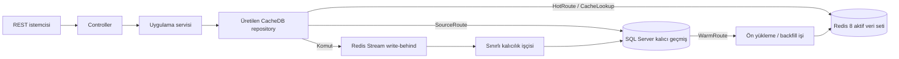

# CacheDB SQL Server Örneği

> CacheDB 0.18.1: [sürüm ve indirmeler](https://github.com/esasmer-dou/cache-database/releases/tag/v0.18.1) | [herkese açık Maven deposu](https://esasmer-dou.github.io/cache-database/maven2). Maven ile indirmek için GitHub token'ı veya framework kaynak kodunu derlemek gerekmez.

[English](README.md) | Türkçe

## 0.18.1 ile Okuma ve Yazma Kontrolleri

[Çalışan 0.18 senaryoları](#cachedb-018-çalışan-senaryolar); tedarikçi tekliflerini,
toplu L1 okumayı, soft TTL'yi, gruplamayı, bileşik indeksleri ve bağımsız karma
yazmaları gösterir. Depo örneği tenant kapsamında batch, partition, projection
ve minimum sürüm okumasını kapsar. Yeni demo API'si ayrı kimlik eşleştirmesi kullanır;
mevcut REST sözleşmeleri değişmez. Tam Java kaynakları, beklenen sonuçlar ve
Postman istekleri aşağıdadır.

Bu örnek SQL Server kullanır. BOM, processor, starter ve doctor eklentisini aynı
sürümden indirir. Java 21 gerekir; framework kaynak kodunu indirip derlemek
gerekmez. Geçiş ve tutarlılık sınırları için
[kontrol rehberini](https://github.com/esasmer-dou/cache-database/blob/main/tr/docs/aktif-veri-performans-kontrolleri.md)
inceleyin.

Önce mevcut hızlı başlangıç, seed ve ön yükleme adımlarını tamamlayın. Ardından:

Mevcut PATCH ve sorgu yolları, 0.17'nin toplu JDBC yazmalarından, sınırlı indeks
okumalarından ve son erişim sıralı L1'inden yararlanır. Yeni delta, toplam, tenant,
watcher ve şema/sıkıştırma API'leri isteğe bağlıdır. Örnek bunları kendiliğinden
açmaz veya tenant yetkilendirmesi eklemez. Kendi entity ve dağıtım sözleşmenize
uyarlamadan önce framework'ün [senaryo rehberini](https://github.com/esasmer-dou/cache-database/blob/main/tr/docs/deklaratif-veri-kontrolleri.md)
inceleyin.

1. `CatalogConfiguration`, aktif ürünleri
   `ProductEntityCacheBinding.Columns.ACTIVE_STATUS` ile seçer,
   `Columns.PRODUCT_ID` ile kapsamı belirler ve
   `autoDirtyOnRootEntity()` ile değişiklikleri izler.
2. Repository'deki dar güncelleme derleme sırasında doğrulanır:

```java
@CachePatch
WriteReceipt<ProductEntity, Long> patchStockValues(
        @CacheId Long productId,
        @CacheColumn("stock_quantity") Integer stockQuantity,
        @CacheColumn("reserved_quantity") Integer reservedQuantity,
        @CacheColumn("stock_status") String stockStatus,
        @CacheColumn("updated_at") Long updatedAt);
```

3. `ProductApplicationService.replaceStock`, `0 <= reserved <= stock`
   kuralını denetler, stok durumunu hesaplar ve bu metodu çağırır. Ürün adı,
   kategori ve fiyat değişmez; SQL'e tam satır UPSERT gönderilmez.

```java
return products.patchStockValues(productId, stock, reserved, status,
        Instant.now(clock).getEpochSecond());
```

4. Artırma komutu değil, **yeni mutlak değerleri** gönderin:

```http
PATCH http://127.0.0.1:8092/api/products/1/stock-values
Content-Type: application/json

{"stock": 20, "reserved": 2}
```

HTTP 202, Redis'in komutu kabul ettiğini belirtir; SQL'e aktarımın bittiği
anlamına gelmez. Redis'te tam kayıt yoksa receipt içinde `entity: null` olabilir.
Eksik alanlardan ürün uydurulmaz. İsteğe bağlı alanlarla çalışan eski `/stock`
endpoint'i korunur. `/stock-values` için iki alan da zorunludur; eksik veya
geçersiz istek 400 döndürür.

5. Kataloğun otomatik yenilenmesi için uygulamayı
   `SAMPLE_CATALOG_SCHEDULE_ENABLED=true` ile başlatın. Örnekte aralık bir
   saniye, eşik 20 kayıttır. SQL'e aktarım tamamlanınca ürünün kök kimliği
   yenileme listesine alınır ve yalnızca ilgili katalog kaydı hazırlanır.
   `GET /api/catalog/items/1` ile sonucu izleyin. Zamanlamayı açmadıysanız
   mevcut elle yenileme endpoint'lerini kullanın. Uygulama dışı SQL değişiklikleri
   için açık yenileme, CDC veya periyodik tam uzlaştırma gerekir.

`ProductEntity` için L1 de açıkça etkinleştirilmiştir: 1024 kayıt, iki saniye,
tahmini 4 MiB sınırı. Tekrarlanan ürün detayı okumaları Redis isteği yapmadan
yanıtlanabilir; her yanıtta ayrı bir nesne çözülür. Pod'lar arası geçersiz kılma
asenkron çalışır, anlık tutarlılık garantisi vermez. Her okuma Redis'e gitmeli ise
`@CacheNearPolicy` tanımını kaldırın. Framework uygulama başına tek bir abonelik
bağlantısı açar; arka plan havuzunda bu bağlantı için yer bırakın.

Birden fazla kaydı birlikte değiştirmek için:

```java
var receipt = database.inTransaction(tx -> {
    tx.put(product);
    tx.putAll(otherProducts);
});
boolean durable = database.awaitDurable(receipt, Duration.ofSeconds(5));
```

Bu ertelenmiş kapsamda receipt döndüren `saveAll` yerine `tx.putAll` kullanın.
Gerçek kabul sonucu ancak commit sonrasında oluşur. Commit öncesi hata yazmaları
iptal eder; kabulden sonra SQL bekleme süresinin dolması rollback değildir.
Sınırlar 100 kimlik, 4 MiB ve 2000 kuyruk alanıdır. Cluster aynı hash-tag kapsamını
ister; sınırlı tenant kabul kuralları atomik işlemle atlanamaz.

[](https://github.com/esasmer-dou/sample-cache-database-mssql/actions/workflows/consumer-build.yml)
[](https://github.com/esasmer-dou/cache-database/releases/tag/v0.18.1)

Bu proje, CacheDB'nin Redis 8 ve SQL Server ile nasıl kullanılacağını gösteren
bir Spring Boot REST API örneğidir. Canlı ortamda verilmesi gereken kararları
açıkça gösterir: operasyonel yollar Redis'teki sınırlı aktif veri setini
kullanır, kalıcı geçmiş SQL Server'da tutulur, büyüyen listeler ise bütün nesne
ağacı yerine projection üzerinden okunur.

> Bu örnek CacheDB `0.18.1` sürümünü kullanır. Paketler herkese açık Maven
> deposundan alınır; GitHub token'ı veya
> yerel framework kaynak kodu gerekmez.

Hızlı başlangıcı tamamladığında canlı ortama benzeyen tek bir yolu baştan sona
doğrulamış olacaksın: kalıcı SQL Server verisini oluşturacak, sınırlı arşiv
yolunu okuyacak, karşılık gelen Redis projection'ını hazırlayacak, aktif yolu
çağıracak ve kapsam ile kalıcılık sinyallerini inceleyeceksin. Redis'te kayıt
bulunmaması arka planda gizli bir SQL Server sorgusu başlatmaz.

## CacheDB 0.18.1 Sürümüne Geçiş

Örnek POM; BOM, sağlayıcı starter'ı, annotation processor ve doctor plugin'ini
`0.18.1` ile eşitler. Binding'lerin yeniden üretilmesi için örnek projeyi derleyin.
POM ayrıca `jedis.version=5.2.0` ayarını içerir. Bu ayar olmadan Spring Boot parent,
gerekli pipeline API'sini içermeyen eski sürücüyü seçebilir.

- Mevcut REST, arşiv, projection ve ön yükleme yollarının açık davranışı korunur.
- Mevcut SQL worker'larını yükseltmeden önce sağlayıcınıza ait `cachedb_write_fence` migration'ını uygulayın, eski worker'ları devreden çıkarın ve sürüm sayaçlarını koruyun. Ayrı metadata tablosu, geciken eski yazmanın silinmiş kaydı yeniden oluşturmasını engeller; iş tabloları değişmez. [Kalıcı yazma sürümleri](https://github.com/esasmer-dou/cache-database/blob/main/tr/docs/kalici-yazma-surumleri.md) rehberini izleyin.
- Tipli snapshot, Jackson'sız codec ve atomik ürün aktarımı çalışan katalog senaryosunda kullanılır. Ayrı API/worker profilleri de bulunur. [Katalog senaryolarını](#bildirimsel-katalog-senaryoları) adım adım izleyin.
- Katı 50 ms CI hedefi, ilk kullanım dâhil üretilen codec/snapshot senaryosu içindir. REST, SQL, ağ veya canlı sistem SLA'sı değildir; eski mapper API'lerinin uyumluluğu ve tüm JUnit metot süreleri ayrıca raporlanır.
- `hotEntityLimit=0` entity kabulünü kapatır. `-1` değerini yalnızca bilinçli bir sınırsız kayıt politikası için kullanın. Varsayılan 1.000 olarak korunur.
- SQL kolonunuz NULL alabiliyorsa `Boolean` kullanın; primitive `boolean`, SQL NULL değerini reddeder.
- Atomik katalog aktarımı ve indeksli snapshot sayfaları açık endpoint'lerle gösterilir. Redis Cluster dağılımı isteğe bağlı framework altyapısıdır; yerel Compose tek Redis kullanır.

Bu API'leri eklemeden önce [sürüm notlarını](https://github.com/esasmer-dou/cache-database/blob/main/tr/docs/releases/v0.18.1.md)
ve [sınırlı çalışma sözleşmelerini](https://github.com/esasmer-dou/cache-database/blob/main/tr/docs/sinirli-calisma-islemleri.md)
okuyun. Paketin kullanılabilir olması, uygulamanızın canlı ortam topolojisini doğrulamaz.

## Kolon Güvenliği

Örnek uygulamadaki entity'ler bilerek dar tutulur. Sağlayıcıya göre belirlenen kontroller, 0.18.1 bağımlılığı
ile devrededir; ek cache politikası veya iş tablosu değişikliği gerekmez.
Redis'te daha geniş veri kabul edilmesi, SQL tablosunun sınırını kaldırmaz.

| Veri yüzeyi | Varsayılan sayı sınırı |
| --- | --- |
| PostgreSQL tablosu | 1600 fiziksel kolon |
| SQL Server standart tablosu | 1024 fiziksel kolon |
| Oracle standart tablosu | 1000 fiziksel kolon |
| Redis entity/projection verisi | 4096 alan; veri boyutu ve bellek bütçeleri ayrıca geçerlidir |

JDBC pozitif kapasite bildirirse, 4096'yı aşmamak koşuluyla bu değer kullanılır.
Kapasite bilinmiyorsa sağlayıcının varsayılanı esas alınır. ID, sürüm ve mantıksal
silme kolonları toplama katılır. Örneğin PostgreSQL'de ID dâhil 1199 eşlenmiş
kolona ayrı sürüm kolonu eklenirse toplam 1200 olur. Kolon sayısı denetimi geçer;
aynı tanım standart Oracle ve SQL Server sınırını aşar. Satır genişliği ve SQL
parametre bütçesi de uygun olmalıdır. Bir rapor ekranında 1200 alanın tümünü
yüklemek yerine dar bir projection kullanın.

İsteğe bağlı, tek seferlik dağıtım kontrolü için aşağıdaki yardımcı metodu
**üretilmiş entity'ler kaydedildikten sonra**, trafik açılmadan önce çağırın.
Her REST isteğinde çalıştırmayın; ikinci bir otomatik warm döngüsü eklemeyin:

```java
import javax.sql.DataSource;
import com.reactor.cachedb.core.config.SchemaBootstrapConfig;
import com.reactor.cachedb.starter.CacheDatabase;
import com.reactor.cachedb.starter.CacheDatabaseSchemaAdmin;

public final class SampleSchemaSafety {
    private SampleSchemaSafety() {}

    public static void verify(CacheDatabase database, DataSource source) {
        var schema = new CacheDatabaseSchemaAdmin(
                source, database.entityRegistry(), SchemaBootstrapConfig.defaults());
        var result = schema.validate();
        if (!result.success()) {
            throw new IllegalStateException("Schema validation failed: " + result.issues());
        }
    }
}
```

Bu kontrol, iş tablosu oluşturmadan kayıtlı eşlemeleri doğrular. Uyumsuz tanım,
normal trafik başlamadan raporlanır. Write-behind da iş tablosuna SQL göndermeden
önce kolon ve parametre sayısını denetler. JDBC metadata davranışı sürücüye bağlıdır.

1024 alanı aşan veri üretmeden önce tüm okuyucu ve worker'ları yükseltin: eski
0.15.0 okuyucuları bu veriyi okuyamaz. 0.15.0 kalıcı sürüm koruma tablosu zaten
kuruluysa bu yama için ek iş tablosu migration'ı gerekmez. Oracle extended modu
kendiliğinden açılmaz; standart Oracle test kurulumu bu modun kanıtı değildir.

Sürücü varsayılanları, record constructor sınırları ve migration denetimleri için
[kolon sınırları rehberini](https://github.com/esasmer-dou/cache-database/blob/main/tr/docs/sema-kolon-sinirlari.md) okuyun.

## Buradan Başla

| Hedefin | İlgili bölüm |
| --- | --- |
| Örneği çalıştırmak | [Hızlı Başlangıç](#hızlı-başlangıç) |
| Redis ve SQL Server davranışını anlamak | [Çalışma Zamanı Sözleşmesi](#çalışma-zamanı-sözleşmesi) |
| Deklaratif Java API'sini görmek | [Kod Üzerinden Akış](#kod-üzerinden-akış) |
| SQL Server'daki mevcut veriyi Redis'e hazırlamak | [Mevcut Veriyi Hazırlama](#mevcut-veriyi-hazırlama) |
| Cache sınırlarını belirlemek | [Kullanım Senaryosuna Göre Ayar](#kullanım-senaryosuna-göre-ayar) |
| Tüm yolları denemek | [API Kataloğu](#api-kataloğu) veya [Postman](#postman) |
| Tipli snapshot, atomik aktarım ve ayrı worker'ları çalıştırmak | [Bildirimsel Katalog Senaryoları](#bildirimsel-katalog-senaryoları) |
| Canlı ortam hazırlığını kanıtlamak | [Production Sertifikası](#production-sertifikası) |
| Canlı ortam geçişini hazırlamak | [Canlı Ortam Kontrol Listesi](#canlı-ortam-kontrol-listesi) |
| Başlangıç veya veri yolu sorununu çözmek | [Sorun Giderme](#sorun-giderme) |

## Bu Örnek Ne Öğretiyor?

Örnek, basit bir CRUD uygulamasından daha geniş bir alanı kapsar:

- müşteriler sipariş verir; siparişlerin çok sayıda satırı olabilir
- ürün uygunluğu katalog ve düşük stok ekranlarını besler
- gönderiler aktif, istisna, hareket ve arşiv yollarına ayrılır
- destek talepleri operasyon paneline veri sağlar
- rapor işleri ve denetim olaylarında anlık iş yükü ile kalıcı geçmiş ayrılır

Ürünün sınırı da aynı açıklıkla gösterilir:

| Sınıflandırma | Anlamı |
| --- | --- |
| **BEST** | Sınırlı bir operasyonel yol tanımla, entity veya projection verisini hazırla, ölç ve arşiv/geçmiş okumalarını SQL Server'da tut. |
| **ACCEPTABLE** | Redis'teki aktif veri setinin dışında kalan ve seyrek okunan veri için sınırlı bir SQL Server yolu kullan. |
| **ANTI-PATTERN** | CacheDB'yi şeffaf bir cache gibi görüp Redis'te bulunmayan her sorgunun otomatik SQL çalıştırmasını ve Redis'i doldurmasını bekleme. |

CacheDB, hangi ekran ve komutların öngörülebilir düşük gecikmeye ihtiyaç
duyduğunu bilen ekipler için güçlü bir çözümdür. Temel iş yükü bütün veritabanı
üzerinde sınırsız ve anlık sorgular çalıştırmak olan uygulamalar için uygun
değildir.

## Mimari



Uygulama kodu repository interface'lerine bağımlıdır. Annotation processor;
implementasyonları, codec'leri, indeksleri, projection binding'lerini ve Spring
bean'lerini derleme sırasında üretir. Entity keşfi için çalışma zamanı
reflection'ı kullanılmaz.

## Kısa Sözlük

| Terim | Bu örnekteki anlamı |
| --- | --- |
| Entity | SQL kolonlarına ve Redis namespace'ine eşlenen komut/detay modeli |
| Projection | `OrderSummary` gibi küçük ve ekrana özel okuma modeli |
| Aktif veri seti | Redis'te bilinçli olarak tutulan sınırlı veri kümesi |
| Aktif yol (`HotRoute`) | Redis'teki aktif veri setini okuyan repository metodu |
| Kaynak yolu (`SourceRoute`) | SQL Server'ı açıkça ve sınırlı biçimde okuyan repository metodu |
| Ön yükleme (`warm/backfill`) | SQL Server'dan Redis'e kontrollü veri hazırlama işi |
| Route coverage | Gerekli kapsamın ve pencerenin Redis'te hazır olduğunu gösteren kanıt |
| Write-behind | Redis'in kabul ettiği komutun SQL Server'a asenkron yazılması |
| Write receipt | Kimlik, sürüm ve kalıcılık durumunu izlemek için kullanılan komut sonucu |
| Snapshot / yayın nesli | Redis'te tutarlı bir sürüm olarak yayımlanan hazır okuma modeli; okuma isteği bunu kendiliğinden hazırlamaz |
| Üretilmiş JSON codec | Belirlenen DTO için derleme sırasında üretilen JSON dönüştürücü; Spring MVC'nin JSON işlemesinden ayrıdır |
| Atomik batch | Birden fazla komutun Redis'te birlikte kabul edilmesi veya hiçbirinin uygulanmaması; SQL'e yazma daha sonra gerçekleşir |
| SQL kalıcılığı | Kabul edilen yazmanın SQL'e ulaştığının doğrulanması; HTTP `202` bunu tek başına göstermez |
| Çalışma rolü | `CLIENT_ONLY` okuma ve iş kabulünü, `WORKER_ONLY` arka plan işlemesini üstlenir |
| Silme sürüm koruması | Eski UPSERT'in silinen kaydı geri getirmesini engelleyen, SQL'de kalıcı tutulan sürüm bilgisi |
| Snapshot cursor'ı | Hazırlanan nesle/bölüme bağlı kapalı devam anahtarı; rastgele SQL offset'i değildir |

## Gereksinimler

- JDK 21
- Maven 3.9+
- Docker Desktop veya uyumlu bir Docker Engine
- Hazır yük testi için PowerShell 7+

Yerel araçları kontrol et:

```powershell
java -version
mvn -version
docker version
docker compose version
```

## Bağımlılık Modeli

Örnek proje CacheDB'yi Maven artifact'leri üzerinden kullanır. Sample build'i
framework kaynak kodunu kendi içinde derlemez.

```xml
<properties>
    <java.version>21</java.version>
<cachedb.version>0.18.1</cachedb.version>
<jedis.version>5.2.0</jedis.version>
</properties>

<dependencyManagement>
    <dependencies>
        <dependency>
            <groupId>com.reactor.cachedb</groupId>
            <artifactId>cachedb-bom</artifactId>
            <version>${cachedb.version}</version>
            <type>pom</type>
            <scope>import</scope>
        </dependency>
    </dependencies>
</dependencyManagement>

<dependencies>
    <dependency>
        <groupId>com.reactor.cachedb</groupId>
        <artifactId>cachedb-spring-boot-starter-mssql</artifactId>
    </dependency>
    <dependency>
        <groupId>com.reactor.cachedb</groupId>
        <artifactId>cachedb-annotations</artifactId>
    </dependency>
    <dependency>
        <groupId>org.springframework.boot</groupId>
        <artifactId>spring-boot-starter-jdbc</artifactId>
    </dependency>
    <dependency>
        <groupId>com.microsoft.sqlserver</groupId>
        <artifactId>mssql-jdbc</artifactId>
        <scope>runtime</scope>
    </dependency>
</dependencies>

<build>
    <plugins>
        <plugin>
            <artifactId>maven-compiler-plugin</artifactId>
            <configuration>
                <release>${java.version}</release>
                <annotationProcessorPaths>
                    <path>
                        <groupId>com.reactor.cachedb</groupId>
                        <artifactId>cachedb-processor</artifactId>
                        <version>${cachedb.version}</version>
                    </path>
                </annotationProcessorPaths>
            </configuration>
        </plugin>
    </plugins>
</build>
```

Yönetim ekranı gerekiyorsa `cachedb-spring-boot-starter-admin` ekle. JPA veya
başka bir starter uygulama için zaten `DataSource` oluşturuyorsa
`spring-boot-starter-jdbc` bağımlılığını tekrar eklemen gerekmez. CacheDB'nin
ihtiyacı; çalışan bir `DataSource`, tek bir veritabanı starter'ı, annotations
artifact'i ve annotation processor'dır.

Maven, normal bağımlılıkları ve build plugin'lerini farklı repository
listelerinden çözümler. Bu nedenle genel kullanıma açık CacheDB deposu iki
bölümde de tanımlanır:

```xml
<repositories>
    <repository>
        <id>cachedb-public</id>
        <url>https://esasmer-dou.github.io/cache-database/maven2</url>
    </repository>
</repositories>

<pluginRepositories>
    <pluginRepository>
        <id>cachedb-public</id>
        <url>https://esasmer-dou.github.io/cache-database/maven2</url>
        <releases><enabled>true</enabled></releases>
        <snapshots><enabled>false</enabled></snapshots>
    </pluginRepository>
</pluginRepositories>
```

`repositories`; BOM, starter ve kütüphaneleri çözümler.
`pluginRepositories` ise `cachedb-maven-plugin` eklentisini çözümler. Adres
herkese açıktır; Maven `settings.xml`, kullanıcı adı veya token gerekmez.

## Hızlı Başlangıç

### 1. Yayımlanmış CacheDB paketini çözümle

Örnek projeyi doğrudan doğrulayın. Maven; BOM, starter,
annotation processor ve doctor plugin'ini bu paketten kimlik bilgisi istemeden alır:

```powershell
mvn -U -DskipTests validate
```

Build çıktısında `CacheDB doctor` ve
`OK: CacheDB build contract is consistent` satırları görünmelidir. Build,
yerel olarak kurulmuş bir CacheDB checkout'una bağımlı olmamalıdır.

### 2. Redis ve SQL Server'ı başlat

```powershell
docker compose up -d --wait --wait-timeout 180 redis sqlserver
docker compose run --rm --no-deps sql-init
docker compose ps
```

İki komut da başarılıysa devam edin. `sql-init` bir kez çalışıp kapanır;
çıkış kodunun `0` olması demo veritabanının hazır olduğunu gösterir. Sürekli
çalışması beklenmez. `--wait` yalnızca Redis ve SQL Server için kullanılır;
böylece Compose sürümlerinin tamamlanan kurulum container'ını farklı
değerlendirmesi engellenir.

Compose dosyası şu servisleri açar:

| Servis | Adres | Yerel kullanım amacı |
| --- | --- | --- |
| Redis 8.2.1 | `127.0.0.1:56380` | Aktif entity, projection, indeks, stream, lease ve telemetry verileri |
| SQL Server 2022 | `127.0.0.1:14333` | Kalıcı doğruluk kaynağı |

### 3. API'yi demo profiliyle başlat

Yerel şema kurulumu, seed ve ön yükleme endpoint'leri, periyodik warm ve yönetim
ekranı için `demo` profili zorunludur.

Bu örnekte veritabanı sağlayıcısına özel `schema.sql` dosyasını Spring çalıştırır.
CacheDB bu betikten sonra başlar ve sonucu `VALIDATE_ONLY` modunda doğrular; DDL
yönetimi için Spring ile yarışmaz.

```powershell
$env:SPRING_PROFILES_ACTIVE = "demo"
mvn spring-boot:run
```

Bash karşılığı:

```bash
SPRING_PROFILES_ACTIVE=demo mvn spring-boot:run
```

### 4. Hazırlık durumunu kontrol et

```powershell
Invoke-RestMethod http://127.0.0.1:8092/actuator/health/readiness
```

Durum `UP` olmadan ilerleme. Readiness; Redis, SQL Server ve write-behind
durumunu birlikte değerlendirir. Liveness ise yalnızca uygulama sürecinin
çalıştığını gösterir.

### 5. Kalıcı demo verisini oluştur

Seed işlemi sınırlı ve dağıtık bir iş olarak çalışır; `202 Accepted` döner. Tek
HTTP isteğini açık tutmak yerine işi durum endpoint'inden izle:

```powershell
$seed = Invoke-RestMethod -Method Post `
  -Uri "http://127.0.0.1:8092/api/demo/seed?customers=20&ordersPerCustomer=40&linesPerOrder=4"

do {
    Start-Sleep -Milliseconds 250
    $seedState = Invoke-RestMethod "http://127.0.0.1:8092/api/warm/jobs/$($seed.jobId)"
} while ($seedState.status -in @("QUEUED", "RUNNING"))

if ($seedState.status -ne "COMPLETED") {
    throw ($seedState | ConvertTo-Json -Depth 8)
}
```

`COMPLETED`, seed işinin tamamlandığını gösterir. Production geçişinde SQL
kalıcılığının sağlıklı olduğunu doğrulamak için ayrıca readiness durumunu ve
write-behind kuyruğunu izlemelisin.

Seed işlemi kalıcı demo kayıtlarını oluşturur; ancak bütün Redis route'larını
hazır kabul etmez. İlgili warm işi tamamlanıp coverage kaydı oluşmadan hızlı
erişim listesi bilinçli olarak `503 Service Unavailable` döner. Böylece boş ya
da eksik bir Redis penceresi, tam iş sonucu sanılmaz.

### 6. Müşteri sipariş projection'ını hazırla

```powershell
$warm = Invoke-RestMethod -Method Post `
  -Uri "http://127.0.0.1:8092/api/warm/orders/customer/1?limit=100&projectionOnly=true"

do {
    Start-Sleep -Milliseconds 250
    $warmState = Invoke-RestMethod "http://127.0.0.1:8092/api/warm/jobs/$($warm.jobId)"
} while ($warmState.status -in @("QUEUED", "RUNNING"))

if ($warmState.status -ne "COMPLETED") {
    throw ($warmState | ConvertTo-Json -Depth 8)
}
```

### 7. Aktif yol ile arşiv yolunu karşılaştır

```powershell
# Redis projection yolu
$page = Invoke-RestMethod "http://127.0.0.1:8092/api/customers/1/orders?limit=10"
$page.items

# nextCursor varsa offset kullanmadan devam et
if ($page.nextCursor) {
    Invoke-RestMethod "http://127.0.0.1:8092/api/customers/1/orders?limit=10&after=$($page.nextCursor)"
}

# Sınırlı SQL Server yolu
Invoke-RestMethod "http://127.0.0.1:8092/api/orders/archive?customerId=1&limit=10"
```

### 8. Operasyon araçlarını aç

- Yönetim ekranı: `http://127.0.0.1:8092/cachedb-admin`
- Güncel ayarlar: `http://127.0.0.1:8092/api/tuning`
- Periyodik warm durumu: `http://127.0.0.1:8092/api/warm/schedules`

Yerel servisleri durdur:

```powershell
docker compose down
```

Bu örnek SQL Server `cachedb_sample` veritabanını kullanır ve kalıcı bir SQL Server
volume'u bağlamaz. Container kaldırıldığında demo şeması ve satırları da
silinir. Bu davranış tekrarlanabilir yerel test için uygundur; production
kurulumuna taşınmamalıdır.

## Çalışma Zamanı Sözleşmesi

| İşlem | Ana veri yolu | Veri Redis'in dışındaysa | Kalıcılık ve güvenlik kuralı |
| --- | --- | --- | --- |
| `save`, update, soft delete | Önce Redis, sonra SQL Server write-behind | Veri kabul politikası izin veriyorsa komut Redis'e girer | `202 Accepted`, SQL commit anlamına gelmez; işlem makbuzunu ve readiness ölçümlerini izle |
| Entity detayı | Redis entity sorgusu | Açık bir `unavailable/not-found` sonucu döner; kendiliğinden sınırsız SQL çalıştırmaz | Entity yolunu hazırla veya sınırlı source-detail yolu oluştur |
| Büyüyen liste veya panel | Redis projection | Tam route kapsamı hazır değilse `completeItems()` çağrısı `503 Service Unavailable` döner | Aynı kapsamı hazırlayan warm işini çalıştır, `COMPLETED` durumunu bekle ve geçişten önce coverage doğrula |
| Arşiv, dışa aktarma, denetim geçmişi | Sınırlı SQL Server source route | SQL Server'ı doğrudan okur | Satır sınırı, deterministik sıralama, indeks ve timeout kullan |
| SQL Server'daki mevcut kayıt | Warm/backfill SQL Server'dan okur ve Redis'i doldurur | Uygulama açılırken otomatik içe aktarma yapılmaz | Önce dry-run, ardından sınırlı warm ve coverage kontrolü yap |
| CacheDB dışından SQL Server yazısı | Önce SQL Server değişir | Bir değişiklik akışı yoksa Redis eski kalabilir | Outbox/CDC kullan; periyodik warm olay aktarımının yerine geçmez |

Aktif veri seti, veritabanının ikinci ve tam kopyası değildir. Redis belleğini;
entity veri yükleri, projection'lar, indeksler, stream durumu, lease kayıtları ve
operasyon metadata'sıyla birlikte hesaplamalısın.

## Kod Üzerinden Akış

Bu bölümdeki kısa parçalar öğretici kesitlerdir; tam kaynak dosyaları bağlantılarda bulunur.
[Katalog senaryolarında](#bildirimsel-katalog-senaryoları) ise import ve constructor'ları dâhil tam, derlenen Java dosyaları yer alır.

### 1. Entity: kalıcı veri şekli

[`OrderEntity`](src/main/java/com/example/cachedb/sample/domain/OrderEntity.java),
SQL kolonlarını, Redis namespace'ini, bölümlenmiş indeksi ve sınırlı ilişkiyi
tanımlar:

```java
@CacheEntity(table = "sample_orders", redisNamespace = "sample-orders")
@CachePartitionedIndex(partitionBy = "customer_id", sortBy = "order_date")
public class OrderEntity {
    @CacheId(column = "order_id")
    public Long orderId;

    @CacheColumn("customer_id")
    public Long customerId;

    @CacheColumn("order_date")
    public Long orderDate;

    @CacheRelation(
            target = OrderLineEntity.class,
            mappedBy = "orderId",
            kind = CacheRelation.RelationKind.ONE_TO_MANY,
            batchLoadOnly = true,
            maxRowsPerParent = 50,
            parentBatchSize = 16,
            orderBy = "lineNumber ASC"
    )
    public List<OrderLineEntity> lines;
}
```

Veritabanındaki foreign key kalıcı ilişki bütünlüğünü korur.
`@CacheRelation` ise CacheDB'ye ilişkinin nasıl ve hangi sınırla yükleneceğini
söyler. Biri olmadan diğeri teknik olarak bulunabilir; canlı ortam modelinde
çoğunlukla ikisine de ihtiyaç vardır.

### 2. Projection: ekranın ihtiyacı olan şekil

[`OrderSummary`](src/main/java/com/example/cachedb/sample/readmodel/OrderSummary.java),
`OrderEntity`'den küçüktür ve sipariş satırı veri yüklerini içermez:

```java
@CacheProjectionRecord(
        source = OrderEntity.class,
        id = "orderId",
        name = "order-summary",
        rankedBy = {"order_date", "priority_score"},
        refresh = CacheProjectionRecord.Refresh.ASYNC
)
public record OrderSummary(
        Long orderId,
        Long customerId,
        Long orderDate,
        BigDecimal orderAmount,
        String currencyCode,
        String orderType,
        String status,
        Integer lineCount,
        Double priorityScore
) {
}
```

Komut ve seçilmiş detay için entity; liste, zaman çizelgesi, panel, top-N ve
global sıralı yol için projection kullan.

### 3. Repository: yol sözleşmesi

[`OrderRepository`](src/main/java/com/example/cachedb/sample/repository/OrderRepository.java)
yolu tanımlar; implementasyonu processor üretir:

```java
@CacheRepository(entity = OrderEntity.class)
@CacheRepositoryDefaults(
        hotPopulation = HotRoute.Population.DECLARED_WARM,
        sourceMaxRows = 500,
        sourceTimeoutSeconds = 15
)
public interface OrderRepository extends CacheDbRepository<OrderEntity, Long> {

    @HotRoute(
            value = "customer-order-timeline",
            projection = OrderSummary.class,
            pageSize = 100,
            hotWindow = 1_000,
            memoryBudgetBytes = CacheMemoryBudget.MIB_16,
            coverageScopeParameter = "customerId"
    )
    @CacheRouteQuery(
            predicates = {
                    @CachePredicate(field = "customerId"),
                    @CachePredicate(field = "status", operator = CachePredicate.Operator.NE, constants = "DELETED")
            },
            orderBy = {
                    @CacheOrder(field = "orderDate", direction = CacheOrder.Direction.DESC),
                    @CacheOrder(field = "orderId", direction = CacheOrder.Direction.DESC)
            }
    )
    CursorPage<OrderSummary> customerTimeline(long customerId, WindowRequest window);

    @WarmRoute(
            value = "warm-customer-order-timeline",
            from = "customerTimeline",
            maxRows = 1_000
    )
    CacheWarmPlan warmCustomerTimeline(
            long customerId,
            int maxRows,
            CacheWarmTarget target
    );
}
```

Yol sözleşmesi; sayfa boyutunu, aktif pencereyi, bellek bütçesini, sıralamayı,
coverage kapsamını ve warm sınırını tek yerde görünür kılar. Processor; alanla
aynı adı taşıyan predicate parametresini, tek `WindowRequest` parametresini,
warm satır sınırını, warm hedefini ve warm coverage kapsamını çıkarır. Birden
fazla aday varsa sessiz seçim yapmaz; derlemeyi açık bir hatayla durdurur.

### 4. Uygulama servisi: iş akışının yönetimi

[`CustomerApplicationService`](src/main/java/com/example/cachedb/sample/application/customer/CustomerApplicationService.java),
Redis client'ı veya generated binding sınıfı yerine interface kullanır:

```java
@Service
public final class CustomerApplicationService {
    private final CustomerRepository customers;
    private final OrderRepository orders;

    public CustomerEntity detail(long customerId, int orderPreview) {
        return SampleHotLookups.require(
                "Customer",
                customerId,
                customers.detail(customerId, orderPreview)
        );
    }

    public CursorPage<OrderSummary> orderTimeline(long customerId, int limit, String after) {
        return orders.customerTimeline(customerId, WindowRequest.of(limit, after));
    }
}
```

Controller HTTP girdisini doğrular. Uygulama servisi kullanım senaryosunu
yönetir. Repository interface'i veri yolu sözleşmesini taşır. Generated kod;
serileştirme, indeks ve veritabanı sağlayıcısı bağlantısını üstlenir.

REST endpoint'i yanıttaki `nextCursor` değerini bir sonraki isteğin isteğe bağlı
`after` parametresi olarak kabul eder. Cursor bu route'a, müşteri kapsamına ve
sıralama sözleşmesine bağlıdır; başka müşteri veya route için kullanılamaz.
Strict bir HOT route doğrudan `CursorPage<T>` dönebilir; generated kod sayfayı
oluşturmadan önce coverage bilgisinin eksiksiz ve güncel olduğunu doğrular.
Uygulama coverage kanıtını ayrıca inceleyecekse dönüş tipi `HotWindow<T>` kalmalıdır.

Processor ayrıca reflection kullanmayan bir route companion sınıfı üretir.
Integration test ve operasyon kodunda route adını string olarak tekrarlamak
yerine bu referansı kullan:

```java
cacheDbTestProbe.requireDeclaredWarmRoute(
        OrderRepositoryCacheDbRoutes.customerTimeline()
);

RouteCoverage coverage = cacheDbTestProbe.coverage(
        OrderRepositoryCacheDbRoutes.customerTimeline(),
        String.valueOf(customerId),
        Duration.ofMinutes(5)
);
```

Repository metodu veya route sözleşmesi değişirse bu kullanım derleme sırasında
değişmek zorunda kalır. Generated companion `target/generated-sources` altında
oluşur; bu sınıfı `src/main/java` dizinine kopyalama.

## Mevcut Veriyi Hazırlama

SQL Server'daki mevcut satırlar uygulama açılırken otomatik olarak Redis'e
aktarılmaz. Mevcut sistemden geçerken şu sırayı izle:

1. Sınırlı bir `@HotRoute` veya `@CacheLookup` tanımla.
2. Aynı yol için `@WarmRoute` ekle.
3. `dryRun=true` çalıştır ve aday satır sayısını incele.
4. Gerçek warm işini gönder ve `COMPLETED` durumuna kadar izle.
5. Route coverage ile SQL Server üyelik/sıralama karşılaştırmasını doğrula.
6. Trafiği kademeli aç ve SQL Server geri dönüş yolunu koru.

Dry-run örneği:

```powershell
Invoke-RestMethod -Method Post `
  -Uri "http://127.0.0.1:8092/api/warm/orders/customer/1?limit=100&projectionOnly=true&dryRun=true"
```

Liste ve panel için yalnızca projection hazırlamak en doğru seçimdir. Tam entity
hazırlama, yalnızca seçilmiş detay veya komut yolu bütün aktif veri yüküne ihtiyaç
duyuyorsa kullanılmalıdır.

Eski tablolarda `entity_version` değeri `NULL` veya `0` ise ilk hazırlama
sırasında başlangıç Redis sürümü kullanılır. Bu davranış yalnızca geçişi
kolaylaştırır; değişiklik akışının yerini tutmaz. Geçişten sonra SQL Server'a
dışarıdan yazan her uygulama sürümü düzenli artırmalı ve değişikliği outbox/CDC
ile yayımlamalıdır. Aksi durumda bir sonraki sınırlı uzlaştırma çevrimine kadar
oluşacak gecikme bilinçli olarak kabul edilmelidir.

### Periyodik warm ve uzlaştırma

[`SampleScheduledWarmPlans`](src/main/java/com/example/cachedb/sample/config/SampleScheduledWarmPlans.java),
90 günlük sipariş penceresini deklaratif olarak tanımlar. Redis lease sayesinde
bir döngüyü yalnızca bir pod çalıştırır; diğer pod'lar güvenli biçimde bekler
veya döngüyü atlar. Uzlaştırma, policy kapsamından çıkan kayıtları temizler.

```java
@CacheScheduledWarm(
        name = "sample-active-order-window",
        fixedDelayString = "${sample.scheduled-warm.orders.fixed-delay:PT15M}",
        lockAtMostForString = "${sample.scheduled-warm.orders.lock-at-most-for:PT2M}",
        lockWaitTimeoutString = "${sample.scheduled-warm.orders.lock-wait-timeout:PT20S}",
        minimumIntervalString = "${sample.scheduled-warm.orders.minimum-interval:PT15M}",
        reconcileHotSet = true
)
public CacheWarmPlan activeOrderWindow() {
    long cutoff = Instant.now().minus(Duration.ofDays(90)).getEpochSecond();
    return orders.warmActiveWindow(cutoff, orderWarmMaxRows);
}
```

Periyodik warm seçilen aktif pencereyi korur. CacheDB üzerinden gelen yeni
yazılar normal komut yoluyla hemen işlenir; bir sonraki zamanlanmış döngüyü
beklemez.

Annotation processor metot imzasını derleme sırasında doğrular ve tipli bir
Spring task adapter'ı üretir. Runtime, annotation eklenen metotları taramaz ve
reflection ile çağırmaz.

### Ön yükleme çalıştırma, sorgu niyeti ve kalıcılık

Tipli hedef, entity mi yoksa yalnızca projection mı hazırlanacağını bir kez
seçer. Generated plan bu kararı taşır; çalıştırma aşamasında yalnızca deneme
veya uygulama modu seçilir:

```java
CacheWarmTarget target = projectionOnly
        ? CacheWarmTarget.PROJECTIONS_ONLY
        : CacheWarmTarget.ENTITY_AND_PROJECTIONS;
CacheWarmPlan plan = orders.warmCustomerTimeline(customerId, limit, target);
CacheWarmExecution execution = cacheDatabase.executeWarm(
        plan,
        dryRun ? CacheWarmExecutionMode.DRY_RUN : CacheWarmExecutionMode.APPLY
);
CacheWarmSummary summary = execution.summary("customer-orders");
```

`DRY_RUN` Redis'i değiştirmez. Aynı yol için ayrı entity/projection metotları
oluşturma ve planın kararını ikinci bir `warmProjections`/`warm` koşuluyla
uygulama kodunda tekrar etme.

REST endpoint, ön yüklemeyi HTTP isteğini karşılayan iş parçacığında çalıştırmaz.
Tipli komutu Redis üzerindeki dayanıklı iş kuyruğuna gönderir; `202 Accepted` ve
işi izleyeceğin `Location` başlığını döndürür:

```java
public record SampleWarmCommand(Route route, int limit, boolean projectionOnly,
                                boolean dryRun) {
}

static final CacheDistributedJobDefinition<SampleWarmCommand> WARM_JOB =
        CacheDistributedJobDefinition.of("sample.route.warm", SampleWarmCommand.class);

CacheDistributedJobSnapshot job = jobs.submit(WARM_JOB, command);
// Location: /api/warm/jobs/{jobId}
```

Handler, `CacheDistributedJobHandler.Typed<SampleWarmCommand>` interface'ini
uygular ve aynı tanımı döndürür. Sınırlı ilerleme bilgisi
`CacheDistributedJobProgress` ile yazılır; route metni ve payload tipi tekrar edilmez.

Her pod aynı iş tanımını kaydeder. Redis iş durumunu ve checkpoint bilgisini
tutar; yarım kalan işi başka bir pod devralabilir. Satır sınırı, tekrarlanabilir
ön yükleme davranışı ve generated SQL sözleşmesi korunur. Arka plan işi, sorguyu
sınırsız hâle getirmez.

Sorgu koşullarındaki gruplar da açık bir sözleşmedir. Aynı gruptaki koşullar
AND, farklı gruplar OR ile birleştirilir. Aktif sipariş penceresi bilinçli
olarak "son 90 gün OR aktif durum" anlamına geldiği için
`@CacheRouteQuery`, `0` ve `1` gruplarıyla birlikte
`explicitDisjunction = true` kullanır. Birden fazla grup kullanıp bu onayı
vermeyen sorgu derleme sırasında reddedilir. İş kuralı AND ise bütün koşulları
aynı grupta tut.

Seed ve içe aktarma batch'leri SQL kalıcılık kanıtını korur:

```java
try (var orders = cacheDatabase.durableBatchWriter(
        "sample seed/orders", 128, 1_024, Duration.ofSeconds(30),
        orderRepository::saveAll
)) {
    sourceOrders.forEach(orders::add);
}
```

Timeout, komutun Redis tarafından kabul edildiğini fakat verilen süre içinde
SQL kalıcılığının doğrulanamadığını anlatır. Exception, receipt listesini ve
operasyon adını taşır. Bu nedenle aynı yazıları körlemesine tekrar gönderme;
önce receipt durumunu incele.

### Üretilen route envanteri

Annotation processor her repository için route (erişim yolu) kataloğu üretir.
Starter bu katalogları runtime reflection kullanmadan bir araya getirir:

```powershell
Invoke-RestMethod http://127.0.0.1:8092/actuator/cachedb
```

Yanıt; tanımlı repository ve route sayılarını, route türlerini, hızlı erişim
route'larının doldurma stratejilerini, en fazla 250 route ayrıntısını, en fazla
100 zamanlanmış ön yükleme ayrıntısını ve kesilme işaretlerini içerir. Micrometer
tarafında `cachedb.repositories.declared`, `cachedb.routes.declared`,
`cachedb.routes.hot.population{strategy=...}` ve `cachedb.scheduled.warm.*`
ölçümleri bulunur. Strateji etiketi dört sabit değerle sınırlıdır; route,
customer ve tenant adları metric etiketi yapılmaz. Katalog yalnızca derlenen
yüzeyi kanıtlar; coverage, veri eşitliği, gecikme, bellek ve SQL kalıcılığı ayrı
production kapılarıdır.

## Kullanım Senaryosuna Göre Ayar

Ayar kararına tablo boyutundan değil, ölçülmüş yol ihtiyacından başla.

| Senaryo | Aktif veri politikası | Okuma modeli | Başlangıç sınırı | Aktif setin dışında |
| --- | --- | --- | --- | --- |
| Müşteri sipariş zaman çizelgesi | Son 90 gün **veya** aktif sipariş durumları | Müşteri başına `OrderSummary` | Sayfa `100`, pencere `1.000`, yol bütçesi `16 MiB` | Sınırlı `archive` source route |
| Ürün kataloğu | Aktif ürünler **veya** stokta/düşük stokta olanlar | `ProductAvailability` | Entity sınırı `25.000`, sayfa `100` | Pasif ürün source route'u |
| Destek operasyonu | Son 30 günde güncellenen **veya** `OPEN/PENDING/ESCALATED` kayıtlar | Küçük satırlar için entity | Entity sınırı `50.000`, sayfa `50` | Gerektiğinde açık ticket-history SQL yolu |
| Lojistik kontrol paneli | Son 14 günde güncellenen **veya** aktif/istisna durumları | `ShipmentSummary` | Entity sınırı `150.000`, yol penceresi `2.000-10.000` | Teslim edilmiş gönderi source route'u |
| Rapor çalıştırma | `QUEUED/RUNNING/FAILED` veya son 24 saat | Küçük rapor işi entity'si | Entity sınırı `5.000`, sayfa `50` | Tamamlanan rapor geçmişi SQL Server'da |
| Güvenlik denetimi | Son 24 saatteki önemli olaylar | Küçük ve sınırlı entity listesi | Entity sınırı `2.000`, read admission kapalı | Tam denetim arşivi SQL Server'da |

Örnek, çözümlenmiş çalışma zamanı ayarlarını API üzerinden gösterir:

```powershell
Invoke-RestMethod http://127.0.0.1:8092/api/tuning
Invoke-RestMethod http://127.0.0.1:8092/api/tuning/profiles
```

[`SampleCacheDbTuningConfig`](src/main/java/com/example/cachedb/sample/config/SampleCacheDbTuningConfig.java)
içindeki temel kontroller:

| Kontrol | Örnek değer | Neden var? |
| --- | ---: | --- |
| `maxEntityQueryLimit` | `250` | Geniş entity materialization işlemini durdurur |
| `maxProjectionQueryLimit` | `1.000` | Küçük projection satırları için daha geniş pencereye izin verir |
| `maxQueryLoadRows` | `1.000` | Kayıtlı source yüklemeyi sınırlar |
| `queryTimeoutSeconds` | `15` | Source okumaya zaman sınırı koyar |
| `workerThreads` | `2` | Eş zamanlı SQL flush baskısını sınırlar |
| `batchSize` / `maxFlushBatchSize` | `128` | Sınırsız batch oluşturmadan SQL round-trip sayısını azaltır |
| Redis uyarı / kritik eşikleri | `%75` / `%88` | Redis maxmemory değerine ulaşmadan backpressure uygular |
| Beklenen eviction policy | `noeviction` | Redis'in koordinasyon veya yazma durumunu sessizce atmasını engeller |

Bu değerleri doğrudan canlı ortama kopyalama. Serileştirilmiş veri yükü boyutunu,
projection/indeks maliyetini, en yüksek eş zamanlı yol trafiğini, SQL flush
gecikmesini ve yeniden hazırlama/failover sırasında gereken Redis boşluğunu ölç.

## API Kataloğu

| Alan | Örnek endpoint'ler | Veri yolu |
| --- | --- | --- |
| Sağlık ve operasyon | `GET /actuator/health/readiness`, `GET /api/tuning`, `GET /api/warm/schedules` | Çalışma zamanı telemetry'si |
| Demo hazırlığı | `POST /api/demo/seed`, `GET /api/warm/jobs/{jobId}` | Dağıtık arka plan işleri |
| Müşteri | `POST /api/customers`, `GET /api/customers/{id}`, `GET /api/customers/{id}/orders` | Komut, entity detayı, projection listesi |
| Sipariş komutları | `POST /api/orders`, `PATCH /api/orders/{id}/status`, `DELETE /api/orders/{id}` | Redis öncelikli write-behind komutları |
| Sipariş okumaları | `GET /api/orders/{id}`, `GET /api/orders/high-value`, `GET /api/orders/archive` | Entity, ranked projection, SQL Server source route |
| Ürün | `GET /api/products/active`, `GET /api/products/low-stock`, `PATCH /api/products/{id}/stock` | Projection okumaları ve komut |
| Gönderi | `GET /api/shipments/active`, `GET /api/shipments/exceptions`, `GET /api/shipments/archive` | Projection ve SQL Server source route'ları |
| Destek | `GET /api/tickets/open`, `POST /api/tickets`, `PATCH /api/tickets/{id}/status` | Sınırlı entity okuması ve komutlar |
| Raporlama | `GET /api/reports/jobs/live`, `GET /api/reports/audit/security`, `GET /api/reports/audit/archive` | Aktif kayıtlar ve kalıcı arşiv |
| Paneller | `GET /api/dashboard/commerce`, `GET /api/dashboard/operations` | Ekrana göre şekillendirilmiş Redis verisi |
| Katalog snapshot'ları | `GET /api/catalog/items/{id}`, `GET /api/catalog/items?ids=...`, `GET /api/catalog/categories/{category}` | Tipli Redis okumaları ve cursor ile sayfalama |
| Katalog hazırlığı ve aktarım | `POST /api/catalog/refresh`, `POST /api/catalog/imports` | Sınırlı demo işleri; iş sonucunu ve SQL kalıcılığını ayrı kontrol edin |
| Redis'e hazırlama | `POST /api/warm/customers/active`, `/orders/customer/{id}`, `/orders/{id}/lines`, `/orders/high-value`, `/orders/highlighted`, `/products/active`, `/products/low-stock`, `/tickets/open`, `/shipments/active`, `/shipments/customer/{id}`, `/shipments/exceptions`, `/shipments/{id}/events`, `/reports/live`, `/reports/type/{type}`, `/audit/security` | Sınırlı SQL Server-Redis işleri; her gönderimden sonra `/api/warm/jobs/{jobId}` durumunu izle |

İstek sınırları doğrulanır. Sınırı aşan değerler sessizce küçültülmek yerine
`400 Bad Request` döner. Kuyruk doluluğu `429 Too Many Requests`; optimistic
conflict ve henüz kalıcılaşmamış ana kayıt ise `409 Conflict` üretir.

## Postman

Şu koleksiyonu içe aktar:

```text
postman/cache-database-mssql-sample.postman_collection.json
```

Klasörleri şu sırayla çalıştır:

1. Readiness kontrolünü çalıştır, demo seed işini gönder ve `Latest Background
   Job Status` isteği `COMPLETED` gösterene kadar tekrarla.
2. Her iş alanı klasöründe hızlı erişim listesinden önce ilgili `Warm ...`
   isteğini çalıştır.
3. Her `202 Accepted` yanıtından sonra son iş `COMPLETED` olana kadar durum
   isteğini tekrarla.
4. Hızlı erişim route'unu çağır; klasörde karşılığı varsa sınırlı source/arşiv
   route'u ile sonucu karşılaştır.
5. Dashboard klasörünü, kullandığı bütün alt route'lar hazırlandıktan sonra çalıştır.
6. Pencere veya pool değerini değiştirmeden önce tuning ve periyodik warm
   durumunu incele.

Snapshot ve atomik aktarım için ayrı hazırlanan
`postman/cache-database-mssql-catalog.postman_collection.json` koleksiyonunu
kullanın. Bu koleksiyon kendi dört ürününü oluşturur ve sonuçları doğrular.
Otomatik çalıştırıcı, API/worker kurulumu, tekrar gönderim kuralları ve beklenen
sonuçlar için [çalışan senaryoları](#bildirimsel-katalog-senaryoları) izleyin.

## Yük Testi

Seed ve warm tamamlandıktan sonra:

```powershell
powershell -ExecutionPolicy Bypass -File .\scripts\run-load-test.ps1 `
  -RouteProfile hot-timeline `
  -Concurrency 8 `
  -DurationSeconds 20 `
  -SeedCustomers 20 `
  -OrdersPerCustomer 40 `
  -WarmCustomers 20 `
  -WarmLimit 100 `
  -MaxP95Millis 250
```

Bu komut yerel bir regresyon kapısıdır; production kapasite sonucu değildir.
Production ölçümü gerçek Redis/SQL Server gecikmesi, Kubernetes kaynak
sınırları, gerçek payload ve beklenen eş zamanlılıkla yapılmalıdır.

## SQL Server Canlı Ortam Notları

- Her source route predicate'i ve deterministik sıralama son eki için uygun
  indeks oluştur.
- Tüm pod'ların toplamını düşünerek HikariCP bağlantı sayısını SQL Server
  bütçesinin altında tut.
- Write-behind batch boyutunu transaction log baskısı, lock süresi ve SQL
  Server parametre sınırlarına göre ayarla.
- `lock-timeout-millis`, `query-timeout-seconds`, transaction isolation ve lock
  timeout'un işlem sonrasında geri yüklenmesi ayarlarını gerçek iş yüküyle
  doğrula.
- Always On için primary'ye yazabilen bir JDBC URL ve topolojiye uygun
  `multiSubnetFailover` benzeri driver ayarları kullan; connection pool'un
  toparlandığını gerçek staging failover testiyle kanıtla.
- Warm, arşiv ve geçiş sorgularında query timeout kullan.
- Aynı tablolara başka uygulamalar da yazıyorsa outbox/CDC ekle.
- Yedekleme, geri yükleme, Redis kaybı/yeniden hazırlama ve uygulamanın geri dönüş yollarını
  kanıtla.
- Production'da kalıcı bir uygulama veritabanı ve onaylı snapshot isolation
  ayarlarını kullan; geçici konteyner kurulumunu üretime taşıma.
- Operasyonel yol Redis'ten çalışsa bile kalıcı doğruluk kaynağının SQL Server
  olduğunu koru.

## Production Sertifikası

Framework deposundaki testler CacheDB'nin kendi Docker ve provider davranışını
kanıtlar. Uygulamanın rotaları ile gerçek staging topolojisi ayrıca
kanıtlanmalıdır. Rota kapsamı, veri eşitliği, bellek, failover, canary ve geri
dönüş kanıtlarını `cachedb-certification/` altında topladıktan sonra çalıştır:

```powershell
mvn verify -Pproduction-certification
```

Eksik rota, başka commit veya ortama ait kanıt, veri eşitliği sorunu, aşılmış
bellek bütçesi ya da eksik failover/geri dönüş provası build'i durdurur.
Paylaşılabilir sonuç `target/cachedb-production-certification.md` altında
oluşur. Ayrıntılı sözleşme için
[production sertifikası rehberini](https://github.com/esasmer-dou/cache-database/blob/main/tr/docs/production-sertifikasi.md)
kullan. Örnek kanıtları başarılı gibi işaretleme.

## Canlı Ortam Kontrol Listesi

- [ ] Her operasyonel endpoint; komut, aktif entity, projection veya source
  route olarak sınıflandırıldı.
- [ ] Her aktif yolun sayfa sınırı, aktif penceresi, bellek bütçesi, sıralaması
  ve coverage kapsamı tanımlandı.
- [ ] İlişki yoğun ve global sıralı ekranlar projection kullanıyor.
- [ ] Warm/backfill sınırlı, kaldığı yerden devam edebilir, izlenebilir ve Redis
  kaybından sonra test edilmiş durumda.
- [ ] Source route'ların uygun indeksleri, timeout ve maksimum satır sınırı var.
- [ ] Çağıran servisler `202 Accepted` kalıcılık anlamını biliyor.
- [ ] Redis için açık `maxmemory`, `noeviction`, alarm ve kapasite boşluğu var.
- [ ] SQL Server ve HikariCP bağlantı bütçesi pod başına ve toplam replica sayısı
  için hesaplandı.
- [ ] Çok pod'lu periyodik warm ve yarım kalan işin başka pod tarafından alınması
  test edildi.
- [ ] CacheDB dışındaki veritabanı yazıları outbox/CDC veya açık bir uzlaştırma
  kararıyla kapsandı.
- [ ] Yönetim endpoint'leri kapalı veya iç gateway arkasında korunuyor.
- [ ] Geçiş öncesi veri eşitliği, gecikme, canary, geri dönüş ve recovery kanıtı
  kaydedildi.

## Sorun Giderme

| Belirti | Olası neden | Çözüm |
| --- | --- | --- |
| `/api/demo/seed` veya `/api/warm/**` için `404` | Uygulama `demo` profili olmadan açıldı | `SPRING_PROFILES_ACTIVE=demo` tanımlayıp yeniden başlat |
| CacheDB artifact'leri için `404` alınıyor | İstenen sürüm yayımlanmamış veya genel Maven deposu eksik | Yayımlanmış kararlı sürümü kullan ve iki repository bölümüne de `https://esasmer-dou.github.io/cache-database/maven2` adresini ekle |
| Bağımlılıklar çözülüyor ancak `cachedb-maven-plugin` bulunamıyor | `pluginRepositories` tanımı yok | Aynı genel CacheDB adresini `pluginRepositories` altına ekle |
| `production-certification` başarısız oluyor | Rota kanıtı eksik, eski veya başka commit/ortama ait | Üretilen raporu oku, gerçek staging kanıtını yenile ve profili yeniden çalıştır |
| Aktif route `503` döndürüyor, arşiv route'u satır getiriyor | Redis route'u hazırlanmadı, coverage süresi doldu veya kapsam farklı | Dry-run yap, aynı route/scope'u hazırla, `COMPLETED` durumunu bekle ve coverage kaydını incele |
| Detay yolu verinin hazır olmadığını söylüyor | Entity payload'ı aktif setin dışında | O detay kapsamı için entity warm et veya sınırlı source-detail yolu ekle |
| Ana kaydı yazdıktan sonra `409 Conflict` | Ana kayıt henüz kalıcı değil veya optimistic version değişti | `Retry-After` değerine uy, write-behind durumunu kontrol et, idempotent retry yap |
| `429 Too Many Requests` | Sınırlı iş kuyruğu veya backpressure koruması devrede | Üretim hızını düşür, Redis ve write-behind telemetry'sini incele |
| Readiness `DOWN` | Redis, SQL Server, dead-letter, recovery veya backlog koşulu başarısız | Readiness ayrıntısını ve logları incele; trafiği henüz yönlendirme |
| Redis bellek uyarısı veriyor | Aktif set, projection/indeks maliyeti veya backlog bütçeyi aştı | Yeni admission'ı yavaşlat, keyspace'i ölç, pencereleri küçült veya kapasite ekle |

## İlgili Dokümanlar

- [Ana CacheDB README](https://github.com/esasmer-dou/cache-database/blob/main/tr/README.md)
- [Deklaratif repository kullanımı](https://github.com/esasmer-dou/cache-database/blob/main/tr/docs/deklaratif-repositoryler.md)
- [Başlangıç rehberi](https://github.com/esasmer-dou/cache-database/blob/main/tr/docs/getting-started.md)
- [Periyodik warm ve uzlaştırma](https://github.com/esasmer-dou/cache-database/blob/main/tr/docs/periodik-warm.md)
- [Production tuning](https://github.com/esasmer-dou/cache-database/blob/main/tr/docs/production-tuning-rehberi.md)
- [Kullanım senaryosu örnekleri](https://github.com/esasmer-dou/cache-database/blob/main/tr/docs/use-case-examples.md)
- [Veritabanı provider SPI](https://github.com/esasmer-dou/cache-database/blob/main/tr/docs/veritabani-provider-spi.md)
- [Production reçeteleri](https://github.com/esasmer-dou/cache-database/blob/main/tr/docs/production-recipes.md)

<!-- BEGIN COMPILED FEATURE EXAMPLES -->
## CacheDB 0.18: Çalışan Senaryolar

Bu bölümdeki sınıflar örnek projede gerçekten bulunur; taslak kod değildir.
Önce mevcut Hızlı Başlangıç adımlarını `demo` profiliyle tamamlayın. Maven,
framework kaynak kodunu derlemeden **CacheDB 0.18.1** paketlerini indirir.
`postman/cache-database-mssql-v018.postman_collection.json` koleksiyonunu
kayıtlı sırasıyla çalıştırın.

### 1. Kurulum, Kimlik ve Veri Akışı

Demo, `schema.sql` ile sağlayıcıya özel `schema-controls.sql` dosyalarını uygular.
Yeni tablolar `sample_supplier_offers` ve `sample_tenant_stock` adını taşır.
Mevcut veritabanında yeni DDL dosyasını inceleyip kendi migration sürecinizle
uygulayın; canlı ortamda demo şema kurulumunu açmayın.
SQL Server/Oracle dosyalarında Spring'in `@@` komut ayırıcısı kullanılır.

| Demo profilindeki kimlik bilgisi | Sunucunun belirlediği yetki |
| --- | --- |
| `Bearer demo-supplier` | Tedarikçi teklifleri, açık SQL okuması ve sınırlı ön yükleme |
| `Bearer demo-shop-a` | Yalnızca `shop-a` kurumunun depo kayıtları |
| `Bearer demo-shop-b` | Yalnızca `shop-b` kurumunun depo kayıtları |

Bunlar herkese açık **demo kimlik bilgileridir**; canlı ortam sırrı değildir.
Endpoint'ler yalnızca `sample.demo.write-tools-enabled=true` olduğunda açılır.
Demo profilindeki değerleri `SAMPLE_CONTROLS_SUPPLIER_TOKEN`,
`SAMPLE_CONTROLS_TENANT_A_TOKEN` ve `SAMPLE_CONTROLS_TENANT_B_TOKEN` ile değiştirebilirsiniz.
Normal production profili bu endpoint'leri açmaz ve token sağlamaz.
Gerçek uygulamada bu küçük eşleştiricinin yerine doğrulanmış JWT/oturum kimliğini
kullanın. İstekten gelen serbest bir tenant başlığına güvenilmez.

| İşlem | SQL ve Redis davranışı |
| --- | --- |
| Teklif PUT / tenant batch | Önce Redis kabul eder. HTTP 202, **SQL commit anlamına gelmez**. Worker daha sonra kalıcılaştırır. |
| Teklif / depo / toplu GET | Seçilen aktif Redis kümesini okur; uygun kayıtlarda L1 kullanır. Bulunamayan kayıt için SQL çalıştırmaz. |
| GET `/offers/{id}/source` | Açık SQL okumasıdır; Redis'i kendiliğinden doldurmaz. |
| POST `/offers/warm` | Tedarikçiye göre filtrelenmiş, 1–100 satırlık açık ön yükleme işini arka planda başlatır. |
| Dashboard / projection | Seçilmiş Redis verisini kapsar; bütün SQL geçmişini kapsamaz. |

Yalnızca SQL'de bulunan kayıtta beklenen sıra şöyledir: GET 404 döner; source GET
SQL kaydını gösterebilir; normal GET hâlâ 404 döner; warm işini gönderin;
`/api/warm/jobs/{jobId}` üzerinden `COMPLETED` durumunu bekleyin; ardından normal
GET ön yüklenen kaydı döndürebilir. Sınıra sığan bir pencere seçin; bu akış sınırsız
tablo aktarımı değildir. Teklif okumaları bilgilendirme amaçlıdır; fiyat sabitleme
veya stok rezervasyonu garantisi vermez.

### 2. Tedarikçi Teklifleri: Toplu L1, Soft TTL ve Bileşik İndeks

Tedarikçi kimliğiyle `PUT /api/examples/v018/offers/9600001` çağrısını yapın:

```json
{"supplier":"postman-window","status":"ACTIVE","unitPrice":12.1250,"availableUnits":20}
```

Yanıtta `version`, `causalToken`, `redisAccepted=true` ve
`sqlDurabilityConfirmed=false` bulunur. PUT için tam teklif gönderilir.
Yalnızca miktarı değiştirmek için `PATCH /offers/{id}/units` adresine
`{"availableUnits":25}` gönderin. Aşağıdaki yolların başına
`/api/examples/v018` eklenir.

| İstek | Beklenen sonuç |
| --- | --- |
| GET `/offers?ids=9600001,9600002,9600001` | Giriş sırası ve tekrarlar korunur. Redis'ten yalnızca L1'de bulunmayan benzersiz ID'ler istenir; bulunamayanlar sonuçtan çıkarılır. |
| GET `/offers/search?supplier=postman-window&status=ACTIVE` | Tedarikçi/durum bileşik eşitlik indeksini kullanır; en fazla 50 sonuç verir. |
| Aynı ID için PAUSED durumuyla PUT | İndeks üyeliği taşınır; kayıt ACTIVE sonucundan çıkar. |
| Tekrarlanan tekil/toplu okumalar | Sınırlı L1 kullanılabilir. Erişim sıklığına dayalı tahliye, yoğun taramalarda sık okunan kayıtları korumaya yardımcı olur. |

Teklif politikası her JVM için en fazla **256 L1 kaydı / 1 MiB mantıksal veri
rezervasyonu**, **2 saniye soft TTL / 10 saniye hard TTL** tanımlar.
Bu iki süre arasında mevcut değer döndürülebilir; arka planda yalnızca Redis'ten
yenilenir. Ortak havuz iki worker ve 256 kuyruk öğesiyle sınırlıdır; aynı yenileme
tekilleştirilir, reddedilen ve başarısız yenilemeler ölçülebilir.
Hard TTL, Redis'te kalan süre ve bağlantı kesilince geçersizleştirme kuralları
devam eder. Bu davranış güncel stok kararı garantisi değildir.
Tenant depo örneğinde soft TTL bilerek kapalı bırakılmıştır.

Bu sayılar toplam JVM veya Redis belleği değildir: sıklık metaverisi, nesne
maliyeti, Redis entity/indeks/projection/sürüm anahtarları ve yazma kuyrukları da
yer kaplar. Pod sayısı arttıkça toplam L1 belleği artar. Redis komut ve bağlantı
havuzu bekleme sürelerini sınırlayın. Ayarları gerçek erişim oranına, yenileme
baskısına ve bellek ölçümüne göre değiştirin.

<details>
<summary>Tedarikçi entity'si ve üretilen repository için tam tanımlar</summary>

`src/main/java/com/example/cachedb/sample/domain/SupplierOffer.java`
```java
package com.example.cachedb.sample.domain;

import com.reactor.cachedb.annotations.*;
import java.math.BigDecimal;

/** Independent supplier quotes: no FK, secondary UNIQUE constraint or cross-row trigger. */
@CacheEntity(table = "sample_supplier_offers", redisNamespace = "sample-supplier-offers",
        indexedColumns = {"supplier", "status", "unit_price", "available_units"},
        independentWriteReordering = true)
@CacheCompositeIndex(columns = {"supplier", "status"})
@CacheNearPolicy(maxEntries = 256, maxBytes = 1_048_576, ttlSeconds = 10, softTtlSeconds = 2)
public record SupplierOffer(
        @CacheId(column = "offer_id") Long offerId,
        @CacheColumn("supplier") String supplier,
        @CacheColumn("status") String status,
        @CacheColumn("unit_price") BigDecimal unitPrice,
        @CacheColumn("available_units") Integer availableUnits) {
    public SupplierOffer {
        if (offerId == null || offerId <= 0 || supplier == null || supplier.isBlank() || supplier.length() > 32
                || !("ACTIVE".equals(status) || "PAUSED".equals(status))
                || unitPrice == null || unitPrice.signum() < 0 || unitPrice.scale() > 4
                || (long) unitPrice.precision() - unitPrice.scale() > 15
                || availableUnits == null || availableUnits < 0 || availableUnits > 1_000_000)
            throw new IllegalArgumentException("Invalid bounded supplier offer");
    }
}
```

`src/main/java/com/example/cachedb/sample/repository/SupplierOfferRepository.java`
```java
package com.example.cachedb.sample.repository;

import com.example.cachedb.sample.domain.SupplierOffer;
import com.reactor.cachedb.annotations.*;
import com.reactor.cachedb.core.query.AggregateFunction;
import com.reactor.cachedb.core.repository.CacheDbRepository;
import java.math.BigDecimal;
import java.util.Map;

@CacheRepository(entity = SupplierOffer.class)
public interface SupplierOfferRepository extends CacheDbRepository<SupplierOffer, Long> {
    @CacheFacet(groupBy = "status")
    Map<String, Long> countsBySupplier(String supplier);

    @CacheFacet(groupBy = "status", function = AggregateFunction.SUM, field = "unit_price")
    Map<String, BigDecimal> priceTotalsBySupplier(String supplier);

    @CacheAggregate(function = AggregateFunction.SUM, field = "unit_price")
    BigDecimal sumPriceBySupplierAndStatus(String supplier, String status);

    @CachePatch
    com.reactor.cachedb.core.model.WriteReceipt<SupplierOffer, Long> replaceUnits(
            @CacheId Long offerId, @CacheColumn("available_units") Integer units);
}
```
</details>

### 3. Satın Alma Ekranı: Gruplama ve Hassas Tutarlar

`postman-window` için 12.1250 ve 7.8750 fiyatlı iki ACTIVE teklif,
1.0050 fiyatlı bir PAUSED teklif oluşturun.
`GET /offers/dashboard?supplier=postman-window` şu bilgileri verir:

- `counts`: ACTIVE = 2, PAUSED = 1.
- `activePriceTotal`: 20.0000.
- `priceTotals`: her durumun fiyat toplamı.
- `decimalAverage`: bu tedarikçinin önbellekteki teklifleri için DECIMAL128 ortalama.

Aktif önbellek kümesi, saklama politikasını anlatır; ACTIVE iş durumuyla aynı şey
değildir. PAUSED teklifler de önbellekte tutulup sayılabilir. İstemcide tutarları
ondalık hassasiyetini koruyan bir türle işleyin; fiyat toplamları adetle ağırlıklandırılmış
stok değeri değildir.

`@CacheFacet` ve `@CacheAggregate`, doğrudan repository çağrıları üretir.
Kayıt sayısına dayalı politika ve indeks kapsamı uygun olduğunda, tekil toplam
işlemleri her salt okunur Lua çağrısında en fazla 512 adayı işler. Farklı Cluster
slot'larına dağılan sorgular sınırlı alternatif yolu kullanır. İndeks ve erişim
kayıtları için ek çağrılar yapılabilir. Ondalık hesap Java'da yapılır;
Lua'nın kayan noktalı hesabına bırakılmaz. Gruplama en fazla 256 grup ve açık
aday/bayt bütçeleriyle sınırlıdır. Sınır aşılırsa eksik toplam yerine hata verilir.
Bu sonuçlar aktif kümenin operasyonel göstergeleridir; yasal mali rapor değildir.

### 4. Tedarikçi Akışı: Bağımsız Karma Yazmalar

`POST /offers/changes`, tek ve sınırlı bir Redis transaction'ı gönderir:

```json
{"putId":9600006,"put":{"supplier":"postman-window","status":"ACTIVE","unitPrice":3.5000,"availableUnits":9},"patchId":9600002,"units":77,"secondPutId":9600007,"secondPut":{"supplier":"postman-window","status":"ACTIVE","unitPrice":4.2500,"availableUnits":10},"secondPatchId":9600001,"secondUnits":78,"deleteId":9600003}
```

Beş ID farklı olmalıdır; PATCH için tam kayıt Redis'te bulunmalıdır.
Bu sırada aynı yapıdaki PUT ve PATCH işlemleri farklı konumlarda yer alır;
worker bağımsız kayıtlar için bunları gruplayabilir.
Komutların tümü Redis kabulünde birlikte başarılı olur veya reddedilir.
Worker daha sonra bu grubu SQL'e kalıcılaştırır. HTTP isteğini yinelemek için
**idempotency garantisi verilmez**. Yanıt belirsizse karma komutu körlemesine
tekrarlamak yerine durumu ve receipt'leri kontrol edin.

Yalnızca `SupplierOffer`, `independentWriteReordering=true` kullanır.
Tabloda foreign key, ek UNIQUE kısıtı veya satırlar arası trigger yoktur.
Bu sözleşme, aynı kaydın işlem sırasını koruyarak uyumlu karma yazmaları
gruplamaya izin verir. Bu ayarı ödeme, sipariş/FK veya trigger bağımlı tablolara
kopyalamayın. Böyle bir kural eklerseniz ayarı kaldırıp sıralamayı yeniden inceleyin.
Batch sayısındaki azalma yüke bağlıdır; örnek belirli bir hız çarpanı vaat etmez
ve Redis/SQL işlemlerini dağıtık XA transaction'ına dönüştürmez.

### 5. Depolar: Tenant Batch, Partition ve Projection

`demo-shop-a` kimliğiyle `POST /stock/batch` çağrısını yapın:

```json
[{"stockId":9700001,"warehouse":"PM1","status":"AVAILABLE","availableUnits":40},{"stockId":9700002,"warehouse":"PM1","status":"AVAILABLE","availableUnits":80},{"stockId":9700003,"warehouse":"PM2","status":"AVAILABLE","availableUnits":20}]
```

`demo-shop-b` ile farklı ID'lere daha yüksek miktarlar yazın.
Bu örnekte depo kaydı ID'si bütün kurumlar arasında benzersizdir.
`tenantId` sunucuda doldurulur; istek gövdesinden alınmaz.
Başka kurumun kaydını okuma, üzerine yazma veya PATCH isteği 403 döner.
Batch içinde başka kuruma ait ID varsa **gruptaki hiçbir satır değişmez**.

Shop A için `GET /stock/top?warehouses=PM1,PM2&limit=1`, shop B'nin miktarları
daha yüksek olsa bile her deponun shop A'ya ait ilk kaydını verir.
`GET /stock/cards?limit=1`, kurum kapsamında bir özet döndürür;
tenant işaretinin yanıtta gösterilmesi gerekmez. Filtreleme sayfalama öncesindedir.
Aday ve bayt sınırları geçerlidir; bu yollar SQL'in tamamını taramaz.
Daha büyük ekranlarda açık tenant indeksli read-model tasarımına geçin.

<details>
<summary>Tam tenant entity'si ve özet projection</summary>

`src/main/java/com/example/cachedb/sample/domain/TenantStock.java`
```java
package com.example.cachedb.sample.domain;

import com.reactor.cachedb.annotations.*;

/** Advisory warehouse availability, not an inventory reservation or payment ledger. */
@CacheEntity(table = "sample_tenant_stock", redisNamespace = "sample-tenant-stock",
        indexedColumns = {"tenant_id", "warehouse", "status", "available_units"})
@CacheCompositeIndex(columns = {"tenant_id", "status"})
@CachePartitionedIndex(partitionBy = "warehouse", sortBy = "available_units")
@CacheNearPolicy(maxEntries = 256, maxBytes = 1_048_576, ttlSeconds = 10)
public record TenantStock(
        @CacheId(column = "stock_id") Long stockId,
        @CacheTenantId @CacheColumn("tenant_id") String tenantId,
        @CacheColumn("warehouse") String warehouse,
        @CacheColumn("status") String status,
        @CacheColumn("available_units") Integer availableUnits) {
    public TenantStock {
        if (stockId == null || stockId <= 0 || tenantId == null || tenantId.isBlank() || tenantId.length() > 32
                || warehouse == null || warehouse.isBlank() || warehouse.length() > 32
                || !("AVAILABLE".equals(status) || "HELD".equals(status))
                || availableUnits == null || availableUnits < 0 || availableUnits > 1_000_000)
            throw new IllegalArgumentException("Invalid bounded tenant stock");
    }
}
```

`src/main/java/com/example/cachedb/sample/readmodel/TenantStockCard.java`
```java
package com.example.cachedb.sample.readmodel;

import com.example.cachedb.sample.domain.TenantStock;
import com.reactor.cachedb.annotations.CacheProjectionRecord;

@CacheProjectionRecord(source = TenantStock.class, id = "stockId", name = "tenant-stock-card")
public record TenantStockCard(Long stockId, String warehouse, String status, Integer availableUnits) {}
```
</details>

### 6. Yazdığınız Sürümü Başka Bir Uygulama Örneğinden Okuma

Başarılı PUT/PATCH yanıtındaki `X-CacheDB-Causal` değerini alın.
Normal kimlik doğrulamasını yaparak sonraki entity GET isteğinde bu başlığı gönderin.
`CacheCausalContext`, sürümü eski veya bilinmeyen L1 kaydını kullanmaz.
İstenen minimum sürüm yoksa eski SQL kaydına sessizce geçmek yerine 409 döner.
Bozuk token 400 döner.

Token en fazla 128 kimlik / 4096 karakter taşır. İmzalı değildir; kimlik doğrulama
bilgisi, SQL kalıcılığı kanıtı veya projection güncelliği garantisi değildir.
Koleksiyonda `peerBaseUrl` değerini aynı uygulamanın ikinci çalışan örneğine
(instance) yönlendirebilirsiniz. Tek örnek çalıştırırken `baseUrl` ile aynı değeri verin.
İki uygulama örneği aynı Redis/SQL kaynaklarını, entity tanımlarını ve doğrulanmış
kimlik düzenini kullanmalıdır.

<details>
<summary>Tam adaptör, HTTP sözleşmesi ve kimlik eşleştirmesi</summary>

`src/main/java/com/example/cachedb/sample/controls/ControlsStore.java`
```java
package com.example.cachedb.sample.controls;

import com.example.cachedb.sample.domain.*;
import com.example.cachedb.sample.readmodel.*;
import com.example.cachedb.sample.repository.SupplierOfferRepository;
import com.reactor.cachedb.core.api.EntityRepository;
import com.reactor.cachedb.core.api.ProjectionRepository;
import com.reactor.cachedb.core.api.CacheWriteBatchReceipt;
import com.reactor.cachedb.core.causal.CacheCausalContext;
import com.reactor.cachedb.core.model.WriteReceipt;
import com.reactor.cachedb.core.query.*;
import com.reactor.cachedb.starter.CacheDatabase;
import java.math.BigDecimal;
import java.time.Duration;
import java.util.*;
import org.springframework.stereotype.Service;

/** Small infrastructure adapter for the bulk/partition APIs; generated facets stay in the repository. */
@Service
public final class ControlsStore {
    private final CacheDatabase database;
    private final SupplierOfferRepository generatedOffers;
    private final EntityRepository<SupplierOffer, Long> offers;
    private final EntityRepository<TenantStock, Long> stock;
    private final ProjectionRepository<TenantStockCard, Long> cards;

    public ControlsStore(CacheDatabase database, SupplierOfferRepository generatedOffers) {
        this.database = database;
        this.generatedOffers = generatedOffers;
        offers = SupplierOfferCacheBinding.repository(database);
        stock = TenantStockCacheBinding.repository(database);
        // Bootstrap registers metadata only; request reads still require an authenticated tenant scope.
        try (var bootstrap = com.reactor.cachedb.core.tenant.CacheTenantContext.administrative()) {
            cards = stock.projected(TenantStockCardProjection.PROJECTION);
        }
    }

    public WriteReceipt<SupplierOffer, Long> saveOffer(SupplierOffer offer) { return generatedOffers.save(offer); }
    public SupplierOffer source(long id) {
        return generatedOffers.findSourceById(id).orElseThrow(() -> new NoSuchElementException("Offer is not in SQL"));
    }
    public WriteReceipt<SupplierOffer, Long> replaceUnits(long id, int units) { return generatedOffers.replaceUnits(id, units); }
    public SupplierOffer offer(long id) {
        return offers.findById(id).orElseThrow(() -> new NoSuchElementException("Offer is not in the active set"));
    }
    public List<SupplierOffer> bulk(List<Long> ids) { return offers.findAll(ids); }
    public List<SupplierOffer> search(String supplier, String status) {
        return offers.query(QuerySpec.where(QueryFilter.eq("supplier", supplier))
                .and(QueryFilter.eq("status", status)).orderBy(QuerySort.asc("offer_id")).limitTo(50));
    }
    public Dashboard dashboard(String supplier) {
        var stats = offers.aggregate(AggregateSpec.sum("unit_price", QueryFilter.eq("supplier", supplier)));
        return new Dashboard(generatedOffers.countsBySupplier(supplier), generatedOffers.priceTotalsBySupplier(supplier),
                generatedOffers.sumPriceBySupplierAndStatus(supplier, "ACTIVE"), stats.decimalAverage());
    }
    public record Dashboard(Map<String, Long> counts, Map<String, BigDecimal> priceTotals,
            BigDecimal activePriceTotal, BigDecimal decimalAverage) {}

    /** A real mixed PUT/PATCH/DELETE transaction; only the independent offer table opts into regrouping. */
    public CacheWriteBatchReceipt changes(SupplierOffer put, long patchId, int units,
            SupplierOffer secondPut, long secondPatchId, int secondUnits, long deleteId) {
        return database.inTransaction(tx -> {
            tx.put(put);
            tx.patch(SupplierOffer.class, patchId, Map.of("available_units", units));
            tx.put(secondPut);
            tx.patch(SupplierOffer.class, secondPatchId, Map.of("available_units", secondUnits));
            tx.delete(SupplierOffer.class, deleteId);
        });
    }
    public WriteReceipt<TenantStock, Long> saveStock(TenantStock row) { return stock.saveWithReceipt(row); }
    public WriteReceipt<TenantStock, Long> patchStock(long id, int units) {
        return stock.patchWithReceipt(id, Map.of("available_units", units));
    }
    public CacheWriteBatchReceipt stockBatch(List<TenantStock> rows) {
        return database.inTransaction(tx -> tx.putAll(rows));
    }
    public TenantStock stock(long id) {
        return stock.findById(id).orElseThrow(() -> new NoSuchElementException("Stock is not in the active set"));
    }
    public Map<String, List<TenantStock>> top(List<String> warehouses, int limit) {
        return stock.queryPartitions(PartitionedQuerySpec.top("warehouse", warehouses, limit,
                QuerySort.desc("available_units")));
    }
    public List<TenantStockCard> cards(int limit) {
        return cards.query(QuerySpec.allOf().orderBy(QuerySort.desc("available_units")).limitTo(limit));
    }
    public static String token(WriteReceipt<?, ?> receipt) {
        try (var causal = CacheCausalContext.withReceipt(receipt.redisNamespace(), receipt)) {
            return CacheCausalContext.encodeToken();
        }
    }
}
```

Adaptör yalnızca birkaç toplu okuma/partition işlemini taşır; normal facet
metotları deklaratif kalır. Başlangıçtaki administrative scope yalnızca projection
metaverisini kaydeder; HTTP kullanıcısına yönetici yetkisi vermez.

`src/main/java/com/example/cachedb/sample/controls/ControlsController.java`
```java
package com.example.cachedb.sample.controls;

import com.example.cachedb.sample.domain.*;
import com.example.cachedb.sample.readmodel.TenantStockCard;
import com.reactor.cachedb.core.causal.CacheCausalContext;
import com.reactor.cachedb.core.exception.CacheTenantAccessDeniedException;
import com.reactor.cachedb.core.model.WriteReceipt;
import com.reactor.cachedb.core.tenant.CacheTenantContext;
import jakarta.validation.Valid;
import jakarta.validation.constraints.*;
import java.math.BigDecimal;
import java.util.*;
import java.util.function.Supplier;
import org.springframework.boot.autoconfigure.condition.ConditionalOnProperty;
import org.springframework.http.*;
import org.springframework.validation.annotation.Validated;
import org.springframework.web.bind.annotation.*;
import org.springframework.web.server.ResponseStatusException;

@RestController
@RequestMapping("/api/examples/v018")
@ConditionalOnProperty(prefix = "sample.demo", name = "write-tools-enabled", havingValue = "true")
@Validated
public class ControlsController {
    private final ControlsAccess access;
    private final ControlsStore store;
    private final com.reactor.cachedb.spring.boot.CacheDistributedJobExecutor jobs;
    public ControlsController(ControlsAccess access, ControlsStore store,
            com.reactor.cachedb.spring.boot.CacheDistributedJobExecutor jobs) {
        this.access = access; this.store = store; this.jobs = jobs;
    }

    @PostMapping("/offers/warm")
    public ResponseEntity<com.reactor.cachedb.spring.boot.CacheDistributedJobSnapshot> warm(
            @RequestHeader(value = "Authorization", required = false) String auth,
            @RequestBody OfferWarmCommand command) {
        access.supplier(auth);
        return ResponseEntity.accepted().body(jobs.submit(OfferWarmHandler.DEFINITION, command));
    }
    @GetMapping("/offers/{id}/source")
    public SupplierOffer source(@RequestHeader(value = "Authorization", required = false) String auth,
            @PathVariable @Positive long id) {
        access.supplier(auth); return store.source(id);
    }

    public record OfferInput(@NotBlank @Size(max = 32) String supplier,
            @NotBlank @Pattern(regexp = "ACTIVE|PAUSED") String status,
            @NotNull @DecimalMin("0.0000") @Digits(integer = 15, fraction = 4) BigDecimal unitPrice,
            @NotNull @Min(0) @Max(1_000_000) Integer availableUnits) {
        public SupplierOffer entity(long id) { return new SupplierOffer(id, supplier, status, unitPrice, availableUnits); }
    }
    public record StockInput(@NotNull @Positive Long stockId, @NotBlank @Size(max = 32) String warehouse,
            @NotBlank @Pattern(regexp = "AVAILABLE|HELD") String status,
            @NotNull @Min(0) @Max(1_000_000) Integer availableUnits) {
        public TenantStock entity(String tenant) { return new TenantStock(stockId, tenant, warehouse, status, availableUnits); }
    }
    public record Units(@NotNull @Min(0) @Max(1_000_000) Integer availableUnits) {}
    public record Changes(@NotNull @Positive Long putId, @NotNull @Valid OfferInput put,
            @NotNull @Positive Long patchId, @NotNull @Min(0) @Max(1_000_000) Integer units,
            @NotNull @Positive Long secondPutId, @NotNull @Valid OfferInput secondPut,
            @NotNull @Positive Long secondPatchId, @NotNull @Min(0) @Max(1_000_000) Integer secondUnits,
            @NotNull @Positive Long deleteId) {}
    public record Accepted(Object id, long version, String causalToken, boolean redisAccepted, boolean sqlDurabilityConfirmed) {}
    public record BatchAccepted(List<Long> versions, boolean redisAccepted, boolean sqlDurabilityConfirmed) {}

    @PutMapping("/offers/{id}")
    public ResponseEntity<Accepted> put(@RequestHeader(value = "Authorization", required = false) String auth,
            @PathVariable @Positive long id, @Valid @RequestBody OfferInput input) {
        access.supplier(auth); return accepted(store.saveOffer(input.entity(id)));
    }
    @PatchMapping("/offers/{id}/units")
    public ResponseEntity<Accepted> patch(@RequestHeader(value = "Authorization", required = false) String auth,
            @PathVariable @Positive long id, @Valid @RequestBody Units input) {
        access.supplier(auth); return accepted(store.replaceUnits(id, input.availableUnits()));
    }
    @GetMapping("/offers/{id}")
    public SupplierOffer offer(@RequestHeader(value = "Authorization", required = false) String auth,
            @PathVariable @Positive long id,
            @RequestHeader(value = "X-CacheDB-Causal", defaultValue = "") @Size(max = 4096) String token) {
        access.supplier(auth); return causal(token, () -> store.offer(id));
    }
    @GetMapping("/offers")
    public List<SupplierOffer> bulk(@RequestHeader(value = "Authorization", required = false) String auth,
            @RequestParam @Size(min = 1, max = 64) List<@NotNull @Positive Long> ids) {
        access.supplier(auth); return store.bulk(ids);
    }
    @GetMapping("/offers/search")
    public List<SupplierOffer> search(@RequestHeader(value = "Authorization", required = false) String auth,
            @RequestParam @NotBlank @Size(max = 32) String supplier,
            @RequestParam @Pattern(regexp = "ACTIVE|PAUSED") String status) {
        access.supplier(auth); return store.search(supplier, status);
    }
    @GetMapping("/offers/dashboard")
    public ControlsStore.Dashboard dashboard(@RequestHeader(value = "Authorization", required = false) String auth,
            @RequestParam @NotBlank @Size(max = 32) String supplier) {
        access.supplier(auth); return store.dashboard(supplier);
    }
    @PostMapping("/offers/changes")
    public ResponseEntity<BatchAccepted> changes(@RequestHeader(value = "Authorization", required = false) String auth,
            @Valid @RequestBody Changes input) {
        access.supplier(auth);
        if (new HashSet<>(List.of(input.putId(), input.patchId(), input.secondPutId(), input.secondPatchId(), input.deleteId())).size() != 5)
            throw new IllegalArgumentException("Mixed changes require five distinct IDs");
        var receipt = store.changes(input.put().entity(input.putId()), input.patchId(), input.units(),
                input.secondPut().entity(input.secondPutId()), input.secondPatchId(), input.secondUnits(), input.deleteId());
        return ResponseEntity.accepted().body(new BatchAccepted(receipt.versions(), true, false));
    }
    @PostMapping("/stock/batch")
    public ResponseEntity<BatchAccepted> stockBatch(@RequestHeader(value = "Authorization", required = false) String auth,
            @RequestBody @Size(min = 1, max = 32) List<@NotNull @Valid StockInput> input) {
        String tenant = access.tenant(auth);
        if (input.stream().map(StockInput::stockId).distinct().count() != input.size())
            throw new IllegalArgumentException("Stock batch IDs must be distinct");
        return tenant(tenant, () -> {
            var receipt = store.stockBatch(input.stream().map(row -> row.entity(tenant)).toList());
            return ResponseEntity.accepted().body(new BatchAccepted(receipt.versions(), true, false));
        });
    }
    @PatchMapping("/stock/{id}/units")
    public ResponseEntity<Accepted> stockPatch(@RequestHeader(value = "Authorization", required = false) String auth,
            @PathVariable @Positive long id, @RequestBody @Valid Units input) {
        return tenant(access.tenant(auth), () -> accepted(store.patchStock(id, input.availableUnits())));
    }
    @GetMapping("/stock/{id}")
    public TenantStock stock(@RequestHeader(value = "Authorization", required = false) String auth,
            @PathVariable @Positive long id,
            @RequestHeader(value = "X-CacheDB-Causal", defaultValue = "") @Size(max = 4096) String token) {
        return tenant(access.tenant(auth), () -> causal(token, () -> store.stock(id)));
    }
    @PutMapping("/stock/{id}")
    public ResponseEntity<Accepted> stockPut(@RequestHeader(value = "Authorization", required = false) String auth,
            @PathVariable @Positive long id, @RequestBody @Valid StockInput input) {
        if (id != input.stockId()) throw new IllegalArgumentException("Path and body IDs must match");
        String tenant = access.tenant(auth);
        return tenant(tenant, () -> accepted(store.saveStock(input.entity(tenant))));
    }
    @GetMapping("/stock/top")
    public Map<String, List<TenantStock>> top(@RequestHeader(value = "Authorization", required = false) String auth,
            @RequestParam @Size(min = 1, max = 8) List<@NotBlank @Size(max = 32) String> warehouses,
            @RequestParam(defaultValue = "2") @Min(1) @Max(10) int limit) {
        return tenant(access.tenant(auth), () -> store.top(warehouses, limit));
    }
    @GetMapping("/stock/cards")
    public List<TenantStockCard> cards(@RequestHeader(value = "Authorization", required = false) String auth,
            @RequestParam(defaultValue = "10") @Min(1) @Max(50) int limit) {
        return tenant(access.tenant(auth), () -> store.cards(limit));
    }
    private static ResponseEntity<Accepted> accepted(WriteReceipt<?, ?> receipt) {
        String token = ControlsStore.token(receipt);
        return ResponseEntity.accepted().header("X-CacheDB-Causal", token)
                .body(new Accepted(receipt.id(), receipt.version(), token, true, false));
    }
    private static <T> T causal(String token, Supplier<T> read) {
        try (var scope = CacheCausalContext.withToken(token)) { return read.get(); }
        catch (IllegalStateException failure) {
            if (failure.getMessage() != null && failure.getMessage().startsWith("Causal "))
                throw new ResponseStatusException(HttpStatus.CONFLICT, "Required Redis version is unavailable", failure);
            throw failure;
        }
    }
    private static <T> T tenant(String tenant, Supplier<T> work) {
        try (var scope = CacheTenantContext.withTenant(tenant)) { return work.get(); }
        catch (CacheTenantAccessDeniedException denied) {
            throw new ResponseStatusException(HttpStatus.FORBIDDEN, "Tenant access denied", denied);
        } catch (IllegalStateException denied) {
            if (denied.getMessage() != null && denied.getMessage().startsWith("Atomic batch") && denied.getMessage().contains("tenant"))
                throw new ResponseStatusException(HttpStatus.FORBIDDEN, "Tenant batch denied", denied);
            throw denied;
        }
    }
    @ExceptionHandler(NoSuchElementException.class)
    ResponseEntity<ProblemDetail> notCached(NoSuchElementException missing) {
        return ResponseEntity.status(404).body(ProblemDetail.forStatusAndDetail(HttpStatus.NOT_FOUND, missing.getMessage()));
    }
}
```

`src/main/java/com/example/cachedb/sample/controls/ControlsAccess.java`
```java
package com.example.cachedb.sample.controls;

import java.nio.charset.StandardCharsets;
import java.security.MessageDigest;
import org.springframework.beans.factory.annotation.Value;
import org.springframework.http.HttpStatus;
import org.springframework.stereotype.Component;
import org.springframework.web.server.ResponseStatusException;

/** Demo credential mapping only. Replace with the application's verified identity provider. */
@Component
public final class ControlsAccess {
    private final String supplierToken;
    private final String tenantAToken;
    private final String tenantBToken;

    public ControlsAccess(@Value("${sample.controls.supplier-token:}") String supplierToken,
            @Value("${sample.controls.tenant-a-token:}") String tenantAToken,
            @Value("${sample.controls.tenant-b-token:}") String tenantBToken) {
        this.supplierToken = supplierToken;
        this.tenantAToken = tenantAToken;
        this.tenantBToken = tenantBToken;
        var values = java.util.stream.Stream.of(supplierToken, tenantAToken, tenantBToken)
                .filter(value -> !value.isBlank()).toList();
        if (values.stream().anyMatch(value -> value.length() > 256)
                || values.stream().distinct().count() != values.size())
            throw new IllegalArgumentException("Controls tokens must be distinct and at most 256 characters");
    }

    public String tenant(String authorization) {
        String token = bearer(authorization);
        if (same(token, tenantAToken)) return "shop-a";
        if (same(token, tenantBToken)) return "shop-b";
        throw new ResponseStatusException(HttpStatus.FORBIDDEN, "Tenant credential required");
    }

    public void supplier(String authorization) {
        if (!same(bearer(authorization), supplierToken))
            throw new ResponseStatusException(HttpStatus.FORBIDDEN, "Supplier credential required");
    }

    private String bearer(String authorization) {
        if (supplierToken.isBlank() && tenantAToken.isBlank() && tenantBToken.isBlank())
            throw new ResponseStatusException(HttpStatus.SERVICE_UNAVAILABLE, "Controls credentials are not configured");
        if (authorization == null || !authorization.startsWith("Bearer ") || authorization.length() > 263)
            throw new ResponseStatusException(HttpStatus.UNAUTHORIZED, "Bearer credential required");
        String token = authorization.substring(7);
        if (!same(token, supplierToken) && !same(token, tenantAToken) && !same(token, tenantBToken))
            throw new ResponseStatusException(HttpStatus.UNAUTHORIZED, "Unknown credential");
        return token;
    }

    private static boolean same(String actual, String expected) {
        return !expected.isBlank() && MessageDigest.isEqual(
                actual.getBytes(StandardCharsets.UTF_8), expected.getBytes(StandardCharsets.UTF_8));
    }
}
```

`src/main/java/com/example/cachedb/sample/controls/OfferWarmCommand.java`
```java
package com.example.cachedb.sample.controls;

import com.reactor.cachedb.annotations.CacheJsonRecord;

@CacheJsonRecord
public record OfferWarmCommand(String supplier, int maxRows) {
    public OfferWarmCommand {
        if (supplier == null || supplier.isBlank() || supplier.length() > 32 || maxRows < 1 || maxRows > 100)
            throw new IllegalArgumentException("A supplier and maxRows between 1 and 100 are required");
    }
}
```

`src/main/java/com/example/cachedb/sample/controls/OfferWarmHandler.java`
```java
package com.example.cachedb.sample.controls;

import com.example.cachedb.sample.domain.SupplierOfferCacheBinding;
import com.reactor.cachedb.annotations.CacheJobHandler;
import com.reactor.cachedb.core.query.*;
import com.reactor.cachedb.spring.boot.CacheDistributedJobContext;
import com.reactor.cachedb.spring.boot.CacheDistributedJobDefinition;
import com.reactor.cachedb.starter.*;
import org.springframework.boot.autoconfigure.condition.ConditionalOnProperty;
import org.springframework.stereotype.Component;

@Component
@ConditionalOnProperty(prefix = "sample.demo", name = "write-tools-enabled", havingValue = "true")
public final class OfferWarmHandler {
    public static final CacheDistributedJobDefinition<OfferWarmCommand> DEFINITION =
            CacheDistributedJobDefinition.of("sample.offers.warm", OfferWarmCommand.class);
    private final CacheDatabase database;
    public OfferWarmHandler(CacheDatabase database) { this.database = database; }
    @CacheJobHandler("sample.offers.warm")
    public CacheWarmResult execute(CacheDistributedJobContext context, OfferWarmCommand command) {
        return database.warm(CacheWarmPlan.builder(SupplierOfferCacheBinding.METADATA.entityName())
                .name("supplier-offer-window")
                .querySpec(QuerySpec.where(QueryFilter.eq("supplier", command.supplier()))
                        .orderBy(QuerySort.asc("offer_id")).limitTo(command.maxRows()).withQueryTimeoutSeconds(15))
                .maxRows(command.maxRows()).build());
    }
}
```
</details>

### 7. Doğrulama ve Hatalı İstekler

`mvn clean verify -Pprovider-integration`, önceki sözleşmelerin yanında
`ControlsContractTest` ve iki yeni sağlayıcı entegrasyon testini çalıştırır.
Hassas ondalık hesap, sıra/tekrarlar, bileşik indeks üyeliği, karma SQL yazmaları,
SQL'de bulunan kaydın Redis'te bulunmaması ve açık warm akışı doğrulanır.
Tenant reddinde kısmi değişiklik olmaması, partition/projection pencereleri ve
minimum sürüm hataları da kontrol edilir.

Soft-TTL testi yalnızca yalıtılmış test ortamında kaçırılmış Redis geçersizleştirmesi
oluşturur; önce eski, ardından yenilenmiş veriyi doğrular.
Bu, uygulamanın Redis'e doğrudan yazması için bir öneri değildir.
Ayrı sınırlı önbellek kontrolü, sıklık korumasını ve kapasiteyi doğrular.
REST yanıtları için duvar saati temelli bir SLA iddiası yoktur.

Yeni Postman koleksiyonu başarılı istekleri, 400/401/403/404/409 yanıtlarını ve
sınırlı SQL/iş durumu beklemelerini kapsar. Chunked gövdeler dâhil komutlar,
JSON nesneleri oluşturulmadan önce 64 KiB ile sınırlanır; ID, sayfa ve batch
sayıları da sınırlıdır. `scripts/test-catalog-postman.ps1`, katalog ve 0.18
koleksiyonlarını birlikte çalıştırır. Çalışan, yalıtılmış demo için:

```sh
npx --yes newman@6.2.1 run postman/cache-database-mssql-v018.postman_collection.json --env-var baseUrl=http://127.0.0.1:8092 --env-var peerBaseUrl=http://127.0.0.1:8092 --bail
```

Yalnızca size ait test verisini kullanın. SQL/Redis/HTTP zaman aşımı sürelerini
sınırlayın; yenileme hatalarını, kuyruk baskısını, belleği, tenant hatalarını ve
kaynak veri eşleşmesini izleyin. Framework'ün 50 ms codec kapısı, bu REST/SQL
istekleri için süre garantisi değildir.

---


## Bildirimsel Katalog Senaryoları

Bu senaryolar **CacheDB 0.18.1** sürümünü kullanır. Mevcut sipariş,
destek, lojistik ve arşiv yolları değişmez. Aşağıdaki sınıflar yalnızca anlatım
için yazılmış taslaklar değildir; üç sağlayıcıda da derlenen ve test edilen
örnek kaynak kodlarıdır. Her tam Java bloğunu, üstünde belirtilen dosyaya yerleştirin.

### 0.15 ile Gelen Kolaylıklar

Katalog planı, üretilmiş JSON codec'ini tanım oluşturulurken bir kez bulur.
`scopedBy`, SQL sorgusunu daraltan kimlik sütununu belirtir; `plan.bind` ise tipli
Redis okuyucusunu oluşturur. Çalışma anında alan keşfi, kendiliğinden SQL'e geçiş
veya uygulama açılırken otomatik veri aktarımı yapılmaz.
Arşiv sorgusunda yinelenen OR gruplarının yerini `@CacheSeek` alır.
`@CacheJobHandler` eklenen metot için doğrudan çağrı yapan bir işleyici üretilir.
Komut verisi, üretilmiş bir codec veya açıkça tanımlanmış `CacheValueCodec` kullanmalıdır.

### Stok Aralığı ve Birleştirilen Değişiklik Bildirimleri

Okumaya geçmeden önce aşağıdaki yenileme akışıyla kataloğu hazırlayın.
Alt ve üst stok sınırları sonuca dahildir. Sıralama önce kullanılabilir stok,
eşitlik durumunda ise metin biçimindeki ürün kimliğine göre yapılır:

Bu örnekler, 2. bölümdeki tedarikçi aktarımının `tools` kategorisine eklediği
`9200001` ve `9200002` numaralı ürünleri kullanır. Önce SQL kalıcılığını doğrulayın
ve katalog yenilemesini tamamlayın. Spring servisinize, derlenen sınıflardaki gibi
`SnapshotJobs snapshots` ve `TypedSnapshotRepository<Long, CatalogCard> catalog`
bağımlılıklarını ekleyin.

```java
var page = catalog.findTypedPage(new SnapshotPageRequest(
        "tools", 5, 20, WindowRequest.first(25)));
// Sonraki sayfada page.nextCursor() ile AYNI kategori ve sınırları kullanın.
// Sınırlı sayıda Redis indeks/veri okuması yapılır. Kayıt yoksa SQL çalıştırılmaz.
```

Bu sorgunun API karşılığı:
`GET /api/catalog/categories/tools/available?minimum=5&maximum=20&limit=25`.
Geçersiz sınırlar 400 yanıtı üretir. Önceki kategori adresi de çalışmaya devam eder.

Tedarikçi işlemi SQL'de kalıcılaştıktan sonra değişen ürün kimliklerini biriktirin:

```java
snapshots.markDirty(CatalogConfiguration.PLAN, List.of(9200001L, 9200002L, 9200001L));
// İşleyici tarafında, SQL transaction'ı tamamlandıktan sonra:
var refreshed = snapshots.flushDirty(CatalogConfiguration.PLAN);
// Optional.empty(): bekleyen kimlik yoktur. Hatalı yenilemede kimlikler yeniden beklemeye alınır.
```

Aynı ürün için art arda gelen bildirimler sınırlı bir kümede birleştirilir.
Yenileme sürerken yeniden bildirilen ürün bir sonraki yenilemede de işlenir.
Grubu tek işleyici sahiplenir; işleyici kapanırsa sahiplik süresi dolduktan sonra
başka biri devam edebilir. `batch-rows`, bekleyen ve işlenmekte olan benzersiz
kimliklerin toplamını sınırlar. Sınır aşılırsa veri sessizce atılmaz; hata verilir.
Önceden tamamlanmış bir snapshot ve açık bir root scope tanımı gerekir.
Bir çağrıda girilen kimlik sayısı da, tekrarlar birleştirilmeden önce `batch-rows`
sınırıyla kontrol edilir.
Yenileme SQL çalıştırır; GET isteğinin içine gizlenmemelidir.
Bu bildirimler süreli ipuçlarıdır; kalıcı outbox veya CDC yerine geçmez.
Kurtarma için dönemsel tam karşılaştırmayı ya da kalıcı değişiklik kaynağını koruyun.

Yalnızca demoda açık olan `POST /api/catalog/dirty`, `{"ids":[9200001,9200002]}` alır ve
eklenen kimlik sayısıyla 202 döndürür. `POST /api/catalog/dirty/flush` ise 202 ve
işin takip adresini döndürür. Bu adresi COMPLETED veya FAILED görülene kadar izleyin.
Bu komutlar, açıkça etkinleştirilen demo profili dışında kapalıdır.

`src/main/java/com/example/cachedb/sample/catalog/CatalogDirtyJobHandler.java`:

```java
package com.example.cachedb.sample.catalog;

import com.reactor.cachedb.annotations.CacheJobHandler;
import com.reactor.cachedb.spring.boot.CacheDistributedJobDefinition;
import com.reactor.cachedb.spring.boot.snapshot.SnapshotJobs;
import java.util.Map;
import org.springframework.boot.autoconfigure.condition.ConditionalOnProperty;
import org.springframework.stereotype.Component;

/** SQL reconciliation is explicit worker work, never a hidden read-endpoint side effect. */
@Component
@ConditionalOnProperty(prefix="sample.demo", name="write-tools-enabled", havingValue="true")
public final class CatalogDirtyJobHandler {
    public static final CacheDistributedJobDefinition<CatalogRefreshCommand> DEFINITION =
            CacheDistributedJobDefinition.of("sample.catalog.flush-dirty", CatalogRefreshCommand.class);
    private final SnapshotJobs snapshots;
    public CatalogDirtyJobHandler(SnapshotJobs snapshots) { this.snapshots = snapshots; }

    @CacheJobHandler("sample.catalog.flush-dirty")
    public Object flush(CatalogRefreshCommand command) {
        if (!command.ids().isEmpty()) throw new IllegalArgumentException("Flush consumes the already marked roots, not an input ID list");
        return snapshots.flushDirty(CatalogConfiguration.PLAN).<Object>map(value -> value)
                .orElseGet(() -> Map.of("status", "NO_CHANGES"));
    }
}
```

API pod'larında `client`, SQL hazırlığını yapan pod'larda `worker` profilini kullanın.
İş yayımlayan executor framework tarafından sağlanır; elle yapılandırma gerekmez.
Yalnızca yayımlayan pod, işleyici/heartbeat veya snapshot zamanlayıcı iş parçacığı
başlatmaz. Redis Cluster'da anahtarlar aynı slot'taysa tek atomik script kullanılır.
Farklı slot'larda kontrollü kuyruğa alma ve hata halinde temizleme yolu korunur.
Redis erişilebilir olmalıdır; bu yapı bellekte çalışan kalıcı bir kuyruk değildir.

`withContentReuse()`, JSON diske yazılırken özetini hesaplar. Değişmeyen içerik
yeniden okunup gönderilmeden paylaşılır. İçerik yayın öncesinde silinirse dosyadaki
veriyle tekrar denenir. Bu seçenek, SQL hazırlığını ortadan kaldırmaz ve belleğe
sınırsız veri alma izni vermez.

| Gerçek ihtiyaç | Kullanılan yapı | Gösterdiği davranış |
| --- | --- | --- |
| Mağaza ekranında küçük ve hızlı bir stok kartı göstermek | Üretilmiş JSON codec'i ve tipli snapshot | Veriyi SQL'den açıkça hazırlama, yalnızca Redis'ten okuma, Türkçe metin ve ondalık sayı doğruluğu |
| Tedarikçinin aynı yeni ürün listesini iki kez göndermesi | Atomik katalog aktarımı ve sabit batch kimliği | Redis'in tüm grubu birlikte kabul etmesi, tekrar gönderim güvenliği ve ayrı SQL kalıcılığı kontrolü |
| Bir kategorinin stoğu değişirken diğerinde sayfalamaya devam etmek | Kapsamı belirlenmiş snapshot yenileme | Etkilenmeyen kategorinin cursor'ı korunur; değişen kategoride sayfalama yeniden başlar |
| API trafiği ile SQL'e yazma kapasitesini ayrı ölçeklemek | `client` / `worker` profilleri ve Compose | API işi kabul eder; ayrı işleyiciler veriyi kalıcılaştırır |
| Fiziksel silmeden sonra eski bir yazmanın gecikerek gelmesi | Geçici veritabanında sağlayıcı entegrasyon testi | Eski UPSERT elenir; iş verisi ile sürüm koruması birlikte geri alınır |

**SQL Server önkoşulu:** yerel Compose içindeki `sql-init` servisi, geçici
`cachedb_sample` veritabanını oluşturur ve bu veritabanında
`ALLOW_SNAPSHOT_ISOLATION` ayarını açar. Varsayılan JDBC adresi artık `tempdb`
yerine bu veritabanını gösterir. Eski demo `tempdb` içindeyse otomatik taşınmaz;
geçici demo verisini yeniden oluşturun veya bilinçli olarak seçtiğiniz `DB_URL`
değerini kullanın. Entegrasyon konteyneri de aynı ayarı kendi test altyapısında
hazırlar. Üretimde kalıcı uygulama veritabanı seçin ve snapshot hazırlamadan önce
snapshot isolation için DBA onayı alın. Uygulama başlangıcı, veritabanının genel
isolation ayarlarını değiştirmez.

### 1. Jackson Eşlemesi Olmadan Stok Kartı Hazırlama

`CatalogCard`, entity'nin tamamı değil, ekranın ihtiyaç duyduğu küçük yanıt
modelidir. Annotation processor, `CatalogCardJsonCodec` sınıfını üretir; bu sınıfı
elle oluşturmayın ve Git'e eklemeyin. Spring MVC'nin normal HTTP JSON işlemesi
değişmez. Üretilmiş codec yalnızca snapshot hazırlama ve tipli snapshot okuma
yolunda açıkça seçilir.

`src/main/java/com/example/cachedb/sample/catalog/CatalogCard.java`:

```java
package com.example.cachedb.sample.catalog;

import com.example.cachedb.sample.domain.ProductEntity;
import com.reactor.cachedb.annotations.CacheJsonRecord;

import java.math.BigDecimal;

@CacheJsonRecord
public record CatalogCard(
        long productId,
        String sku,
        String name,
        String category,
        int available,
        BigDecimal unitPrice) {
    public static CatalogCard from(ProductEntity product) {
        return new CatalogCard(
                product.productId,
                product.sku,
                product.productName,
                product.category,
                Math.max(0, product.stockQuantity - product.reservedQuantity),
                product.unitPrice);
    }
}
```

Plan SQL'den yalnızca aktif ürünleri okur. Bütün kök listesini bellekte tutmak
yerine kayıtları sırayla hazırlar. Sıralı indeks kategoriye göre bölünür; kısmi
yenileme için parametreli SQL kapsamı açıkça tanımlanır. Kullanılabilir stok
küçükten büyüğe sıralanır. Eşit stokta ürün kimliğinin metinsel sırası kullanılır.

`src/main/java/com/example/cachedb/sample/catalog/CatalogConfiguration.java`:

```java
package com.example.cachedb.sample.catalog;

import com.example.cachedb.sample.domain.ProductEntity;
import com.example.cachedb.sample.domain.ProductEntityCacheBinding;
import com.reactor.cachedb.spring.boot.snapshot.*;
import com.reactor.cachedb.starter.CacheDatabase;
import java.util.List;
import org.springframework.context.annotation.Bean;
import org.springframework.context.annotation.Configuration;

@Configuration(proxyBeanMethods = false)
public class CatalogConfiguration {
    public static final String PLAN = "stock-catalog";

    @Bean
    SnapshotPlan<ProductEntity, CatalogCard> stockCatalog() {
        var source =
                SnapshotSource.entity("products", ProductEntityCacheBinding.SOURCE)
                        .where(SnapshotPredicate.eq(ProductEntityCacheBinding.Columns.ACTIVE_STATUS, "ACTIVE"));
        return SnapshotPlan.streaming(
                        PLAN,
                        source,
                        row -> row.productId.toString(),
                        CatalogCard.class,
                        row -> List.of(CatalogCard.from(row)))
                .indexed(
                        SnapshotIndexSpec.of(
                                row -> row.category,
                                row -> Math.max(0, row.stockQuantity - row.reservedQuantity)))
                .scopedBy(source, ProductEntityCacheBinding.Columns.PRODUCT_ID)
                .autoDirtyOnRootEntity()
                .withGeneratedJsonCodec()
                .withContentReuse();
    }

    @Bean
    TypedSnapshotRepository<Long, CatalogCard> stockCatalogRepository(
            SnapshotJobs jobs, SnapshotPlan<ProductEntity, CatalogCard> stockCatalog) {
        return stockCatalog.bind(jobs.repository(PLAN), Object::toString);
    }

    @Bean
    CatalogImportService catalogImports(CacheDatabase database) {
        return new CatalogImportService(database::writeBatch, database::awaitDurable);
    }
}
```

Örneğin POM dosyasında Gson **2.13.2** açıkça sabitlenmiştir. Aksi hâlde Spring
Boot parent, gerekli `Strictness` sınıfını içermeyen eski Gson sürümünü seçebilir.
POM'da `cachedb-json`, annotation bağımlılığı ve 0.18.1 processor birlikte bulunur.
Gson sürüm ayarını kaldırmayın; farklı framework sürümlerini karıştırmayın.

0.18.1 BOM ve annotation processor ayarları mevcutsa, derlenen örneğin ek çalışma
zamanı bağımlılıkları şunlardır:

```xml
<dependency>
    <groupId>com.reactor.cachedb</groupId>
    <artifactId>cachedb-json</artifactId>
</dependency>
<dependency>
    <groupId>com.google.code.gson</groupId>
    <artifactId>gson</artifactId>
    <version>2.13.2</version>
</dependency>
```

Hızlı Başlangıç ile SQL şemasını kurup demo API'yi başlattıktan sonra:

```powershell
$base = 'http://127.0.0.1:8092'
$job = Invoke-RestMethod "$base/api/catalog/refresh" -Method Post -ContentType 'application/json' -Body '{"ids":[]}'
$deadline = [DateTime]::UtcNow.AddSeconds(30)
do {
    Start-Sleep -Milliseconds 200
    $state = Invoke-RestMethod "$base/api/warm/jobs/$($job.jobId)"
} while ($state.status -notin @('COMPLETED', 'FAILED') -and [DateTime]::UtcNow -lt $deadline)
if ($state.status -ne 'COMPLETED') { throw ($state | ConvertTo-Json -Depth 10) }
$state
Invoke-RestMethod "$base/api/catalog/items/10"
Invoke-RestMethod "$base/api/catalog/items?ids=10,11"
Invoke-RestMethod "$base/api/catalog/categories/electronics?limit=10"
```

Kaynak verinizde bulunan bir kategori kullanın; kategori adı birebir eşleşir.
Demo ürünlerin kategorilerini kaynak veya ürün API'lerinden görebilirsiniz.
`202`, işin kuyruğa alındığını anlatır; snapshot'ın hazır olduğu anlamına gelmez.
Başarılı hazırlık, yeni yayın neslini atomik olarak etkinleştirir. Hazırlık
başarısızsa önceki nesil kullanılmaya devam eder.

| İşlem | Veritabanı ve önbellek davranışı |
| --- | --- |
| `POST /api/catalog/refresh`, gövde `{"ids":[]}` | Sınırları belirlenmiş SQL hazırlığı yapar; Redis'te yeni nesli yayımlar |
| Aynı POST, gövde `{"ids":[10]}` | Yalnızca seçilen kimlikleri parametreli SQL ile yeniler; etkilenen bölümleri günceller |
| `GET /api/catalog/items/10` | Yalnızca Redis; FOUND/STALE_WARNING için `200`, ABSENT_IN_GENERATION için `404`, SNAPSHOT_UNAVAILABLE için `503` |
| `GET /api/catalog/items?ids=10,11` | En fazla 100 kimlik, aynı nesilden okuma; `200` içinde her kimliğin durumu ayrı belirtilir |
| Kategori GET | En fazla 100 satır ve kapalı cursor; hazırlanmamış katalog boş sayfa döndürebilir, kullanılabilirliği tekil sorguyla kontrol edin |

GET isteği veri hazırlamaz ve kendiliğinden SQL'e geçmez. Entity veya projection
güncellendiğinde snapshot **otomatik güncellenmez**. Açık yenileme yapın veya
zamanlamayı etkinleştirin. `STALE_WARNING` okunabilir bir güncellik uyarısıdır.
Aktif ürün kataloğunda bulunmayan kayıt, SQL'de hiç ürün bulunmadığını kanıtlamaz.

Ürün 10'un SQL'e yazıldığı doğrulandıktan sonra `{"ids":[10]}` gönderin.
Etkilenmeyen kategorinin cursor'ı geçerli kalır. Değişen kategorinin eski cursor'ı
`400` üretir; o kategorinin ilk sayfasından yeniden başlayın. Tam yenileme,
önceki nesle ait bütün cursor'ları geçersiz kılar.

### 2. Atomik Tedarikçi Aktarımı, Güvenli Tekrar ve Kalıcılık

Bu endpoint, **yeni ürünler için tasarlanmış, sınırlı bir aktarım örneğidir**;
genel amaçlı Excel güncelleme mekanizması değildir. Bu akışa ait yeni kimlik ve
SKU'lar kullanın. Beklenen Redis sürümü `0`, sürümü bulunan mevcut bir entity
nedeniyle grubun kısmen değişmesini engeller. Bu kontrol SQL unique constraint'inin
veya kaybolmuş sürüm sayaçlarının kurtarılmasının yerine geçmez.

**Veritabanı düzeyinde yalnızca ekleme garantisi vermez.** Aynı kimlik yalnızca
SQL'de bulunuyorsa Redis sürümü `0` bunu anlayamaz; write-behind UPSERT, SQL'deki
mevcut kaydı güncelleyebilir. Primary key kısıtı UPSERT işlemini engellemez.
Demo için yeni bir kimlik/SKU aralığı ayırın; mevcut kataloğun üzerine aktarım
yapmayın. Canlı ortamda yalnızca ekleme isteniyorsa bunu ayrı SQL komutu ve
kısıt sözleşmesiyle sağlayın; Redis'te kayıt bulunmamasına dayanmayın.

`CatalogImportItem`, tam kaydı ve kaynaktan gelen sabit `updatedAt` değerini taşır.
Zamanı, fiyatı, kayıt sırasını veya kimliği değiştirmek batch içeriğini değiştirir.
Aynı teslimatı yeniden gönderirken `Instant.now()` ile yeni zaman üretmeyin.

`src/main/java/com/example/cachedb/sample/catalog/CatalogImportItem.java`:

```java
package com.example.cachedb.sample.catalog;

import com.example.cachedb.sample.domain.ProductEntity;

import java.math.BigDecimal;

/** Complete insert-only source row. updatedAt comes from the source, never from a retry clock. */
public record CatalogImportItem(
        long productId,
        String sku,
        String name,
        String category,
        BigDecimal unitPrice,
        int stock,
        int reserved,
        long updatedAt) {
    public CatalogImportItem {
        if (productId < 1
                || unitPrice == null
                || unitPrice.signum() < 0
                || (long) unitPrice.precision() - unitPrice.scale() > 15
                || unitPrice.scale() > 4
                || stock < 0
                || reserved < 0
                || reserved > stock
                || updatedAt < 1) {
            throw new IllegalArgumentException(
                    "Invalid complete catalog row or NUMERIC(19,4) price");
        }
        text(sku, 64, "sku");
        text(name, 160, "name");
        text(category, 64, "category");
    }

    private static void text(String value, int maximum, String field) {
        if (value == null || value.isBlank() || value.length() > maximum) {
            throw new IllegalArgumentException(
                    field + " must contain 1.." + maximum + " characters");
        }
    }

    public ProductEntity entity() {
        var row = new ProductEntity();
        row.productId = productId;
        row.sku = sku;
        row.productName = name;
        row.category = category;
        row.activeStatus = "ACTIVE";
        row.unitPrice = unitPrice;
        row.stockQuantity = stock;
        row.reservedQuantity = reserved;
        row.stockStatus = stock - reserved == 0 ? "OUT_OF_STOCK" : "IN_STOCK";
        row.updatedAt = updatedAt;
        return row;
    }
}
```

`src/main/java/com/example/cachedb/sample/catalog/CatalogImportCommand.java`:

```java
package com.example.cachedb.sample.catalog;

import java.util.HashSet;
import java.util.List;

public record CatalogImportCommand(String batchId, List<CatalogImportItem> items) {
    public CatalogImportCommand {
        if (batchId == null || !batchId.matches("[A-Za-z0-9_-]{1,64}")) {
            throw new IllegalArgumentException(
                    "batchId must contain 1..64 letters, digits, underscores or hyphens");
        }
        if (items == null || items.isEmpty() || items.size() > 25) {
            throw new IllegalArgumentException("A catalog import requires 1..25 complete rows");
        }
        items = List.copyOf(items);
        var ids = new HashSet<Long>();
        var skus = new HashSet<String>();
        for (var item : items) {
            if (!ids.add(item.productId()) || !skus.add(item.sku())) {
                throw new IllegalArgumentException("Duplicate product IDs or SKUs in one batch");
            }
        }
    }
}
```

Uygulama servisi bellek içi test oturumuyla da doğrudan sınanabilir. İki işlev
referansını HTTP istemcisi değil, `CatalogConfiguration` sağlar. Süre sınırlı
kalıcılık beklemesini arka plan işleyicisi yapar; HTTP isteği SQL için üç saniye
boyunca açık tutulmaz.

`src/main/java/com/example/cachedb/sample/catalog/CatalogImportService.java`:

```java
package com.example.cachedb.sample.catalog;

import com.reactor.cachedb.core.api.CacheWriteBatch;
import com.reactor.cachedb.core.api.CacheWriteBatchReceipt;

import java.time.Duration;
import java.util.Objects;
import java.util.function.BiPredicate;
import java.util.function.Function;

/** Executes on a bounded background worker, not on the HTTP request thread. */
public final class CatalogImportService {
    private final Function<String, CacheWriteBatch> batches;
    private final BiPredicate<CacheWriteBatchReceipt, Duration> durability;

    public CatalogImportService(
            Function<String, CacheWriteBatch> batches,
            BiPredicate<CacheWriteBatchReceipt, Duration> durability) {
        this.batches = Objects.requireNonNull(batches);
        this.durability = Objects.requireNonNull(durability);
    }

    public Result execute(CatalogImportCommand command) {
        var batch = batches.apply("sample-catalog-" + command.batchId());
        for (var item : command.items()) {
            batch.put(item.entity(), 0L);
        }
        var receipt = batch.commit();
        return new Result(
                "ACCEPTED", receipt, durability.test(receipt, Duration.ofSeconds(3)), null);
    }

    public record Result(
            String outcome, CacheWriteBatchReceipt receipt, boolean durable, String message) {}
}
```

```powershell
$body = @'
{"batchId":"supplier-delivery-001","items":[{"productId":9200001,"sku":"SUP-9200001","name":"İğne çelik","category":"tools","unitPrice":12.3456,"stock":8,"reserved":2,"updatedAt":1700000000},{"productId":9200002,"sku":"SUP-9200002","name":"Tool B","category":"tools","unitPrice":15.0000,"stock":12,"reserved":0,"updatedAt":1700000000}]}
'@
$job = Invoke-RestMethod "$base/api/catalog/imports" -Method Post -ContentType 'application/json; charset=utf-8' -Body ([Text.Encoding]::UTF8.GetBytes($body))
$deadline = [DateTime]::UtcNow.AddSeconds(30)
do {
    Start-Sleep -Milliseconds 200
    $state = Invoke-RestMethod "$base/api/warm/jobs/$($job.jobId)"
} while ($state.status -notin @('COMPLETED', 'FAILED') -and [DateTime]::UtcNow -lt $deadline)
if ($state.status -ne 'COMPLETED') { throw ($state | ConvertTo-Json -Depth 10) }
$state.result
# Aynı receipt'in döndüğünü görmek için aynı $body değerini yeniden gönderin.
```

| Sonuç | Anlamı ve yapılacak işlem |
| --- | --- |
| `202` | İş kuyruğa kabul edildi; SQL commit'i anlamına gelmez |
| COMPLETED ve `result.durable=true` | Atomik grubun SQL'de kalıcılaştığı gözlemlendi |
| COMPLETED, `result.outcome=ACCEPTED` ve `result.durable=false` | Redis grubu kabul etti, fakat üç saniyede SQL kalıcılığı doğrulanamadı; kuyruk/DLQ durumunu inceleyin, gerekiyorsa yalnızca aynı teslimatı yeniden gönderin |
| COMPLETED, `result.outcome=REJECTED` ve `Batch id reused` | Aynı kimlikle farklı içerik gönderildi; yeni batch uygulanmadı, kesin ret sonucu gereksiz yere tekrar denenmez |
| COMPLETED, `result.outcome=REJECTED` ve optimistic version conflict | Üyelerden biri yeni/sürümü sıfır bir entity değildi; Redis gruptaki hiçbir üyeyi değiştirmez |
| `400` / `413` | Geçersiz istek / 64 KiB'den büyük gövde; komut kuyruğa alınmaz |

`COMPLETED`, işin yaşam döngüsünü anlatır. Teslimatı kabul edilmiş ve kalıcı
saymadan önce `outcome` ve `durable` alanlarını kontrol edin. Beklenmeyen bağlantı
hataları framework'ün sınırlı retry yolunu izler ve FAILED ile sonuçlanabilir.

En fazla **25 kayıt**, **64 KiB HTTP gövdesi**, NUMERIC(19,4)'e sığan fiyat ve
negatif olmayan stok/rezervasyon kabul edilir. SQL unique/constraint hataları yine
operasyonel takip gerektirir. Redis kabulü ile sonraki SQL transaction'ı **tek bir
dağıtık transaction değildir**: SQL aktarımı başarısızken kabul edilmiş Redis
değerleri görülebilir. Aynı içeriğin tekrarı güvenlidir; fakat hatalı SQL kaydını
onarmaz ve batch receipt'ini bir denetim kaydı saklama politikasına dönüştürmez.

Fiyat kontrolü, aşırı büyük bilimsel üsleri kuyruğa alınmadan reddeder.
NUMERIC(19,4) sınırlarına sığan normal bilimsel gösterim kullanılabilir.

Farklı batch kimlikleri Redis'te koordinasyon/receipt bilgisi biriktirir. Bu alan,
TTL ile yönetilen entity penceresi değildir. Büyümeyi ölçüp bütçelendirin; eski
teslimatlar için tekrar koruması sözü verirken receipt'leri silmeyin. Üretim
saklama politikası, açık bir tekrar gönderim süresi ve kontrollü kurtarma/geçiş
planı gerektirir.

### 3. API ve İşleyici Konteynerlerini Ayırma

`mvn clean verify -Pprovider-integration` ile derleyin. SQL'i hazırlamak için Hızlı
Başlangıç adımlarını bir kez tamamlayın, ardından API portunu boşaltmak için yerel
Java sürecini durdurun. Aynı Redis ve SQL verisini kullanın; sürüm sayaçlarını
sıfırlamayın.

```powershell
docker compose -f docker-compose.yml -f docker-compose.roles.yml up -d --scale worker=2
docker compose -f docker-compose.yml -f docker-compose.roles.yml logs worker
```

Aynı JAR, API'de `demo,client`, işleyicilerde `demo,worker` profiliyle çalışır.
Worker profili `web-application-type=none` kullanır; REST dinleyicisi açmaz.
Ayrıca `spring.main.keep-alive=true` ayarı bulunur. Arka plan havuzları daemon
iş parçacıkları kullanır; web sunucusu olmayan JVM'in kendiliğinden kapanmaması
için uygulama yaşam döngüsü bu ayarla açıkça korunur.
Entity tanımları, JSON codec'leri, Redis, SQL ve iş tanımları ortaktır.
Otomatik yapılandırma, `CLIENT_ONLY` için yalnızca iş yayımlayan
executor'ı da sağlar. Tanımlı komutları kabul eder; işleri tüketmez ve boşta
işleyici/heartbeat iş parçacığı başlatmaz. Ek yapılandırma sınıfı gerekmez.

Bu yerel örnekte her uygulama konteyneri **2 CPU / 768 MiB** ile sınırlıdır.
Bu değerler ölçülmüş üretim kapasitesi önerisi değil, örnek çalışma sınırlarıdır.

İşleyiciler durduğunda API işi kabul edebilir, fakat işler ve SQL yazmaları bekler.
Bir işleyiciyi yeniden başlatın; kurtarma amacıyla farklı batch kimliği üretmeyin.
Üretim yükseltmesinde bekleyen işleri boşaltmadan işleyicileri durdurmayın.
Buradaki Redis geçici yerel test altyapısıdır; HA depolama örneği değildir.

Periyodik stok hazırlığı için worker konteynerlerinde
`SAMPLE_CATALOG_SCHEDULE_ENABLED=true` ayarlayın. Framework hazırlığı yenilenebilir
Redis lease'i ile koordine eder; aynı lease altında başka worker eş zamanlı yayın
yapamaz. Varsayılan aralık beş dakikadır; dış SQL değişikliğinin anında
yansıyacağı sözü verilmez.

| Ayar | Örnek değer | Amacı |
| --- | --- | --- |
| Kaynak kayıt/bayt sınırı | 10.000 / 16 MB | Beklenmeyen geniş okumayı JVM belleğini tüketmeden reddetmek |
| JDBC fetch / hazırlık batch'i | 128 / 100 | Sürücü ve hazırlık işini sınırlamak |
| Sayfa/toplu yanıt bayt hedefi | 1 MB | Yanıt boyutunu sınırlamak; toplam Redis bellek kotası değildir |
| Uyarı / azami yaş | 10 / 30 dakika | Güncellik uyarısı ile kullanım süresinin bitmesini ayırmak |
| Hazırlık / toplam snapshot zaman aşımı | 20 / 30 saniye | İşi sınırlayıp yayına zaman bırakmak |
| Lease süresi | 45 saniye | Pod'lar arasında yenilenebilir sahiplik |

### 4. Güvenlik Kontrollerini Yeniden Çalıştırma

```powershell
mvn clean verify -Pprovider-integration
```

`CatalogFeatureTest`, üretilen repository'nin `InMemoryCacheDatabase` alan
constructor'ını, üretilmiş codec'i ve `InMemorySnapshotRepository` sınıfını kullanır.
Docker açmadan tekrar gönderimi, çakışmada geri almayı, Türkçe metin/fiyat
doğruluğunu, okuma durumlarını ve bölüm cursor'larını kontrol eder. Test aracındaki
`markDurable` **yalnızca test onayıdır**; gerçek SQL commit'i değildir.

`src/test/java/com/example/cachedb/sample/catalog/CatalogFeatureTest.java`:

```java
package com.example.cachedb.sample.catalog;

import static org.junit.jupiter.api.Assertions.*;

import com.example.cachedb.sample.domain.ProductEntityCacheBinding;
import com.example.cachedb.sample.repository.ProductRepositoryCacheDbImplementation;
import com.example.cachedb.sample.web.CatalogController;
import com.reactor.cachedb.core.model.OptimisticWriteConflictException;
import com.reactor.cachedb.core.repository.WindowRequest;
import com.reactor.cachedb.core.testing.InMemoryCacheDatabase;
import com.reactor.cachedb.spring.boot.snapshot.*;

import org.junit.jupiter.api.Test;

import java.io.ByteArrayOutputStream;
import java.math.BigDecimal;
import java.nio.charset.StandardCharsets;
import java.util.List;

class CatalogFeatureTest {
    private static final class TestClock extends java.time.Clock {
        long now = 1_700_000_000_000L;

        @Override
        public java.time.ZoneId getZone() {
            return java.time.ZoneOffset.UTC;
        }

        @Override
        public java.time.Clock withZone(java.time.ZoneId zone) {
            if (!getZone().equals(zone)) throw new IllegalArgumentException("UTC fixture");
            return this;
        }

        @Override
        public long millis() {
            return now;
        }

        @Override
        public java.time.Instant instant() {
            return java.time.Instant.ofEpochMilli(now);
        }
    }

    @Test
    void staleWarningIsNotAbsenceOrAnImplicitSqlRefresh() {
        var clock = new TestClock();
        var raw = new InMemorySnapshotRepository(clock, java.time.Duration.ofSeconds(1));
        raw.putSnapshot("1", "[]");
        var typed = raw.typedRepository(CatalogCardJsonCodec.INSTANCE);
        assertEquals(SnapshotStatus.FOUND, typed.lookup("1").status());
        clock.now += 2_000;
        assertEquals(SnapshotStatus.STALE_WARNING, typed.lookup("1").status());
        assertTrue(typed.findValuesById("1").orElseThrow().isEmpty());
        assertEquals(SnapshotStatus.ABSENT_IN_GENERATION, typed.lookup("2").status());
    }

    static CatalogImportItem item(long id, String category) {
        return new CatalogImportItem(
                id,
                "SKU-" + id,
                "\u0130\u011fne \u00e7elik \ud83d\ude80",
                category,
                new BigDecimal("12.3456"),
                8,
                2,
                1_700_000_000L);
    }

    @Test
    void generatedCodecPreservesUnicodeMoneyAndEmptyArrays() throws Exception {
        var expected = List.of(CatalogCard.from(item(1, "tools").entity()));
        var output = new ByteArrayOutputStream();
        CatalogCardJsonCodec.INSTANCE.encodeArray(expected, output);
        assertEquals(
                expected,
                CatalogCardJsonCodec.INSTANCE.decodeArray(output.toString(StandardCharsets.UTF_8)));
        assertTrue(CatalogCardJsonCodec.INSTANCE.decodeArray("[]").isEmpty());
        assertThrows(
                java.io.IOException.class,
                () -> CatalogCardJsonCodec.INSTANCE.decodeArray("[{\"extra\":1}]"));
    }

    @Test
    void generatedRepositoryAcceptsTestSessionAndDoesNotInventSqlDurability() {
        var memory = new InMemoryCacheDatabase();
        var repository = new ProductRepositoryCacheDbImplementation(memory);
        var accepted = repository.save(item(1, "tools").entity());
        assertTrue(repository.findHotById(1L).isHit());
        assertFalse(memory.isDurable(accepted));
        memory.markDurable(accepted);
        assertTrue(memory.isDurable(accepted));
    }

    @Test
    void atomicImportReplayRetainsReceiptAndRequiresExplicitDurabilityEvidence() {
        var memory = new InMemoryCacheDatabase();
        ProductEntityCacheBinding.repository(memory);
        var imports =
                new CatalogImportService(
                        memory::writeBatch, (receipt, timeout) -> memory.isDurable(receipt));
        var command =
                new CatalogImportCommand("delivery-1", List.of(item(1, "tools"), item(2, "tools")));
        var first = imports.execute(command);
        assertFalse(first.durable());
        memory.markDurable(first.receipt());
        var replay = imports.execute(command);
        assertEquals(first.receipt(), replay.receipt());
        assertTrue(replay.durable());
        assertThrows(
                IllegalArgumentException.class,
                () ->
                        imports.execute(
                                new CatalogImportCommand("delivery-1", List.of(item(3, "tools")))));
    }

    @Test
    void optimisticConflictLeavesAllOtherBatchMembersUnchanged() {
        var memory = new InMemoryCacheDatabase();
        var products = ProductEntityCacheBinding.repository(memory);
        products.saveWithReceipt(item(2, "tools").entity());
        var imports = new CatalogImportService(memory::writeBatch, (receipt, timeout) -> false);
        assertThrows(
                OptimisticWriteConflictException.class,
                () ->
                        imports.execute(
                                new CatalogImportCommand(
                                        "conflict", List.of(item(1, "tools"), item(2, "tools")))));
        assertTrue(products.findById(1L).isEmpty());
    }

    @Test
    void snapshotStateAndUnrelatedPartitionPaginationStayExplicit() throws Exception {
        var raw = new InMemorySnapshotRepository();
        var typed =
                TypedSnapshotRepository.decoding(
                        raw, CatalogCardJsonCodec.INSTANCE, (Long id) -> id.toString());
        var api = new CatalogController(typed);
        assertEquals(503, api.item(1).getStatusCode().value());
        var encoded = new ByteArrayOutputStream();
        CatalogCardJsonCodec.INSTANCE.encodeArray(
                List.of(CatalogCard.from(item(1, "tools").entity())), encoded);
        String payload = encoded.toString(StandardCharsets.UTF_8);
        raw.putSnapshot("1", payload, "tools", 1);
        raw.putSnapshot("2", payload, "tools", 2);
        raw.putSnapshot("3", payload, "other", 3);
        assertEquals(200, api.item(1).getStatusCode().value());
        assertEquals(404, api.item(99).getStatusCode().value());
        var first = typed.findTypedPage("tools", WindowRequest.first(1));
        raw.putSnapshot("3", payload, "other", 4);
        assertEquals(
                "2",
                typed.findTypedPage("tools", WindowRequest.after(first.nextCursor(), 1))
                        .items()
                        .getFirst()
                        .id());
        raw.putSnapshot("1", payload, "tools", 5);
        assertThrows(
                IllegalArgumentException.class,
                () -> typed.findTypedPage("tools", WindowRequest.after(first.nextCursor(), 1)));
        raw.expire();
        assertEquals(503, api.item(1).getStatusCode().value());
    }

    @Test
    void deterministicBatchRejectionIsNotRetriedAsAnInfrastructureFailure() {
        var service =
                new CatalogImportService(
                        id -> {
                            throw new redis.clients.jedis.exceptions.JedisDataException(
                                    "Batch id reused with different operations");
                        },
                        (receipt, timeout) -> false);
        var handler = new CatalogImportJobHandler(service);
        var rejected =
                (CatalogImportService.Result)
                        handler.execute(
                                new CatalogImportCommand("delivery", List.of(item(1, "tools"))),
                                null);
        assertEquals("REJECTED", rejected.outcome());
        assertFalse(rejected.durable());
        assertNull(rejected.receipt());
        var broken =
                new CatalogImportService(
                        id -> {
                            throw new redis.clients.jedis.exceptions.JedisDataException(
                                    "WRONGTYPE unexpected storage error");
                        },
                        (receipt, timeout) -> false);
        assertThrows(
                redis.clients.jedis.exceptions.JedisDataException.class,
                () ->
                        new CatalogImportJobHandler(broken)
                                .execute(
                                        new CatalogImportCommand(
                                                "delivery", List.of(item(1, "tools"))),
                                        null));
    }

    @Test
    void sourceLimitsAndRequestContractsRejectUnboundedOrAmbiguousImports() {
        assertThrows(
                IllegalArgumentException.class, () -> new CatalogImportCommand("x", List.of()));
        assertThrows(
                IllegalArgumentException.class,
                () -> new CatalogImportCommand("x", List.of(item(1, "a"), item(1, "b"))));
        assertThrows(IllegalArgumentException.class, () -> new CatalogRefreshCommand(List.of(-1L)));
        assertThrows(
                IllegalArgumentException.class,
                () -> new CatalogImportItem(1, "a", "b", "c", new BigDecimal("1E+20"), 1, 0, 1));
        assertThrows(
                IllegalArgumentException.class,
                () ->
                        new CatalogImportItem(
                                1, "a", "b", "c", new BigDecimal("1E+2147483647"), 1, 0, 1));
        assertDoesNotThrow(
                () -> new CatalogImportItem(1, "a", "b", "c", new BigDecimal("1E+14"), 1, 0, 1));
        var plan = new CatalogConfiguration().stockCatalog();
        assertSame(CatalogCardJsonCodec.INSTANCE, plan.jsonCodec());
        assertNotNull(plan.rootScope());
        assertNotNull(plan.indexSpec());
    }
}
```

Gerçek sağlayıcı entegrasyon testi ayrıca `CatalogScenarios`,
`WriteFenceScenarios` ve `SplitRoleScenarios` kontrollerini çalıştırır. REST ile
gerçek Redis/SQL akışı, fiziksel DELETE sonrasında writer yeniden oluşturulup eski
UPSERT'in gönderilmesi, SQL/metadata'nın birlikte geri alınması ve istemcide
bekleyen yazmanın ayrı işleyici ile onun yerine başlayan işleyicide tamamlanması
doğrulanır. Replay müdahalesi **yalnızca geçici testlerde** vardır; üretim HTTP
endpoint'i olarak sunulmaz. Kalıcı `cachedb_write_fence` tablosunu koruyun;
sağlayıcı migration'ı ve kontrollü yükseltme rehberini uygulayın.

`postman/cache-database-mssql-catalog.postman_collection.json` dosyasını içe
aktarın. **23 isteği** sırayla çalıştırın; şema kurulmuşsa demo seed gerekmez.
Akış; ilk süre sınırlı bekleme yeterli değilse yalnızca aynı teslimatı tekrar
göndererek SQL kalıcılığını, aynı receipt ile tekrarı, değişen içeriğin reddini,
snapshot yayınını, Türkçe metin/ondalık sayıyı, tek nesilden okumayı, sayfalamayı
ve geçersiz girdi yanıtlarını doğrular. Mevcut 61 istekli iş senaryosu koleksiyonu
ayrı kalır. İki koleksiyon da REST için 50 ms SLA'sı iddia etmez.

```powershell
npx --yes newman@6.2.1 run postman/cache-database-mssql-catalog.postman_collection.json --env-var baseUrl=$base
```

Entegrasyon testi, etkilenmeyen kategoride cursor'ın korunmasını da doğrular;
Postman akışı SQL'i doğrudan değiştirmez. Redis Cluster namespace dağılımı bir
framework altyapı yeteneğidir; yerel Compose tek Redis kullanır ve Cluster/HA
topolojisini doğruladığını iddia etmez. JSON ve rol seçimleri açıktır; ORM'nin
kendiliğinden SQL'e geçmesi gibi bir davranış eklenmez.

Yalıtılmış komut satırı testi için Node.js/npm ve PowerShell 7 kurulu olmalıdır.
JAR'ı derledikten sonra `./scripts/test-catalog-postman.ps1` çalıştırın. Araç;
geçici sağlayıcı altyapısını ve boş yerel portta JAR'ı başlatır, kaydedilmiş
koleksiyonu Newman ile çalıştırır, JSON/JUnit raporlarını `target/catalog-postman`
altına yazar ve yalnızca kendi test projesini/volume'larını kaldırır.
Bu aracı üretim veritabanına bağlamayın.
`-SplitRoles` seçeneği, yerel şemayı hazırlayıp hazırlık JVM'ini durdurur; aynı
koleksiyonu bir API konteyneri ve **iki worker konteyneri** üzerinde çalıştırır.
Örneklerin CI hattı bu modu kullanır; konteyner logları test kanıtına eklenir.

Ayrı sunulan 61 istekli iş senaryoları koleksiyonu, kabul edilen her arka plan
işinden sonra kayıtlı durum isteğini otomatik sorgular ve tamamlanınca sıradaki
isteğe geçer. Bekleme en fazla 30 saniye veya 150 denemedir. Her yanıtın HTTP
kodu doğrulanır; başarısız işten sonra okumaya devam edilmez. HTTP yük kontrolünden
hemen önce katalog açıkça yenilenmelidir. `warn-age` süresinden sonra görülen
`STALE_WARNING`, verinin yaşıyla ilgili bilinçli bir uyarıdır; kaydın bulunamadığı
veya sistemin kendiliğinden SQL'e geçmesi gerektiği anlamına gelmez.
<!-- END COMPILED FEATURE EXAMPLES -->
