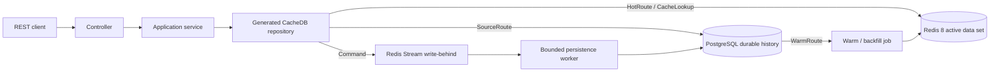

# CacheDB PostgreSQL Sample

> This source targets 0.18.1. Confirm package availability in GitHub Releases and the Maven repository; a source version alone is not publication evidence. If unavailable, use tag v0.18.0 for the downloadable quick start.

English | [Türkçe](README.tr.md)

## Read and Write Controls in 0.18.1

Runnable [0.18 scenarios](#cachedb-018-running-scenarios) demonstrate supplier
offers, bulk L1, soft TTL, facets, composite indexes, independent mixed writes,
and tenant-scoped warehouse batches, partitions, projections and causal reads.
The new demo-only API has its own identity mapping; existing REST contracts stay
unchanged. Complete Java sources, expected results and Postman requests are below.

The sample is a PostgreSQL consumer: it resolves the published BOM, processor,
starter, and doctor plugin at the same version. Java 21 is required; no framework
checkout is needed. For the consistency and upgrade rules, read the framework
[bounded controls guide](https://github.com/esasmer-dou/cache-database/blob/main/docs/hot-path-controls.md).

Follow the existing quick start and seed/warm steps first. Then use this flow:

The existing PATCH and query routes also benefit from 0.17's grouped JDBC writes,
bounded index reads and access-ordered L1. New delta, aggregate, tenant, watcher and
schema/compression APIs are opt-in; this sample does not silently enable them or
add tenant authorization. See the framework's [scenario guide](https://github.com/esasmer-dou/cache-database/blob/main/docs/declarative-data-controls.md)
before adapting them to your own entity and deployment contract.

1. `CatalogConfiguration` selects active products using
   `ProductEntityCacheBinding.Columns.ACTIVE_STATUS`, scopes by
   `Columns.PRODUCT_ID`, and registers `autoDirtyOnRootEntity()`.
2. The generated repository validates this narrow write at compile time:

```java
@CachePatch
WriteReceipt<ProductEntity, Long> patchStockValues(
        @CacheId Long productId,
        @CacheColumn("stock_quantity") Integer stockQuantity,
        @CacheColumn("reserved_quantity") Integer reservedQuantity,
        @CacheColumn("stock_status") String stockStatus,
        @CacheColumn("updated_at") Long updatedAt);
```

3. `ProductApplicationService.replaceStock` validates `0 <= reserved <= stock`,
   derives the stock status, and calls that method. It does not issue a full-row
   SQL UPSERT or alter the product's name, category, or price.

```java
return products.patchStockValues(productId, stock, reserved, status,
        Instant.now(clock).getEpochSecond());
```

4. Send an **absolute replacement**, not an increment:

```http
PATCH http://127.0.0.1:8091/api/products/1/stock-values
Content-Type: application/json

{"stock": 20, "reserved": 2}
```

The response is HTTP 202: Redis acceptance, not SQL commit. A cold patch receipt
can have `entity: null`; the framework must not fabricate a partial product.
The original optional-field `/stock` endpoint remains unchanged.
Both fields are mandatory on `/stock-values`; invalid or incomplete bodies are 400.

5. To observe automatic catalog refresh, start with
   `SAMPLE_CATALOG_SCHEDULE_ENABLED=true`. The sample uses a one-second dirty
   flush interval and threshold 20. After SQL durability, the product is marked
   dirty and its scoped catalog payload is rebuilt. Check
   `GET /api/catalog/items/1`. Without this scheduling opt-in, use the existing
   manual catalog refresh endpoints. External SQL updates still need explicit
   refresh/CDC or periodic full reconciliation.

`ProductEntity` also opts into a bounded L1: 1024 entries, two-second TTL and
4 MiB estimated budget. Repeated product detail reads can avoid Redis requests;
returned objects are decoded copies. Cross-pod invalidation is eventual, not an
immediate-consistency guarantee. Remove `@CacheNearPolicy` if every read must go
to Redis. The framework uses one invalidation connection per application, not per
repository. Reserve that connection in the background pool.

For multi-row commands, prefer:

```java
var receipt = database.inTransaction(tx -> {
    tx.put(product);
    tx.putAll(otherProducts);
});
boolean durable = database.awaitDurable(receipt, Duration.ofSeconds(5));
```

Do not call receipt-returning `saveAll` inside this deferred scope: a truthful
receipt exists only after commit. Use `tx.putAll`. Exceptions before commit
discard the staged writes; a durability timeout after acceptance is not rollback.
Limits are 100 identities, 4 MiB and 2000 stream fields. Cluster requires one
hash-tag scope; bounded tenant admission cannot be bypassed with atomic batches.

[](https://github.com/esasmer-dou/sample-cache-database-postgresql/actions/workflows/consumer-build.yml)
[](https://github.com/esasmer-dou/cache-database/releases/tag/v0.18.1)

A production-oriented Spring Boot REST API that demonstrates CacheDB with Redis
8 and PostgreSQL. The sample is intentionally explicit: operational routes use
a bounded Redis active data set, durable history stays in PostgreSQL, and
growing lists use projections instead of full aggregates.

> This sample uses CacheDB `0.18.1`. The public CacheDB Maven repository
> resolves its immutable packages without a
> GitHub token or a local framework source checkout.

After the quick start, you will have proved one complete production-shaped
route: seed durable PostgreSQL rows, read the bounded archive route, warm the
matching Redis projection, read the active route, and inspect coverage and
durability signals. The sample does not hide a PostgreSQL query behind a Redis
miss.

## CacheDB 0.18.1 Upgrade

The sample POM aligns the BOM, provider starter, annotation processor and doctor
plugin at `0.18.1`. Rebuild the sample to regenerate its bindings.
The POM also sets `jedis.version=5.2.0`; the Spring Boot parent would otherwise
select an older driver that lacks the required pipeline API.

- Existing REST, archive, projection and warm routes retain their explicit behavior.
- Before upgrading existing SQL workers, provision the provider migration for `cachedb_write_fence`, drain old workers and keep version counters intact. This separate metadata table prevents stale replay from recreating a deleted row; business tables are unchanged. See [durable write fences](https://github.com/esasmer-dou/cache-database/blob/main/docs/durable-write-fences.md).
- Typed snapshots, generated Jackson-free codecs and atomic product imports are runnable catalog scenarios. Separate API/worker profiles are also included. Follow the [declarative catalog scenarios](#declarative-catalog-scenarios).
- The strict 50 ms CI target concerns the generated-codec/snapshot probe, including first use. It is not a REST, SQL, network or production SLA; legacy mapper compatibility and full JUnit timings are reported separately.
- `hotEntityLimit=0` disables entity admission; use `-1` only for a deliberate unbounded count policy. The default remains 1,000.
- Use `Boolean` for nullable SQL booleans; primitive `boolean` rejects SQL NULL.
- Atomic catalog imports and indexed snapshot pages have explicit endpoints. Redis Cluster distribution remains an optional framework infrastructure capability; local Compose uses standalone Redis.

Read the [release notes](https://github.com/esasmer-dou/cache-database/blob/main/docs/releases/v0.18.1.md)
and [bounded operation contracts](https://github.com/esasmer-dou/cache-database/blob/main/docs/bounded-runtime-operations.md)
before adding those APIs. Package availability does not certify your application's production topology.

## Column Safety

The existing sample entities stay deliberately narrow. Provider-aware limits are active
through the 0.18.1 dependency; no additional cache policy or business-table change
is required. A wider Redis payload is not permission to create a wider SQL table.

| Surface | Default count limit |
| --- | --- |
| PostgreSQL table | 1600 physical columns |
| SQL Server standard table | 1024 physical columns |
| Oracle standard table | 1000 physical columns |
| Entity/projection payload in Redis | 4096 fields, still subject to byte and memory budgets |

A positive JDBC capability value takes precedence, capped at 4096; unknown values
use the provider default. ID, version and soft-delete columns count. For example,
a PostgreSQL reporting entity with 1199 mapped columns including its ID plus a
separate version column uses 1200 slots. It passes the count check on PostgreSQL,
but exceeds the default Oracle/SQL Server table limits. Row width and SQL parameter
budgets must still fit. Prefer a small report projection to loading all 1200 fields.

For an optional one-time deployment check, call this helper **after the generated
entities have registered**, before admitting traffic. Do not call it on every REST
request or add a second automatic warm loop:

```java
import javax.sql.DataSource;
import com.reactor.cachedb.core.config.SchemaBootstrapConfig;
import com.reactor.cachedb.starter.CacheDatabase;
import com.reactor.cachedb.starter.CacheDatabaseSchemaAdmin;

public final class SampleSchemaSafety {
    private SampleSchemaSafety() {}

    public static void verify(CacheDatabase database, DataSource source) {
        var schema = new CacheDatabaseSchemaAdmin(
                source, database.entityRegistry(), SchemaBootstrapConfig.defaults());
        var result = schema.validate();
        if (!result.success()) {
            throw new IllegalStateException("Schema validation failed: " + result.issues());
        }
    }
}
```

This validates registered mappings without creating business tables. An incompatible
definition is reported before normal traffic; write-behind also checks column and
parameter counts before business SQL. JDBC metadata behavior is driver-dependent.

Upgrade every reader/worker before producing payloads above 1024 fields: old 0.15.0
readers cannot consume them. If the 0.15.0 durable write-fence table is already
provisioned, this patch needs no new business-table migration. Oracle extended mode
is not enabled automatically and was not certified on the standard Oracle fixture.

See the [column-limit guide](https://github.com/esasmer-dou/cache-database/blob/main/docs/schema-column-limits.md)
for driver fallbacks, record-constructor limits and migration checks.

## Start Here

| Goal | Go to |
| --- | --- |
| Run the complete sample | [Quick Start](#quick-start) |
| Understand Redis vs PostgreSQL behavior | [Runtime Contract](#runtime-contract) |
| See the declarative Java API | [Code Walkthrough](#code-walkthrough) |
| Warm existing PostgreSQL rows | [Warm Existing Data](#warm-existing-data) |
| Choose cache limits | [Tuning by Use Case](#tuning-by-use-case) |
| Exercise every route | [API Catalog](#api-catalog) or [Postman](#postman) |
| Run typed snapshots, atomic imports and separate workers | [Declarative Catalog Scenarios](#declarative-catalog-scenarios) |
| Prove production readiness | [Production Certification](#production-certification) |
| Prepare a production rollout | [Production Checklist](#production-checklist) |
| Fix a startup or data-path problem | [Troubleshooting](#troubleshooting) |

## What This Sample Teaches

The domain is larger than a toy CRUD application:

- customers place orders with many order lines
- product availability serves catalog and low-stock screens
- shipments expose active, exception, event, and archive routes
- support tickets feed an operational dashboard
- report jobs and audit events separate live work from durable history

The important product boundary is equally explicit:

| Classification | Meaning |
| --- | --- |
| **BEST** | Define a bounded operational route, warm its entity or projection data, measure it, and keep archive/history reads on PostgreSQL. |
| **ACCEPTABLE** | Use an explicit bounded PostgreSQL route for infrequent data outside the Redis active set. |
| **ANTI-PATTERN** | Treat CacheDB as a transparent cache and expect every Redis miss to run an arbitrary SQL query and refill Redis automatically. |

CacheDB is a strong fit when the team knows which screens and commands require
predictable low latency. It is not a fit for applications whose main workload
is unbounded ad-hoc querying over the complete database.

## Architecture



The application code depends on repository interfaces. The annotation
processor generates implementations, codecs, indexes, projection bindings, and
Spring beans at compile time. Runtime reflection is not used for entity
discovery.

## Key Terms

| Term | Meaning in this sample |
| --- | --- |
| Entity | The command/detail model mapped to SQL columns and a Redis namespace |
| Projection | A compact, screen-specific read model such as `OrderSummary` |
| Active data set | The bounded subset intentionally available in Redis |
| Hot route | A repository method whose contract reads the Redis active data set |
| Source route | A bounded repository method that reads PostgreSQL explicitly |
| Warm/backfill | A controlled PostgreSQL-to-Redis preparation job |
| Route coverage | Evidence that the required scope/window has been prepared in Redis |
| Write-behind | An accepted Redis command that is persisted to PostgreSQL asynchronously |
| Write receipt | The command result used to track identity, version, and durability state |
| Snapshot / generation | A prepared read model published as one consistent version in Redis; reads do not prepare it |
| Generated JSON codec | Compile-time JSON encoding/decoding for a declared DTO; separate from Spring MVC's JSON stack |
| Atomic batch | All-or-none Redis acceptance of several commands; SQL persistence happens later |
| SQL durability | Confirmation that the accepted write reached SQL; not implied by HTTP `202` |
| Runtime role | `CLIENT_ONLY` accepts/reads work; `WORKER_ONLY` processes background work |
| Delete fence | Durable SQL version metadata that prevents an older UPSERT from restoring a deleted row |
| Snapshot cursor | Opaque continuation token tied to the prepared generation/partition; not an arbitrary SQL offset |

## Prerequisites

- JDK 21
- Maven 3.9+
- Docker Desktop or a compatible Docker Engine
- PowerShell 7+ for the bundled load script

Verify the local toolchain:

```powershell
java -version
mvn -version
docker version
docker compose version
```

## Dependency Model

The sample consumes CacheDB as Maven artifacts. It does not compile framework
sources as part of the sample build.

```xml
<properties>
    <java.version>21</java.version>
<cachedb.version>0.18.1</cachedb.version>
<jedis.version>5.2.0</jedis.version>
</properties>

<dependencyManagement>
    <dependencies>
        <dependency>
            <groupId>com.reactor.cachedb</groupId>
            <artifactId>cachedb-bom</artifactId>
            <version>${cachedb.version}</version>
            <type>pom</type>
            <scope>import</scope>
        </dependency>
    </dependencies>
</dependencyManagement>

<dependencies>
    <dependency>
        <groupId>com.reactor.cachedb</groupId>
        <artifactId>cachedb-spring-boot-starter-postgres</artifactId>
    </dependency>
    <dependency>
        <groupId>com.reactor.cachedb</groupId>
        <artifactId>cachedb-annotations</artifactId>
    </dependency>
    <dependency>
        <groupId>org.springframework.boot</groupId>
        <artifactId>spring-boot-starter-jdbc</artifactId>
    </dependency>
    <dependency>
        <groupId>org.postgresql</groupId>
        <artifactId>postgresql</artifactId>
        <scope>runtime</scope>
    </dependency>
</dependencies>

<build>
    <plugins>
        <plugin>
            <artifactId>maven-compiler-plugin</artifactId>
            <configuration>
                <release>${java.version}</release>
                <annotationProcessorPaths>
                    <path>
                        <groupId>com.reactor.cachedb</groupId>
                        <artifactId>cachedb-processor</artifactId>
                        <version>${cachedb.version}</version>
                    </path>
                </annotationProcessorPaths>
            </configuration>
        </plugin>
    </plugins>
</build>
```

Add `cachedb-spring-boot-starter-admin` only when the operations UI is needed.
If JPA or another starter already creates the application `DataSource`, adding
`spring-boot-starter-jdbc` again is not required. CacheDB needs one working
`DataSource`, one provider starter, the annotations artifact, and the annotation
processor.

Maven resolves normal dependencies and build plugins from separate repository
lists, so the public CacheDB repository appears in both sections:

```xml
<repositories>
    <repository>
        <id>cachedb-public</id>
        <url>https://esasmer-dou.github.io/cache-database/maven2</url>
    </repository>
</repositories>

<pluginRepositories>
    <pluginRepository>
        <id>cachedb-public</id>
        <url>https://esasmer-dou.github.io/cache-database/maven2</url>
        <releases><enabled>true</enabled></releases>
        <snapshots><enabled>false</enabled></snapshots>
    </pluginRepository>
</pluginRepositories>
```

`repositories` resolves the BOM, starters, and libraries.
`pluginRepositories` resolves `cachedb-maven-plugin`. The endpoint is public;
no Maven `settings.xml`, username, or token is required.

## Quick Start

### 1. Resolve the published CacheDB package

Validate the sample directly. Maven resolves the published BOM,
starter, annotation processor and doctor plugin anonymously from that package:

```powershell
mvn -U -DskipTests validate
```

The build must print `CacheDB doctor` and
`OK: CacheDB build contract is consistent`. It must not depend on a locally
installed CacheDB checkout.

### 2. Start Redis and PostgreSQL

```powershell
docker compose up -d
docker compose ps
```

The compose file starts:

| Service | Address | Local purpose |
| --- | --- | --- |
| Redis 8.2.1 | `127.0.0.1:56379` | Active entities, projections, indexes, streams, leases, and telemetry |
| PostgreSQL 16 | `127.0.0.1:55432` | Durable source of truth |

### 3. Start the API in the demo profile

The `demo` profile is required for local schema initialization, seed endpoints,
warm endpoints, scheduled warm, and the admin UI.

Spring owns the provider-specific `schema.sql` in this sample. CacheDB starts
after that script and validates the result with `VALIDATE_ONLY`; it does not
compete with Spring for DDL ownership.

```powershell
$env:SPRING_PROFILES_ACTIVE = "demo"
mvn spring-boot:run
```

Bash equivalent:

```bash
SPRING_PROFILES_ACTIVE=demo mvn spring-boot:run
```

### 4. Verify readiness

```powershell
Invoke-RestMethod http://127.0.0.1:8091/actuator/health/readiness
```

Continue only when the status is `UP`. Readiness covers Redis, PostgreSQL, and
write-behind health; liveness only proves that the process is running.

### 5. Seed durable demo data

Seed runs as a bounded distributed job and returns `202 Accepted`. Poll the job
instead of keeping one HTTP request open:

```powershell
$seed = Invoke-RestMethod -Method Post `
  -Uri "http://127.0.0.1:8091/api/demo/seed?customers=20&ordersPerCustomer=40&linesPerOrder=4"

do {
    Start-Sleep -Milliseconds 250
    $seedState = Invoke-RestMethod "http://127.0.0.1:8091/api/warm/jobs/$($seed.jobId)"
} while ($seedState.status -in @("QUEUED", "RUNNING"))

if ($seedState.status -ne "COMPLETED") {
    throw ($seedState | ConvertTo-Json -Depth 8)
}
```

`COMPLETED` means the seed job finished. Before a production cutover, also
observe readiness and the write-behind backlog until SQL durability is healthy.

Seed creates durable demo rows, but it does not declare every Redis route
complete. A hot list intentionally returns `503 Service Unavailable` until its
matching warm job finishes and coverage is recorded. This prevents an empty or
partial Redis window from being mistaken for a complete business result.

### 6. Warm the customer timeline projection

```powershell
$warm = Invoke-RestMethod -Method Post `
  -Uri "http://127.0.0.1:8091/api/warm/orders/customer/1?limit=100&projectionOnly=true"

do {
    Start-Sleep -Milliseconds 250
    $warmState = Invoke-RestMethod "http://127.0.0.1:8091/api/warm/jobs/$($warm.jobId)"
} while ($warmState.status -in @("QUEUED", "RUNNING"))

if ($warmState.status -ne "COMPLETED") {
    throw ($warmState | ConvertTo-Json -Depth 8)
}
```

### 7. Compare the active route with the archive route

```powershell
# Redis projection route
$page = Invoke-RestMethod "http://127.0.0.1:8091/api/customers/1/orders?limit=10"
$page.items

# Continue without offset when nextCursor is present
if ($page.nextCursor) {
    Invoke-RestMethod "http://127.0.0.1:8091/api/customers/1/orders?limit=10&after=$($page.nextCursor)"
}

# Bounded PostgreSQL route
Invoke-RestMethod "http://127.0.0.1:8091/api/orders/archive?customerId=1&limit=10"
```

### 8. Open the tools

- Admin UI: `http://127.0.0.1:8091/cachedb-admin`
- Tuning snapshot: `http://127.0.0.1:8091/api/tuning`
- Scheduled warm status: `http://127.0.0.1:8091/api/warm/schedules`

Stop the local infrastructure without deleting PostgreSQL data:

```powershell
docker compose down
```

Use `docker compose down -v` only when the local PostgreSQL volume should be
deleted intentionally.

## Runtime Contract

| Operation | Primary path | If data is outside Redis | Durability / safety rule |
| --- | --- | --- | --- |
| `save`, update, soft delete | Redis first, then PostgreSQL write-behind | The command can enter Redis when admission policy permits | `202 Accepted` is not the same as SQL commit; inspect the receipt and readiness telemetry |
| Entity detail | Redis entity lookup | Returns an explicit unavailable/not-found outcome; it does not run arbitrary SQL automatically | Warm the entity route or expose a bounded source-detail route |
| Growing list or dashboard | Redis projection | `completeItems()` returns `503 Service Unavailable` until the exact route scope is warm and complete | Warm the matching route, poll the job to `COMPLETED`, and require coverage before cutover |
| Archive, export, audit history | Bounded PostgreSQL source route | Reads PostgreSQL directly | Apply row limits, deterministic ordering, indexes, and timeouts |
| Existing PostgreSQL rows | Warm/backfill reads PostgreSQL and hydrates Redis | No automatic startup import | Dry-run first, run a bounded warm job, then verify coverage |
| External PostgreSQL write | PostgreSQL changes first | Redis can become stale without a feed | Integrate outbox/CDC; periodic warm is reconciliation, not a replacement for event propagation |

The active data set is a deliberate subset, not a second complete copy of the
database. Redis memory must be budgeted for entity payloads, projections,
indexes, stream state, leases, and operational metadata.

## Code Walkthrough

The short blocks here are teaching excerpts; their linked files contain the complete source.
The [declarative catalog scenarios](#declarative-catalog-scenarios) include complete compiled Java files with imports and constructors.

### 1. Entity: persistence shape

[`OrderEntity`](src/main/java/com/example/cachedb/sample/domain/OrderEntity.java)
maps SQL columns, Redis namespace, a partitioned index, and a bounded relation:

```java
@CacheEntity(table = "sample_orders", redisNamespace = "sample-orders")
@CachePartitionedIndex(partitionBy = "customer_id", sortBy = "order_date")
public class OrderEntity {
    @CacheId(column = "order_id")
    public Long orderId;

    @CacheColumn("customer_id")
    public Long customerId;

    @CacheColumn("order_date")
    public Long orderDate;

    @CacheRelation(
            target = OrderLineEntity.class,
            mappedBy = "orderId",
            kind = CacheRelation.RelationKind.ONE_TO_MANY,
            batchLoadOnly = true,
            maxRowsPerParent = 50,
            parentBatchSize = 16,
            orderBy = "lineNumber ASC"
    )
    public List<OrderLineEntity> lines;
}
```

The database foreign key protects durable relational integrity.
`@CacheRelation` tells CacheDB how to load and bound the relation. Either can
exist without the other, but production models normally need both.

### 2. Projection: screen shape

[`OrderSummary`](src/main/java/com/example/cachedb/sample/readmodel/OrderSummary.java)
is smaller than `OrderEntity` and excludes order-line payloads:

```java
@CacheProjectionRecord(
        source = OrderEntity.class,
        id = "orderId",
        name = "order-summary",
        rankedBy = {"order_date", "priority_score"},
        refresh = CacheProjectionRecord.Refresh.ASYNC
)
public record OrderSummary(
        Long orderId,
        Long customerId,
        Long orderDate,
        BigDecimal orderAmount,
        String currencyCode,
        String orderType,
        String status,
        Integer lineCount,
        Double priorityScore
) {
}
```

Use an entity for commands and selected detail. Use a projection for a list,
timeline, dashboard, top-N, or global sorted route.

### 3. Repository: route contract

[`OrderRepository`](src/main/java/com/example/cachedb/sample/repository/OrderRepository.java)
declares the route; the processor generates its implementation:

```java
@CacheRepository(entity = OrderEntity.class)
@CacheRepositoryDefaults(
        hotPopulation = HotRoute.Population.DECLARED_WARM,
        sourceMaxRows = 500,
        sourceTimeoutSeconds = 15
)
public interface OrderRepository extends CacheDbRepository<OrderEntity, Long> {

    @HotRoute(
            value = "customer-order-timeline",
            projection = OrderSummary.class,
            pageSize = 100,
            hotWindow = 1_000,
            memoryBudgetBytes = CacheMemoryBudget.MIB_16,
            coverageScopeParameter = "customerId"
    )
    @CacheRouteQuery(
            predicates = {
                    @CachePredicate(field = "customerId"),
                    @CachePredicate(field = "status", operator = CachePredicate.Operator.NE, constants = "DELETED")
            },
            orderBy = {
                    @CacheOrder(field = "orderDate", direction = CacheOrder.Direction.DESC),
                    @CacheOrder(field = "orderId", direction = CacheOrder.Direction.DESC)
            }
    )
    CursorPage<OrderSummary> customerTimeline(long customerId, WindowRequest window);

    @WarmRoute(
            value = "warm-customer-order-timeline",
            from = "customerTimeline",
            maxRows = 1_000
    )
    CacheWarmPlan warmCustomerTimeline(
            long customerId,
            int maxRows,
            CacheWarmTarget target
    );
}
```

The route contract puts the page size, active window, memory budget, sort order,
coverage scope, and warm limit in one reviewable place. The processor infers the
same-name predicate parameter, the single `WindowRequest`, the warm row-limit,
warm target, and warm coverage scope. Ambiguous declarations fail compilation;
the processor never chooses between multiple candidates silently.

### 4. Application service: business orchestration

[`CustomerApplicationService`](src/main/java/com/example/cachedb/sample/application/customer/CustomerApplicationService.java)
injects interfaces, not Redis clients or generated binding classes:

```java
@Service
public final class CustomerApplicationService {
    private final CustomerRepository customers;
    private final OrderRepository orders;

    public CustomerEntity detail(long customerId, int orderPreview) {
        return SampleHotLookups.require(
                "Customer",
                customerId,
                customers.detail(customerId, orderPreview)
        );
    }

    public CursorPage<OrderSummary> orderTimeline(long customerId, int limit, String after) {
        return orders.customerTimeline(customerId, WindowRequest.of(limit, after));
    }
}
```

Controllers validate HTTP input. Application services own use-case
orchestration. Repository interfaces own data-path contracts. Generated code
owns serialization, indexes, and provider wiring.

The REST endpoint accepts the returned `nextCursor` as the next request's
optional `after` parameter. The cursor is bound to this route, customer scope,
and sort contract; it cannot be reused for another customer or route. A strict
HOT route may return `CursorPage<T>` directly because generated code verifies
complete and fresh coverage before creating the page. Return `HotWindow<T>`
instead when application code must inspect coverage evidence itself.

The processor also generates a reflection-free route companion. Use it in
integration tests and operational code instead of repeating route-name strings:

```java
cacheDbTestProbe.requireDeclaredWarmRoute(
        OrderRepositoryCacheDbRoutes.customerTimeline()
);

RouteCoverage coverage = cacheDbTestProbe.coverage(
        OrderRepositoryCacheDbRoutes.customerTimeline(),
        String.valueOf(customerId),
        Duration.ofMinutes(5)
);
```

If the repository method or route contract changes, this code changes at
compile time. The generated companion is under `target/generated-sources`; do
not copy it into `src/main/java`.

## Warm Existing Data

Existing PostgreSQL rows are not imported at startup. Use this sequence for an
existing system:

1. Define one bounded `@HotRoute` or `@CacheLookup`.
2. Add the matching `@WarmRoute`.
3. Run `dryRun=true` and inspect the candidate row count.
4. Submit the real warm job and poll it to `COMPLETED`.
5. Verify route coverage and compare membership/order with PostgreSQL.
6. Enable traffic gradually and retain the PostgreSQL rollback path.

Dry-run example:

```powershell
Invoke-RestMethod -Method Post `
  -Uri "http://127.0.0.1:8091/api/warm/orders/customer/1?limit=100&projectionOnly=true&dryRun=true"
```

Projection-only warm is best for lists and dashboards. Entity warm is justified
only when selected detail or command routes need the complete active payload.

For legacy tables, an `entity_version` value of `NULL` or `0` is normalized to
the initial Redis version during the first warm. This is a migration aid, not a
change-feed strategy. After cutover, every external PostgreSQL writer must
advance a monotonic version and publish through outbox/CDC, or the next bounded
reconciliation cycle must be an explicitly accepted lag window.

### Periodic warm and reconciliation

[`SampleScheduledWarmPlans`](src/main/java/com/example/cachedb/sample/config/SampleScheduledWarmPlans.java)
declares a 90-day order window. Redis leases ensure that only one pod performs a
scheduled cycle while other pods wait or skip safely. Reconciliation removes
rows that no longer satisfy the policy.

```java
@CacheScheduledWarm(
        name = "sample-active-order-window",
        fixedDelayString = "${sample.scheduled-warm.orders.fixed-delay:PT15M}",
        lockAtMostForString = "${sample.scheduled-warm.orders.lock-at-most-for:PT2M}",
        lockWaitTimeoutString = "${sample.scheduled-warm.orders.lock-wait-timeout:PT20S}",
        minimumIntervalString = "${sample.scheduled-warm.orders.minimum-interval:PT15M}",
        reconcileHotSet = true
)
public CacheWarmPlan activeOrderWindow() {
    long cutoff = Instant.now().minus(Duration.ofDays(90)).getEpochSecond();
    return orders.warmActiveWindow(cutoff, orderWarmMaxRows);
}
```

Scheduled warm maintains the chosen active window. New CacheDB writes still
enter through the normal command path immediately; they do not wait for the
next schedule.

The annotation processor validates the method and generates a typed Spring
task adapter. The runtime does not scan annotated methods or invoke them through
reflection.

### Explicit warm execution, query intent, and durability

A typed target selects the payload once. The generated plan then owns that
decision, while execution selects only dry-run or apply:

```java
CacheWarmTarget target = projectionOnly
        ? CacheWarmTarget.PROJECTIONS_ONLY
        : CacheWarmTarget.ENTITY_AND_PROJECTIONS;
CacheWarmPlan plan = orders.warmCustomerTimeline(customerId, limit, target);
CacheWarmExecution execution = cacheDatabase.executeWarm(
        plan,
        dryRun ? CacheWarmExecutionMode.DRY_RUN : CacheWarmExecutionMode.APPLY
);
CacheWarmSummary summary = execution.summary("customer-orders");
```

Dry-run never mutates Redis. Do not create separate entity/projection methods
for the same route or repeat the decision with a second
`warmProjections`/`warm` branch.

The REST endpoint does not execute a backfill on the request thread. It submits
one typed command to the durable Redis job lane and returns `202 Accepted` with
a `Location` header:

```java
public record SampleWarmCommand(Route route, int limit, boolean projectionOnly,
                                boolean dryRun) {
}

static final CacheDistributedJobDefinition<SampleWarmCommand> WARM_JOB =
        CacheDistributedJobDefinition.of("sample.route.warm", SampleWarmCommand.class);

CacheDistributedJobSnapshot job = jobs.submit(WARM_JOB, command);
// Location: /api/warm/jobs/{jobId}
```

The handler implements `CacheDistributedJobHandler.Typed<SampleWarmCommand>`
and returns this same definition. It stores bounded progress with
`CacheDistributedJobProgress`; route strings and payload types are not repeated.

Every pod registers the same job definition. Redis stores status and
checkpoints, so another pod can claim abandoned work. The route still keeps
bounded row limits, idempotent warm behavior, and generated SQL; the job layer
does not turn the operation into an unbounded background query.

Predicate groups are also explicit. Predicates in one group are ANDed; separate
groups are ORed. The active-order window deliberately means "last 90 days OR
an active state", so its `@CacheRouteQuery` uses groups `0` and `1` together
with `explicitDisjunction = true`. A multi-group query without that flag fails
compilation. Keep predicates in one group when the business rule is AND.

Seed and import batches preserve SQL durability evidence:

```java
try (var orders = cacheDatabase.durableBatchWriter(
        "sample seed/orders", 128, 1_024, Duration.ofSeconds(30),
        orderRepository::saveAll
)) {
    sourceOrders.forEach(orders::add);
}
```

A timeout means Redis accepted the command but SQL durability was not proven
within the deadline. The exception retains the receipts and operation name; do
not issue blind duplicate writes.

### Generated route inventory

The processor generates a route catalog for every repository, and the starter
aggregates it without runtime reflection:

```powershell
Invoke-RestMethod http://127.0.0.1:8091/actuator/cachedb
```

The response contains declared route counts/kinds, HOT-route population
strategies, at most 250 route details, at most 100 scheduled-warm details, and
truncation flags. Aggregate Micrometer meters include
`cachedb.repositories.declared`, `cachedb.routes.declared`,
`cachedb.routes.hot.population{strategy=...}`, and the
`cachedb.scheduled.warm.*` meters. The strategy tag has four bounded values;
route, customer, and tenant names are never metric tags. The catalog proves
what was compiled; route coverage, parity, latency, memory, and SQL durability
remain separate production gates.

## Tuning by Use Case

Start from measured route demand, not from a guess about table size.

| Scenario | Active data policy | Read model | Initial limits | Outside the active set |
| --- | --- | --- | --- | --- |
| Customer order timeline | Last 90 days **or** active order states | `OrderSummary` per customer | Page `100`, window `1,000`, route budget `16 MiB` | Bounded `archive` source route |
| Product catalog | Active products **or** in-stock/low-stock states | `ProductAvailability` | Entity limit `25,000`, page `100` | Inactive-product source route |
| Support operations | Updated in 30 days **or** `OPEN/PENDING/ESCALATED` | Entity for small rows | Entity limit `50,000`, page `50` | Explicit ticket-history SQL route when needed |
| Logistics control tower | Updated in 14 days **or** active/exception states | `ShipmentSummary` | Entity limit `150,000`, route windows `2,000-10,000` | Delivered-shipment source route |
| Report execution | `QUEUED/RUNNING/FAILED` or last 24 hours | Small job entity | Entity limit `5,000`, page `50` | Completed report history on PostgreSQL |
| Security audit | Severe events from the last 24 hours | Small bounded entity list | Entity limit `2,000`, read admission disabled | Full audit archive on PostgreSQL |

The sample exposes the resolved runtime configuration:

```powershell
Invoke-RestMethod http://127.0.0.1:8091/api/tuning
Invoke-RestMethod http://127.0.0.1:8091/api/tuning/profiles
```

Key controls in
[`SampleCacheDbTuningConfig`](src/main/java/com/example/cachedb/sample/config/SampleCacheDbTuningConfig.java):

| Control | Sample value | Why it exists |
| --- | ---: | --- |
| `maxEntityQueryLimit` | `250` | Stops broad entity materialization |
| `maxProjectionQueryLimit` | `1,000` | Allows larger compact read-model windows |
| `maxQueryLoadRows` | `1,000` | Bounds registered source loading |
| `queryTimeoutSeconds` | `15` | Bounds source reads |
| `workerThreads` | `2` | Limits concurrent SQL flush pressure |
| `batchSize` / `maxFlushBatchSize` | `128` | Reduces SQL round trips without unbounded batches |
| Redis warning / critical thresholds | `75%` / `88%` | Adds backpressure before Redis reaches maxmemory |
| expected eviction policy | `noeviction` | Prevents Redis from silently dropping coordination or write state |

Do not copy these numbers directly to production. Measure serialized payload
size, projection/index overhead, peak route concurrency, SQL flush latency, and
the Redis memory headroom needed during rewarm or failover.

## API Catalog

| Area | Representative endpoints | Data path |
| --- | --- | --- |
| Health and operations | `GET /actuator/health/readiness`, `GET /api/tuning`, `GET /api/warm/schedules` | Runtime telemetry |
| Demo setup | `POST /api/demo/seed`, `GET /api/warm/jobs/{jobId}` | Distributed background jobs |
| Customers | `POST /api/customers`, `GET /api/customers/{id}`, `GET /api/customers/{id}/orders` | Command, entity detail, projection timeline |
| Orders | `POST /api/orders`, `PATCH /api/orders/{id}/status`, `DELETE /api/orders/{id}` | Redis-first write-behind commands |
| Order reads | `GET /api/orders/{id}`, `GET /api/orders/high-value`, `GET /api/orders/archive` | Entity, ranked projection, PostgreSQL source route |
| Products | `GET /api/products/active`, `GET /api/products/low-stock`, `PATCH /api/products/{id}/stock` | Projection reads and command |
| Shipments | `GET /api/shipments/active`, `GET /api/shipments/exceptions`, `GET /api/shipments/archive` | Projection and PostgreSQL source routes |
| Support | `GET /api/tickets/open`, `POST /api/tickets`, `PATCH /api/tickets/{id}/status` | Bounded entity read and commands |
| Reporting | `GET /api/reports/jobs/live`, `GET /api/reports/audit/security`, `GET /api/reports/audit/archive` | Active rows and durable archive |
| Dashboards | `GET /api/dashboard/commerce`, `GET /api/dashboard/operations` | Pre-shaped Redis data |
| Catalog snapshots | `GET /api/catalog/items/{id}`, `GET /api/catalog/items?ids=...`, `GET /api/catalog/categories/{category}` | Typed Redis-only snapshot reads and cursor pages |
| Catalog preparation and imports | `POST /api/catalog/refresh`, `POST /api/catalog/imports` | Bounded demo jobs; inspect both job outcome and SQL durability |
| Warm | `POST /api/warm/customers/active`, `/orders/customer/{id}`, `/orders/{id}/lines`, `/orders/high-value`, `/orders/highlighted`, `/products/active`, `/products/low-stock`, `/tickets/open`, `/shipments/active`, `/shipments/customer/{id}`, `/shipments/exceptions`, `/shipments/{id}/events`, `/reports/live`, `/reports/type/{type}`, `/audit/security` | Bounded PostgreSQL-to-Redis jobs; poll `/api/warm/jobs/{jobId}` after every submission |

Request limits are validated. Oversized values return `400 Bad Request` rather
than being silently clamped. Queue saturation returns `429 Too Many Requests`.
Optimistic conflicts and not-yet-durable parent references return `409 Conflict`.

## Postman

Import:

```text
postman/cache-database-postgresql-sample.postman_collection.json
```

Run folders in this order:

1. Run readiness, submit demo seed, and repeat `Latest Background Job Status`
   until it reports `COMPLETED`.
2. In each business folder, run the matching `Warm ...` request before its hot
   list request.
3. After every `202 Accepted`, repeat `Latest Background Job Status` until the
   submitted job reports `COMPLETED`.
4. Call the hot route and compare it with the bounded archive/source route where
   the folder provides one.
5. Run the dashboard folder only after its component routes have been warmed.
6. Inspect tuning and scheduled-warm status before changing any window or pool.

For snapshots and atomic imports, use the separate
`postman/cache-database-postgresql-catalog.postman_collection.json` collection.
It carries its own four-product fixture and assertions. Follow the
[runnable scenarios](#declarative-catalog-scenarios) for the automated runner,
API/worker setup, replay rules and expected results.

## Load Test

After seed and warm complete:

```powershell
powershell -ExecutionPolicy Bypass -File .\scripts\run-load-test.ps1 `
  -RouteProfile hot-timeline `
  -Concurrency 8 `
  -DurationSeconds 20 `
  -SeedCustomers 20 `
  -OrdersPerCustomer 40 `
  -WarmCustomers 20 `
  -WarmLimit 100 `
  -MaxP95Millis 250
```

This is a local regression gate, not a production capacity result. Production
numbers require realistic latency to Redis/PostgreSQL, Kubernetes resource
limits, representative payloads, and expected concurrency.

## PostgreSQL Production Notes

- Index every source-route predicate and deterministic sort suffix.
- Keep HikariCP below the PostgreSQL connection budget across all pods.
- Tune write-behind batch size against WAL pressure and lock duration.
- Use statement timeouts for warm, archive, and migration queries.
- Integrate outbox/CDC when another application can write the same tables.
- Prove backup, restore, Redis loss/rebuild, and application rollback paths.
- Treat PostgreSQL as the durable source of truth even when Redis serves the
  operational route.

## Production Certification

The framework repository proves CacheDB's own Docker and provider behavior.
Your application must separately prove its routes and its real staging
topology. After collecting route coverage, parity, memory, failover, canary,
and rollback evidence under `cachedb-certification/`, run:

```powershell
mvn verify -Pproduction-certification
```

The command fails on missing routes, evidence from another commit or
environment, unresolved parity, an exceeded memory budget, or a missing
failover/rollback drill. It writes the shareable result to
`target/cachedb-production-certification.md`. Use the complete
[production certification contract](https://github.com/esasmer-dou/cache-database/blob/main/docs/production-certification.md);
never copy placeholder evidence and mark it as passed.

## Production Checklist

- [ ] Every operational endpoint is classified as command, active entity,
  projection, or source route.
- [ ] Every active route has a page limit, active window, memory budget, sort
  order, and coverage scope.
- [ ] Relation-heavy and globally sorted screens use projections.
- [ ] Warm/backfill is bounded, resumable, observable, and tested after Redis
  loss.
- [ ] Source routes have matching indexes, timeouts, and maximum row counts.
- [ ] `202 Accepted` durability semantics are understood by callers.
- [ ] Redis uses explicit `maxmemory`, `noeviction`, alerting, and capacity
  headroom.
- [ ] PostgreSQL and HikariCP connection budgets are calculated per pod and for
  the full replica count.
- [ ] Multi-pod scheduled warm and abandoned-job claiming are tested.
- [ ] External database writes are covered by outbox/CDC or an explicit
  reconciliation decision.
- [ ] Admin endpoints are disabled or protected behind the internal gateway.
- [ ] Side-by-side parity, latency, canary, rollback, and recovery evidence is
  recorded before cutover.

## Troubleshooting

| Symptom | Likely cause | Fix |
| --- | --- | --- |
| `/api/demo/seed` or `/api/warm/**` returns `404` | Application was not started with the `demo` profile | Set `SPRING_PROFILES_ACTIVE=demo` and restart |
| CacheDB artifacts return `404` | The requested version is not published or the public repository URL is missing | Use a released stable version and declare `https://esasmer-dou.github.io/cache-database/maven2` in both repository sections |
| Dependencies resolve but `cachedb-maven-plugin` does not | `pluginRepositories` is absent | Add the same public CacheDB URL under `pluginRepositories` |
| `production-certification` fails | Route evidence is missing, stale, or belongs to another commit/environment | Read the generated report, regenerate real staging evidence, and rerun the profile |
| Active route returns `503` while archive returns rows | Redis route has not been warmed, its coverage expired, or the scope differs | Run dry-run, warm the exact route/scope, poll to `COMPLETED`, then inspect coverage |
| Detail route reports unavailable data | Entity payload is outside the active set | Warm entities for that detail scope or add a bounded source-detail route |
| `409 Conflict` after a parent write | Parent is not durable yet or optimistic version changed | Honor `Retry-After`, verify write-behind health, retry idempotently |
| `429 Too Many Requests` | Bounded job queue or backpressure guard is active | Reduce producer rate and inspect Redis/write-behind telemetry |
| Readiness is `DOWN` | Redis, PostgreSQL, dead-letter, recovery, or backlog condition failed | Inspect readiness details and logs; do not route traffic yet |
| Redis reaches memory warning | Active set, projection/index overhead, or backlog exceeded budget | Stop admission growth, measure keyspace, reduce windows, or add capacity |

## Related Documentation

- [Main CacheDB README](https://github.com/esasmer-dou/cache-database)
- [Declarative repositories](https://github.com/esasmer-dou/cache-database/blob/main/docs/declarative-repositories.md)
- [Getting started](https://github.com/esasmer-dou/cache-database/blob/main/docs/getting-started.md)
- [Scheduled warm and reconciliation](https://github.com/esasmer-dou/cache-database/blob/main/docs/scheduled-warm.md)
- [Production tuning](https://github.com/esasmer-dou/cache-database/blob/main/docs/production-tuning-guide.md)
- [Use-case examples](https://github.com/esasmer-dou/cache-database/blob/main/docs/use-case-examples.md)
- [Database provider SPI](https://github.com/esasmer-dou/cache-database/blob/main/docs/database-provider-spi.md)
- [Production recipes](https://github.com/esasmer-dou/cache-database/blob/main/docs/production-recipes.md)

<!-- BEGIN COMPILED FEATURE EXAMPLES -->
## CacheDB 0.18: Running Scenarios

This section uses real classes in this sample, not pseudocode. Start with the
existing Quick Start and `demo` profile. Maven downloads CacheDB **0.18.1**
without building the framework. Run the Postman collection
`postman/cache-database-postgresql-v018.postman_collection.json` in its saved order.

### 1. Setup, Identity and Data Flow

The demo initializes `schema.sql` and the provider-specific `schema-controls.sql`.
The two new tables are `sample_supplier_offers` and `sample_tenant_stock`.
For an existing database, review and apply the new provider DDL through your own
migration process before startup; do not enable demo initialization in production.
SQL Server/Oracle scripts use Spring's `@@` statement delimiter.

| Credential in the demo profile | Server-selected permission |
| --- | --- |
| `Bearer demo-supplier` | Supplier offer feed, its SQL source and bounded warm jobs |
| `Bearer demo-shop-a` | Tenant `shop-a` stock only |
| `Bearer demo-shop-b` | Tenant `shop-b` stock only |

These are public **demo-only credentials**, not production secrets. The routes
exist only with `sample.demo.write-tools-enabled=true`. The demo profile supplies
the three credentials; override them with `SAMPLE_CONTROLS_SUPPLIER_TOKEN`,
`SAMPLE_CONTROLS_TENANT_A_TOKEN` and `SAMPLE_CONTROLS_TENANT_B_TOKEN`.
The ordinary production profile does not enable these endpoints or supply tokens.
Replace this small credential adapter with your verified JWT/session principal
before adopting the example in a real application. A raw tenant header is never trusted.

| Operation | SQL and Redis behavior |
| --- | --- |
| PUT offer / tenant batch | Redis accepts first; HTTP 202 is **not SQL commit**. Workers persist asynchronously. |
| GET offer / stock / bulk | Reads the bounded active Redis set, with eligible L1 reuse. A miss does not run SQL. |
| GET `/offers/{id}/source` | Explicit SQL read; does not silently warm Redis. |
| POST `/offers/warm` | Explicit background SQL-to-Redis warm, filtered by supplier and limited to 1–100 rows. |
| Dashboard / projection | Covers the selected Redis set, not the full SQL history. |

For a SQL-only row, the intended sequence is: GET gives 404; source GET can return
the SQL row; GET is still 404; submit warm; poll `/api/warm/jobs/{jobId}` until
`COMPLETED`; then GET can return the warmed row. Choose a window that fits the
limit; this is not an unbounded full-table import. Offer reads are informational,
not a price-lock or stock-reservation guarantee.

### 2. Supplier Quotes: Bulk L1, Soft TTL and Composite Lookup

Use `PUT /api/examples/v018/offers/9600001` with the supplier credential:

```json
{"supplier":"postman-window","status":"ACTIVE","unitPrice":12.1250,"availableUnits":20}
```

The response includes `version`, `causalToken`, `redisAccepted=true` and
`sqlDurabilityConfirmed=false`. Send a complete offer to PUT; use
`PATCH /offers/{id}/units` with `{"availableUnits":25}` for that column only.
All paths in this section are relative to `/api/examples/v018`.

| Request | Expected behavior |
| --- | --- |
| GET `/offers?ids=9600001,9600002,9600001` | Preserves order and duplicate results. Fetches only unique L1 misses from Redis; absent IDs are omitted. |
| GET `/offers/search?supplier=postman-window&status=ACTIVE` | Uses the declared supplier/status composite equality index; at most 50 results. |
| PUT same ID with PAUSED status | Moves its composite membership; it no longer appears in the ACTIVE lookup. |
| Repeated point/bulk reads | May reuse the bounded L1. Frequency-aware eviction protects frequently read keys during cold scans. |

The offer policy reserves at most **256 L1 entries / 1 MiB logical payload budget
per JVM**, with **2 s soft TTL / 10 s hard TTL**. Between those times an old value
can be returned while a Redis-only refresh runs. The shared refresh pool has two
workers and 256 queued tasks, with deduplication and rejection/failure counters.
Hard expiry, Redis TTL and disconnect invalidation still apply. This is not a
guarantee of a fresh stock decision. Tenant stock deliberately keeps soft TTL off.

These budgets are not total JVM or Redis memory: frequency metadata, object
overhead, Redis entity/index/projection/version keys and write queues also consume
space. More application pods multiply L1 memory. Keep Redis command/pool timeouts
finite; tune policy from hit rate, refresh pressure, memory and real request data.

<details>
<summary>Complete supplier entity and generated repository declarations</summary>

`src/main/java/com/example/cachedb/sample/domain/SupplierOffer.java`
```java
package com.example.cachedb.sample.domain;

import com.reactor.cachedb.annotations.*;
import java.math.BigDecimal;

/** Independent supplier quotes: no FK, secondary UNIQUE constraint or cross-row trigger. */
@CacheEntity(table = "sample_supplier_offers", redisNamespace = "sample-supplier-offers",
        indexedColumns = {"supplier", "status", "unit_price", "available_units"},
        independentWriteReordering = true)
@CacheCompositeIndex(columns = {"supplier", "status"})
@CacheNearPolicy(maxEntries = 256, maxBytes = 1_048_576, ttlSeconds = 10, softTtlSeconds = 2)
public record SupplierOffer(
        @CacheId(column = "offer_id") Long offerId,
        @CacheColumn("supplier") String supplier,
        @CacheColumn("status") String status,
        @CacheColumn("unit_price") BigDecimal unitPrice,
        @CacheColumn("available_units") Integer availableUnits) {
    public SupplierOffer {
        if (offerId == null || offerId <= 0 || supplier == null || supplier.isBlank() || supplier.length() > 32
                || !("ACTIVE".equals(status) || "PAUSED".equals(status))
                || unitPrice == null || unitPrice.signum() < 0 || unitPrice.scale() > 4
                || (long) unitPrice.precision() - unitPrice.scale() > 15
                || availableUnits == null || availableUnits < 0 || availableUnits > 1_000_000)
            throw new IllegalArgumentException("Invalid bounded supplier offer");
    }
}
```

`src/main/java/com/example/cachedb/sample/repository/SupplierOfferRepository.java`
```java
package com.example.cachedb.sample.repository;

import com.example.cachedb.sample.domain.SupplierOffer;
import com.reactor.cachedb.annotations.*;
import com.reactor.cachedb.core.query.AggregateFunction;
import com.reactor.cachedb.core.repository.CacheDbRepository;
import java.math.BigDecimal;
import java.util.Map;

@CacheRepository(entity = SupplierOffer.class)
public interface SupplierOfferRepository extends CacheDbRepository<SupplierOffer, Long> {
    @CacheFacet(groupBy = "status")
    Map<String, Long> countsBySupplier(String supplier);

    @CacheFacet(groupBy = "status", function = AggregateFunction.SUM, field = "unit_price")
    Map<String, BigDecimal> priceTotalsBySupplier(String supplier);

    @CacheAggregate(function = AggregateFunction.SUM, field = "unit_price")
    BigDecimal sumPriceBySupplierAndStatus(String supplier, String status);

    @CachePatch
    com.reactor.cachedb.core.model.WriteReceipt<SupplierOffer, Long> replaceUnits(
            @CacheId Long offerId, @CacheColumn("available_units") Integer units);
}
```
</details>

### 3. Procurement Dashboard: Facets and Exact Money

Create two ACTIVE offers priced `12.1250` and `7.8750`, and one PAUSED offer priced
`1.0050`, all for `postman-window`. GET
`/offers/dashboard?supplier=postman-window` returns:

- `counts`: ACTIVE = 2, PAUSED = 1.
- `activePriceTotal`: 20.0000.
- `priceTotals`: totals per status.
- `decimalAverage`: DECIMAL128 average over this supplier's cached offers.

The active cache set is a retention concept, not the ACTIVE business status.
PAUSED offers can also be cached and counted. Keep decimal precision when parsing
money in a client; the price sums are not quantity-weighted inventory values.

`@CacheFacet` and `@CacheAggregate` generate direct repository calls.
For eligible count-window/index-covered scalar operations, the runtime processes
up to 512 candidates per read-only Lua call; multi-slot Cluster shapes use bounded
fallbacks. Additional index/bookkeeping calls can remain. Decimal arithmetic is
performed in Java, not Lua floating point. Facets have at most 256 groups and
candidate/byte budgets; overflow fails instead of returning incomplete totals.
These are operational figures over the cached set, not statutory financial reports.

### 4. Supplier Feed: Independent Mixed Writes

POST `/offers/changes` submits one bounded Redis transaction:

```json
{"putId":9600006,"put":{"supplier":"postman-window","status":"ACTIVE","unitPrice":3.5000,"availableUnits":9},"patchId":9600002,"units":77,"secondPutId":9600007,"secondPut":{"supplier":"postman-window","status":"ACTIVE","unitPrice":4.2500,"availableUnits":10},"secondPatchId":9600001,"secondUnits":78,"deleteId":9600003}
```

The five IDs must be distinct; PATCH needs a complete hot row. Commands arrive as
PUT, PATCH, PUT, PATCH, DELETE, providing repeated compatible shapes to compact.
All commands succeed or fail together at Redis acceptance. The worker subsequently
persists the batch in SQL. Repeating the HTTP request is **not an idempotency
contract**; after an uncertain response, inspect state/receipts rather than blindly
replaying this mixed command.

Only `SupplierOffer` opts into `independentWriteReordering=true`. Its table has
no foreign key, secondary UNIQUE constraint or cross-row trigger. This allows the
worker to compact compatible mixed writes while preserving same-key barriers.
Do not copy this flag to payment, order/FK or trigger-dependent tables.
If you add such constraints, remove the flag and reassess write ordering.
A lower batch count is workload-dependent; this example does not promise a
throughput multiplier or make Redis/SQL a distributed XA transaction.

### 5. Warehouses: Tenant Batch, Partition and Projection

POST `/stock/batch` as `demo-shop-a`:

```json
[{"stockId":9700001,"warehouse":"PM1","status":"AVAILABLE","availableUnits":40},{"stockId":9700002,"warehouse":"PM1","status":"AVAILABLE","availableUnits":80},{"stockId":9700003,"warehouse":"PM2","status":"AVAILABLE","availableUnits":20}]
```

Create different stock IDs as `demo-shop-b` with larger quantities.
Stock IDs are globally unique in this example. The server fills `tenantId`;
it is not accepted from the request body. A cross-tenant overwrite/read/PATCH
returns 403. If a batch includes a foreign-owned ID, **none of its rows changes**.

GET `/stock/top?warehouses=PM1,PM2&limit=1` as shop A returns its own top row
per warehouse, even if shop B has larger quantities. GET `/stock/cards?limit=1`
returns a tenant-scoped summary; the response does not need to expose the tenant
marker. Filtering occurs before pagination. These paths still have bounded
candidate/byte limits; they are not global SQL scans. Explicit tenant-indexed
read models are the next step for larger screens.

<details>
<summary>Complete tenant entity and summary projection</summary>

`src/main/java/com/example/cachedb/sample/domain/TenantStock.java`
```java
package com.example.cachedb.sample.domain;

import com.reactor.cachedb.annotations.*;

/** Advisory warehouse availability, not an inventory reservation or payment ledger. */
@CacheEntity(table = "sample_tenant_stock", redisNamespace = "sample-tenant-stock",
        indexedColumns = {"tenant_id", "warehouse", "status", "available_units"})
@CacheCompositeIndex(columns = {"tenant_id", "status"})
@CachePartitionedIndex(partitionBy = "warehouse", sortBy = "available_units")
@CacheNearPolicy(maxEntries = 256, maxBytes = 1_048_576, ttlSeconds = 10)
public record TenantStock(
        @CacheId(column = "stock_id") Long stockId,
        @CacheTenantId @CacheColumn("tenant_id") String tenantId,
        @CacheColumn("warehouse") String warehouse,
        @CacheColumn("status") String status,
        @CacheColumn("available_units") Integer availableUnits) {
    public TenantStock {
        if (stockId == null || stockId <= 0 || tenantId == null || tenantId.isBlank() || tenantId.length() > 32
                || warehouse == null || warehouse.isBlank() || warehouse.length() > 32
                || !("AVAILABLE".equals(status) || "HELD".equals(status))
                || availableUnits == null || availableUnits < 0 || availableUnits > 1_000_000)
            throw new IllegalArgumentException("Invalid bounded tenant stock");
    }
}
```

`src/main/java/com/example/cachedb/sample/readmodel/TenantStockCard.java`
```java
package com.example.cachedb.sample.readmodel;

import com.example.cachedb.sample.domain.TenantStock;
import com.reactor.cachedb.annotations.CacheProjectionRecord;

@CacheProjectionRecord(source = TenantStock.class, id = "stockId", name = "tenant-stock-card")
public record TenantStockCard(Long stockId, String warehouse, String status, Integer availableUnits) {}
```
</details>

### 6. Read Your Write on a Different Application Instance

Capture `X-CacheDB-Causal` from a successful PUT/PATCH and send it on the next
entity GET, after normal authentication. `CacheCausalContext` bypasses stale or
unknown-version L1 entries. An unavailable minimum version returns 409 rather
than silently serving an older SQL row. A malformed token returns 400.

The token is bounded to 128 identities / 4096 characters. It is not signed,
not an authentication credential, not proof of SQL durability, and not a projection
freshness guarantee. In the collection, set `peerBaseUrl` to a second application
instance to exercise cross-instance reads; for a single instance set it to
the same value as `baseUrl`. The peer must share Redis/SQL and have the same
entity definitions and verified identity setup.

<details>
<summary>Complete adapter, HTTP contract and identity mapping</summary>

`src/main/java/com/example/cachedb/sample/controls/ControlsStore.java`
```java
package com.example.cachedb.sample.controls;

import com.example.cachedb.sample.domain.*;
import com.example.cachedb.sample.readmodel.*;
import com.example.cachedb.sample.repository.SupplierOfferRepository;
import com.reactor.cachedb.core.api.EntityRepository;
import com.reactor.cachedb.core.api.ProjectionRepository;
import com.reactor.cachedb.core.api.CacheWriteBatchReceipt;
import com.reactor.cachedb.core.causal.CacheCausalContext;
import com.reactor.cachedb.core.model.WriteReceipt;
import com.reactor.cachedb.core.query.*;
import com.reactor.cachedb.starter.CacheDatabase;
import java.math.BigDecimal;
import java.time.Duration;
import java.util.*;
import org.springframework.stereotype.Service;

/** Small infrastructure adapter for the bulk/partition APIs; generated facets stay in the repository. */
@Service
public final class ControlsStore {
    private final CacheDatabase database;
    private final SupplierOfferRepository generatedOffers;
    private final EntityRepository<SupplierOffer, Long> offers;
    private final EntityRepository<TenantStock, Long> stock;
    private final ProjectionRepository<TenantStockCard, Long> cards;

    public ControlsStore(CacheDatabase database, SupplierOfferRepository generatedOffers) {
        this.database = database;
        this.generatedOffers = generatedOffers;
        offers = SupplierOfferCacheBinding.repository(database);
        stock = TenantStockCacheBinding.repository(database);
        // Bootstrap registers metadata only; request reads still require an authenticated tenant scope.
        try (var bootstrap = com.reactor.cachedb.core.tenant.CacheTenantContext.administrative()) {
            cards = stock.projected(TenantStockCardProjection.PROJECTION);
        }
    }

    public WriteReceipt<SupplierOffer, Long> saveOffer(SupplierOffer offer) { return generatedOffers.save(offer); }
    public SupplierOffer source(long id) {
        return generatedOffers.findSourceById(id).orElseThrow(() -> new NoSuchElementException("Offer is not in SQL"));
    }
    public WriteReceipt<SupplierOffer, Long> replaceUnits(long id, int units) { return generatedOffers.replaceUnits(id, units); }
    public SupplierOffer offer(long id) {
        return offers.findById(id).orElseThrow(() -> new NoSuchElementException("Offer is not in the active set"));
    }
    public List<SupplierOffer> bulk(List<Long> ids) { return offers.findAll(ids); }
    public List<SupplierOffer> search(String supplier, String status) {
        return offers.query(QuerySpec.where(QueryFilter.eq("supplier", supplier))
                .and(QueryFilter.eq("status", status)).orderBy(QuerySort.asc("offer_id")).limitTo(50));
    }
    public Dashboard dashboard(String supplier) {
        var stats = offers.aggregate(AggregateSpec.sum("unit_price", QueryFilter.eq("supplier", supplier)));
        return new Dashboard(generatedOffers.countsBySupplier(supplier), generatedOffers.priceTotalsBySupplier(supplier),
                generatedOffers.sumPriceBySupplierAndStatus(supplier, "ACTIVE"), stats.decimalAverage());
    }
    public record Dashboard(Map<String, Long> counts, Map<String, BigDecimal> priceTotals,
            BigDecimal activePriceTotal, BigDecimal decimalAverage) {}

    /** A real mixed PUT/PATCH/DELETE transaction; only the independent offer table opts into regrouping. */
    public CacheWriteBatchReceipt changes(SupplierOffer put, long patchId, int units,
            SupplierOffer secondPut, long secondPatchId, int secondUnits, long deleteId) {
        return database.inTransaction(tx -> {
            tx.put(put);
            tx.patch(SupplierOffer.class, patchId, Map.of("available_units", units));
            tx.put(secondPut);
            tx.patch(SupplierOffer.class, secondPatchId, Map.of("available_units", secondUnits));
            tx.delete(SupplierOffer.class, deleteId);
        });
    }
    public WriteReceipt<TenantStock, Long> saveStock(TenantStock row) { return stock.saveWithReceipt(row); }
    public WriteReceipt<TenantStock, Long> patchStock(long id, int units) {
        return stock.patchWithReceipt(id, Map.of("available_units", units));
    }
    public CacheWriteBatchReceipt stockBatch(List<TenantStock> rows) {
        return database.inTransaction(tx -> tx.putAll(rows));
    }
    public TenantStock stock(long id) {
        return stock.findById(id).orElseThrow(() -> new NoSuchElementException("Stock is not in the active set"));
    }
    public Map<String, List<TenantStock>> top(List<String> warehouses, int limit) {
        return stock.queryPartitions(PartitionedQuerySpec.top("warehouse", warehouses, limit,
                QuerySort.desc("available_units")));
    }
    public List<TenantStockCard> cards(int limit) {
        return cards.query(QuerySpec.allOf().orderBy(QuerySort.desc("available_units")).limitTo(limit));
    }
    public static String token(WriteReceipt<?, ?> receipt) {
        try (var causal = CacheCausalContext.withReceipt(receipt.redisNamespace(), receipt)) {
            return CacheCausalContext.encodeToken();
        }
    }
}
```

The adapter owns the few bulk/partition primitives; normal facet methods stay
declarative. Its administrative scope only registers projection metadata during
startup; it never grants an HTTP caller administrative access.

`src/main/java/com/example/cachedb/sample/controls/ControlsController.java`
```java
package com.example.cachedb.sample.controls;

import com.example.cachedb.sample.domain.*;
import com.example.cachedb.sample.readmodel.TenantStockCard;
import com.reactor.cachedb.core.causal.CacheCausalContext;
import com.reactor.cachedb.core.exception.CacheTenantAccessDeniedException;
import com.reactor.cachedb.core.model.WriteReceipt;
import com.reactor.cachedb.core.tenant.CacheTenantContext;
import jakarta.validation.Valid;
import jakarta.validation.constraints.*;
import java.math.BigDecimal;
import java.util.*;
import java.util.function.Supplier;
import org.springframework.boot.autoconfigure.condition.ConditionalOnProperty;
import org.springframework.http.*;
import org.springframework.validation.annotation.Validated;
import org.springframework.web.bind.annotation.*;
import org.springframework.web.server.ResponseStatusException;

@RestController
@RequestMapping("/api/examples/v018")
@ConditionalOnProperty(prefix = "sample.demo", name = "write-tools-enabled", havingValue = "true")
@Validated
public class ControlsController {
    private final ControlsAccess access;
    private final ControlsStore store;
    private final com.reactor.cachedb.spring.boot.CacheDistributedJobExecutor jobs;
    public ControlsController(ControlsAccess access, ControlsStore store,
            com.reactor.cachedb.spring.boot.CacheDistributedJobExecutor jobs) {
        this.access = access; this.store = store; this.jobs = jobs;
    }

    @PostMapping("/offers/warm")
    public ResponseEntity<com.reactor.cachedb.spring.boot.CacheDistributedJobSnapshot> warm(
            @RequestHeader(value = "Authorization", required = false) String auth,
            @RequestBody OfferWarmCommand command) {
        access.supplier(auth);
        return ResponseEntity.accepted().body(jobs.submit(OfferWarmHandler.DEFINITION, command));
    }
    @GetMapping("/offers/{id}/source")
    public SupplierOffer source(@RequestHeader(value = "Authorization", required = false) String auth,
            @PathVariable @Positive long id) {
        access.supplier(auth); return store.source(id);
    }

    public record OfferInput(@NotBlank @Size(max = 32) String supplier,
            @NotBlank @Pattern(regexp = "ACTIVE|PAUSED") String status,
            @NotNull @DecimalMin("0.0000") @Digits(integer = 15, fraction = 4) BigDecimal unitPrice,
            @NotNull @Min(0) @Max(1_000_000) Integer availableUnits) {
        public SupplierOffer entity(long id) { return new SupplierOffer(id, supplier, status, unitPrice, availableUnits); }
    }
    public record StockInput(@NotNull @Positive Long stockId, @NotBlank @Size(max = 32) String warehouse,
            @NotBlank @Pattern(regexp = "AVAILABLE|HELD") String status,
            @NotNull @Min(0) @Max(1_000_000) Integer availableUnits) {
        public TenantStock entity(String tenant) { return new TenantStock(stockId, tenant, warehouse, status, availableUnits); }
    }
    public record Units(@NotNull @Min(0) @Max(1_000_000) Integer availableUnits) {}
    public record Changes(@NotNull @Positive Long putId, @NotNull @Valid OfferInput put,
            @NotNull @Positive Long patchId, @NotNull @Min(0) @Max(1_000_000) Integer units,
            @NotNull @Positive Long secondPutId, @NotNull @Valid OfferInput secondPut,
            @NotNull @Positive Long secondPatchId, @NotNull @Min(0) @Max(1_000_000) Integer secondUnits,
            @NotNull @Positive Long deleteId) {}
    public record Accepted(Object id, long version, String causalToken, boolean redisAccepted, boolean sqlDurabilityConfirmed) {}
    public record BatchAccepted(List<Long> versions, boolean redisAccepted, boolean sqlDurabilityConfirmed) {}

    @PutMapping("/offers/{id}")
    public ResponseEntity<Accepted> put(@RequestHeader(value = "Authorization", required = false) String auth,
            @PathVariable @Positive long id, @Valid @RequestBody OfferInput input) {
        access.supplier(auth); return accepted(store.saveOffer(input.entity(id)));
    }
    @PatchMapping("/offers/{id}/units")
    public ResponseEntity<Accepted> patch(@RequestHeader(value = "Authorization", required = false) String auth,
            @PathVariable @Positive long id, @Valid @RequestBody Units input) {
        access.supplier(auth); return accepted(store.replaceUnits(id, input.availableUnits()));
    }
    @GetMapping("/offers/{id}")
    public SupplierOffer offer(@RequestHeader(value = "Authorization", required = false) String auth,
            @PathVariable @Positive long id,
            @RequestHeader(value = "X-CacheDB-Causal", defaultValue = "") @Size(max = 4096) String token) {
        access.supplier(auth); return causal(token, () -> store.offer(id));
    }
    @GetMapping("/offers")
    public List<SupplierOffer> bulk(@RequestHeader(value = "Authorization", required = false) String auth,
            @RequestParam @Size(min = 1, max = 64) List<@NotNull @Positive Long> ids) {
        access.supplier(auth); return store.bulk(ids);
    }
    @GetMapping("/offers/search")
    public List<SupplierOffer> search(@RequestHeader(value = "Authorization", required = false) String auth,
            @RequestParam @NotBlank @Size(max = 32) String supplier,
            @RequestParam @Pattern(regexp = "ACTIVE|PAUSED") String status) {
        access.supplier(auth); return store.search(supplier, status);
    }
    @GetMapping("/offers/dashboard")
    public ControlsStore.Dashboard dashboard(@RequestHeader(value = "Authorization", required = false) String auth,
            @RequestParam @NotBlank @Size(max = 32) String supplier) {
        access.supplier(auth); return store.dashboard(supplier);
    }
    @PostMapping("/offers/changes")
    public ResponseEntity<BatchAccepted> changes(@RequestHeader(value = "Authorization", required = false) String auth,
            @Valid @RequestBody Changes input) {
        access.supplier(auth);
        if (new HashSet<>(List.of(input.putId(), input.patchId(), input.secondPutId(), input.secondPatchId(), input.deleteId())).size() != 5)
            throw new IllegalArgumentException("Mixed changes require five distinct IDs");
        var receipt = store.changes(input.put().entity(input.putId()), input.patchId(), input.units(),
                input.secondPut().entity(input.secondPutId()), input.secondPatchId(), input.secondUnits(), input.deleteId());
        return ResponseEntity.accepted().body(new BatchAccepted(receipt.versions(), true, false));
    }
    @PostMapping("/stock/batch")
    public ResponseEntity<BatchAccepted> stockBatch(@RequestHeader(value = "Authorization", required = false) String auth,
            @RequestBody @Size(min = 1, max = 32) List<@NotNull @Valid StockInput> input) {
        String tenant = access.tenant(auth);
        if (input.stream().map(StockInput::stockId).distinct().count() != input.size())
            throw new IllegalArgumentException("Stock batch IDs must be distinct");
        return tenant(tenant, () -> {
            var receipt = store.stockBatch(input.stream().map(row -> row.entity(tenant)).toList());
            return ResponseEntity.accepted().body(new BatchAccepted(receipt.versions(), true, false));
        });
    }
    @PatchMapping("/stock/{id}/units")
    public ResponseEntity<Accepted> stockPatch(@RequestHeader(value = "Authorization", required = false) String auth,
            @PathVariable @Positive long id, @RequestBody @Valid Units input) {
        return tenant(access.tenant(auth), () -> accepted(store.patchStock(id, input.availableUnits())));
    }
    @GetMapping("/stock/{id}")
    public TenantStock stock(@RequestHeader(value = "Authorization", required = false) String auth,
            @PathVariable @Positive long id,
            @RequestHeader(value = "X-CacheDB-Causal", defaultValue = "") @Size(max = 4096) String token) {
        return tenant(access.tenant(auth), () -> causal(token, () -> store.stock(id)));
    }
    @PutMapping("/stock/{id}")
    public ResponseEntity<Accepted> stockPut(@RequestHeader(value = "Authorization", required = false) String auth,
            @PathVariable @Positive long id, @RequestBody @Valid StockInput input) {
        if (id != input.stockId()) throw new IllegalArgumentException("Path and body IDs must match");
        String tenant = access.tenant(auth);
        return tenant(tenant, () -> accepted(store.saveStock(input.entity(tenant))));
    }
    @GetMapping("/stock/top")
    public Map<String, List<TenantStock>> top(@RequestHeader(value = "Authorization", required = false) String auth,
            @RequestParam @Size(min = 1, max = 8) List<@NotBlank @Size(max = 32) String> warehouses,
            @RequestParam(defaultValue = "2") @Min(1) @Max(10) int limit) {
        return tenant(access.tenant(auth), () -> store.top(warehouses, limit));
    }
    @GetMapping("/stock/cards")
    public List<TenantStockCard> cards(@RequestHeader(value = "Authorization", required = false) String auth,
            @RequestParam(defaultValue = "10") @Min(1) @Max(50) int limit) {
        return tenant(access.tenant(auth), () -> store.cards(limit));
    }
    private static ResponseEntity<Accepted> accepted(WriteReceipt<?, ?> receipt) {
        String token = ControlsStore.token(receipt);
        return ResponseEntity.accepted().header("X-CacheDB-Causal", token)
                .body(new Accepted(receipt.id(), receipt.version(), token, true, false));
    }
    private static <T> T causal(String token, Supplier<T> read) {
        try (var scope = CacheCausalContext.withToken(token)) { return read.get(); }
        catch (IllegalStateException failure) {
            if (failure.getMessage() != null && failure.getMessage().startsWith("Causal "))
                throw new ResponseStatusException(HttpStatus.CONFLICT, "Required Redis version is unavailable", failure);
            throw failure;
        }
    }
    private static <T> T tenant(String tenant, Supplier<T> work) {
        try (var scope = CacheTenantContext.withTenant(tenant)) { return work.get(); }
        catch (CacheTenantAccessDeniedException denied) {
            throw new ResponseStatusException(HttpStatus.FORBIDDEN, "Tenant access denied", denied);
        } catch (IllegalStateException denied) {
            if (denied.getMessage() != null && denied.getMessage().startsWith("Atomic batch") && denied.getMessage().contains("tenant"))
                throw new ResponseStatusException(HttpStatus.FORBIDDEN, "Tenant batch denied", denied);
            throw denied;
        }
    }
    @ExceptionHandler(NoSuchElementException.class)
    ResponseEntity<ProblemDetail> notCached(NoSuchElementException missing) {
        return ResponseEntity.status(404).body(ProblemDetail.forStatusAndDetail(HttpStatus.NOT_FOUND, missing.getMessage()));
    }
}
```

`src/main/java/com/example/cachedb/sample/controls/ControlsAccess.java`
```java
package com.example.cachedb.sample.controls;

import java.nio.charset.StandardCharsets;
import java.security.MessageDigest;
import org.springframework.beans.factory.annotation.Value;
import org.springframework.http.HttpStatus;
import org.springframework.stereotype.Component;
import org.springframework.web.server.ResponseStatusException;

/** Demo credential mapping only. Replace with the application's verified identity provider. */
@Component
public final class ControlsAccess {
    private final String supplierToken;
    private final String tenantAToken;
    private final String tenantBToken;

    public ControlsAccess(@Value("${sample.controls.supplier-token:}") String supplierToken,
            @Value("${sample.controls.tenant-a-token:}") String tenantAToken,
            @Value("${sample.controls.tenant-b-token:}") String tenantBToken) {
        this.supplierToken = supplierToken;
        this.tenantAToken = tenantAToken;
        this.tenantBToken = tenantBToken;
        var values = java.util.stream.Stream.of(supplierToken, tenantAToken, tenantBToken)
                .filter(value -> !value.isBlank()).toList();
        if (values.stream().anyMatch(value -> value.length() > 256)
                || values.stream().distinct().count() != values.size())
            throw new IllegalArgumentException("Controls tokens must be distinct and at most 256 characters");
    }

    public String tenant(String authorization) {
        String token = bearer(authorization);
        if (same(token, tenantAToken)) return "shop-a";
        if (same(token, tenantBToken)) return "shop-b";
        throw new ResponseStatusException(HttpStatus.FORBIDDEN, "Tenant credential required");
    }

    public void supplier(String authorization) {
        if (!same(bearer(authorization), supplierToken))
            throw new ResponseStatusException(HttpStatus.FORBIDDEN, "Supplier credential required");
    }

    private String bearer(String authorization) {
        if (supplierToken.isBlank() && tenantAToken.isBlank() && tenantBToken.isBlank())
            throw new ResponseStatusException(HttpStatus.SERVICE_UNAVAILABLE, "Controls credentials are not configured");
        if (authorization == null || !authorization.startsWith("Bearer ") || authorization.length() > 263)
            throw new ResponseStatusException(HttpStatus.UNAUTHORIZED, "Bearer credential required");
        String token = authorization.substring(7);
        if (!same(token, supplierToken) && !same(token, tenantAToken) && !same(token, tenantBToken))
            throw new ResponseStatusException(HttpStatus.UNAUTHORIZED, "Unknown credential");
        return token;
    }

    private static boolean same(String actual, String expected) {
        return !expected.isBlank() && MessageDigest.isEqual(
                actual.getBytes(StandardCharsets.UTF_8), expected.getBytes(StandardCharsets.UTF_8));
    }
}
```

`src/main/java/com/example/cachedb/sample/controls/OfferWarmCommand.java`
```java
package com.example.cachedb.sample.controls;

import com.reactor.cachedb.annotations.CacheJsonRecord;

@CacheJsonRecord
public record OfferWarmCommand(String supplier, int maxRows) {
    public OfferWarmCommand {
        if (supplier == null || supplier.isBlank() || supplier.length() > 32 || maxRows < 1 || maxRows > 100)
            throw new IllegalArgumentException("A supplier and maxRows between 1 and 100 are required");
    }
}
```

`src/main/java/com/example/cachedb/sample/controls/OfferWarmHandler.java`
```java
package com.example.cachedb.sample.controls;

import com.example.cachedb.sample.domain.SupplierOfferCacheBinding;
import com.reactor.cachedb.annotations.CacheJobHandler;
import com.reactor.cachedb.core.query.*;
import com.reactor.cachedb.spring.boot.CacheDistributedJobContext;
import com.reactor.cachedb.spring.boot.CacheDistributedJobDefinition;
import com.reactor.cachedb.starter.*;
import org.springframework.boot.autoconfigure.condition.ConditionalOnProperty;
import org.springframework.stereotype.Component;

@Component
@ConditionalOnProperty(prefix = "sample.demo", name = "write-tools-enabled", havingValue = "true")
public final class OfferWarmHandler {
    public static final CacheDistributedJobDefinition<OfferWarmCommand> DEFINITION =
            CacheDistributedJobDefinition.of("sample.offers.warm", OfferWarmCommand.class);
    private final CacheDatabase database;
    public OfferWarmHandler(CacheDatabase database) { this.database = database; }
    @CacheJobHandler("sample.offers.warm")
    public CacheWarmResult execute(CacheDistributedJobContext context, OfferWarmCommand command) {
        return database.warm(CacheWarmPlan.builder(SupplierOfferCacheBinding.METADATA.entityName())
                .name("supplier-offer-window")
                .querySpec(QuerySpec.where(QueryFilter.eq("supplier", command.supplier()))
                        .orderBy(QuerySort.asc("offer_id")).limitTo(command.maxRows()).withQueryTimeoutSeconds(15))
                .maxRows(command.maxRows()).build());
    }
}
```
</details>

### 7. Verification and Failure Cases

`mvn clean verify -Pprovider-integration` includes the old contracts plus
`ControlsContractTest` and the two additional provider integration tests.
They verify exact decimals, duplicate/order behavior, composite membership updates,
mixed SQL persistence, SQL-only misses and explicit warm, tenant rejection without
partial mutation, partition/projection windows, and minimum-version errors.

The soft-TTL test injects a missed Redis invalidation **only in the disposable test
fixture** and verifies old-then-refreshed data. It does not endorse direct Redis
writes in application code. A bounded cache probe separately verifies frequency
protection and capacity. No wall-clock REST latency SLA is asserted.

The additional Postman collection covers successful requests, 400/401/403/404/409
responses and bounded SQL/job polling. Command bodies, including chunked bodies,
are limited to 64 KiB before JSON materialization; ID/page/batch sizes are bounded.
`scripts/test-catalog-postman.ps1` runs both catalog and 0.18 collections.
For an already running isolated demo:

```sh
npx --yes newman@6.2.1 run postman/cache-database-postgresql-v018.postman_collection.json --env-var baseUrl=http://127.0.0.1:8091 --env-var peerBaseUrl=http://127.0.0.1:8091 --bail
```

Use only owned test data. Keep finite SQL/Redis/HTTP timeouts and observe refresh
failures, queue/backlog pressure, memory, tenant errors and source parity.
The framework's 50 ms codec gate is not a guarantee for these REST/SQL requests.

---


## Declarative Catalog Scenarios

These scenarios use **CacheDB 0.18.1**. Existing commerce,
support, logistics and archive routes are unchanged. Unlike a release-note link,
the classes below are actual sample sources, compiled and tested for all three
providers. Each complete Java block belongs at the path printed above it.

### What Changed in 0.15

The stock catalog now resolves its generated codec once at plan construction;
`scopedBy` declares the SQL ID column, and `plan.bind` creates a typed Redis reader.
There is no runtime field discovery, automatic SQL fallback or implicit startup import.
The archive repository uses `@CacheSeek` instead of copying OR groups. A method with
`@CacheJobHandler` becomes a generated, directly invoked worker adapter; its payload
must have a generated codec or an explicit `CacheValueCodec` bean.

### Stock Ranges and Coalesced Supplier Events

Prepare the catalog using the refresh flow below before serving reads. A stock
range is inclusive and sorted by available quantity, then textual product ID:

These examples assume section 2's supplier delivery has durably stored products
`9200001` and `9200002` in `tools`, followed by a completed catalog refresh.
In your Spring service, inject `SnapshotJobs snapshots` and
`TypedSnapshotRepository<Long, CatalogCard> catalog` as in the compiled classes.

```java
var page = catalog.findTypedPage(new SnapshotPageRequest(
        "tools", 5, 20, WindowRequest.first(25)));
// Reuse the SAME category and bounds when continuing with page.nextCursor().
// This performs bounded Redis index/payload reads. A miss never runs SQL.
```

`GET /api/catalog/categories/tools/available?minimum=5&maximum=20&limit=25`
exposes this contract. Invalid bounds return 400. The legacy category URL is unchanged.

When a committed supplier transaction changes a few products, coalesce the IDs:

```java
snapshots.markDirty(CatalogConfiguration.PLAN, List.of(9200001L, 9200002L, 9200001L));
// In a worker, after the SQL transaction has committed:
var refreshed = snapshots.flushDirty(CatalogConfiguration.PLAN);
// Optional.empty(): no pending roots. Failures requeue the reserved roots.
```

Repeated marks share a bounded pending set. A root marked DURING a refresh stays
pending for the next flush. One owner claims the batch; a crashed claim becomes
recoverable after its lease. `batch-rows` bounds pending plus reserved unique IDs;
overflow fails explicitly, without silently dropping IDs. A first full snapshot
and an explicit root scope are required. Each mark call's input is also bounded
by `batch-rows` before deduplication. Flush performs SQL work and must not run
on a GET handler. Dirty hints expire and are NOT a durable outbox or CDC guarantee;
retain periodic full reconciliation or a durable change feed for recovery.

The demo-only `POST /api/catalog/dirty` accepts `{"ids":[9200001,9200002]}` (202, added count).
`POST /api/catalog/dirty/flush` returns a 202 job and Location; poll that job until
COMPLETED or FAILED. These commands are disabled outside the opt-in demo profile.

`src/main/java/com/example/cachedb/sample/catalog/CatalogDirtyJobHandler.java`:

```java
package com.example.cachedb.sample.catalog;

import com.reactor.cachedb.annotations.CacheJobHandler;
import com.reactor.cachedb.spring.boot.CacheDistributedJobDefinition;
import com.reactor.cachedb.spring.boot.snapshot.SnapshotJobs;
import java.util.Map;
import org.springframework.boot.autoconfigure.condition.ConditionalOnProperty;
import org.springframework.stereotype.Component;

/** SQL reconciliation is explicit worker work, never a hidden read-endpoint side effect. */
@Component
@ConditionalOnProperty(prefix="sample.demo", name="write-tools-enabled", havingValue="true")
public final class CatalogDirtyJobHandler {
    public static final CacheDistributedJobDefinition<CatalogRefreshCommand> DEFINITION =
            CacheDistributedJobDefinition.of("sample.catalog.flush-dirty", CatalogRefreshCommand.class);
    private final SnapshotJobs snapshots;
    public CatalogDirtyJobHandler(SnapshotJobs snapshots) { this.snapshots = snapshots; }

    @CacheJobHandler("sample.catalog.flush-dirty")
    public Object flush(CatalogRefreshCommand command) {
        if (!command.ids().isEmpty()) throw new IllegalArgumentException("Flush consumes the already marked roots, not an input ID list");
        return snapshots.flushDirty(CatalogConfiguration.PLAN).<Object>map(value -> value)
                .orElseGet(() -> Map.of("status", "NO_CHANGES"));
    }
}
```

Use `client` for publisher-only API pods and `worker` for SQL preparation. The
framework supplies the publisher; no manual client executor configuration is needed.
Publisher-only construction starts no job worker/heartbeat or snapshot scheduler
threads. Redis Cluster submission uses a single atomic script only for same-slot
keys; cross-slot keys retain a checked enqueue and cleanup fallback. Redis must
still be available: publishing is not an in-process durable queue.

`withContentReuse()` hashes JSON bytes as they are spooled. Existing content is
shared rather than reloaded and resent. If it expires before publication, the
framework retries with the spool payload. This reduces work on unchanged catalogs;
it does not remove SQL preparation or authorize an unbounded in-memory snapshot.

| Real situation | Implementation | What it proves |
| --- | --- | --- |
| A storefront needs a small, predictable stock card | Generated JSON codec + streaming typed snapshot | Explicit SQL preparation, Redis-only reads, Unicode and decimal parity |
| A supplier sends a small new-product delivery twice | Atomic catalog import + stable batch ID | All-or-none Redis acceptance, replay identity and separate SQL durability |
| Stock changes in one category while another page is open | Scoped snapshot refresh | Unrelated category cursors survive; changed-category cursors must restart |
| API demand grows independently of SQL persistence | `client` and `worker` profiles + Compose | API accepts work; separate, replaceable workers persist it |
| An old queued write arrives after physical deletion | Disposable-provider integration test | Durable delete fences reject stale UPSERTs and roll back with business data |


### 1. Storefront Stock Cards Without Jackson Mapping

`CatalogCard` is a compact response model, not the full entity. The annotation
processor generates `CatalogCardJsonCodec`; never create or commit that class.
Spring MVC still uses its normal HTTP JSON stack. Only snapshot preparation and
typed snapshot decoding use the explicit generated codec.

`src/main/java/com/example/cachedb/sample/catalog/CatalogCard.java`:

```java
package com.example.cachedb.sample.catalog;

import com.example.cachedb.sample.domain.ProductEntity;
import com.reactor.cachedb.annotations.CacheJsonRecord;

import java.math.BigDecimal;

@CacheJsonRecord
public record CatalogCard(
        long productId,
        String sku,
        String name,
        String category,
        int available,
        BigDecimal unitPrice) {
    public static CatalogCard from(ProductEntity product) {
        return new CatalogCard(
                product.productId,
                product.sku,
                product.productName,
                product.category,
                Math.max(0, product.stockQuantity - product.reservedQuantity),
                product.unitPrice);
    }
}
```

The plan reads only active SQL products. It prepares one root at a time instead
of keeping the full root list, partitions the sorted index by category, and
defines parameter-bound SQL for a partial refresh. Ascending available quantity
puts low-stock items first; equal quantities use the textual product ID order.

`src/main/java/com/example/cachedb/sample/catalog/CatalogConfiguration.java`:

```java
package com.example.cachedb.sample.catalog;

import com.example.cachedb.sample.domain.ProductEntity;
import com.example.cachedb.sample.domain.ProductEntityCacheBinding;
import com.reactor.cachedb.spring.boot.snapshot.*;
import com.reactor.cachedb.starter.CacheDatabase;
import java.util.List;
import org.springframework.context.annotation.Bean;
import org.springframework.context.annotation.Configuration;

@Configuration(proxyBeanMethods = false)
public class CatalogConfiguration {
    public static final String PLAN = "stock-catalog";

    @Bean
    SnapshotPlan<ProductEntity, CatalogCard> stockCatalog() {
        var source =
                SnapshotSource.entity("products", ProductEntityCacheBinding.SOURCE)
                        .where(SnapshotPredicate.eq(ProductEntityCacheBinding.Columns.ACTIVE_STATUS, "ACTIVE"));
        return SnapshotPlan.streaming(
                        PLAN,
                        source,
                        row -> row.productId.toString(),
                        CatalogCard.class,
                        row -> List.of(CatalogCard.from(row)))
                .indexed(
                        SnapshotIndexSpec.of(
                                row -> row.category,
                                row -> Math.max(0, row.stockQuantity - row.reservedQuantity)))
                .scopedBy(source, ProductEntityCacheBinding.Columns.PRODUCT_ID)
                .autoDirtyOnRootEntity()
                .withGeneratedJsonCodec()
                .withContentReuse();
    }

    @Bean
    TypedSnapshotRepository<Long, CatalogCard> stockCatalogRepository(
            SnapshotJobs jobs, SnapshotPlan<ProductEntity, CatalogCard> stockCatalog) {
        return stockCatalog.bind(jobs.repository(PLAN), Object::toString);
    }

    @Bean
    CatalogImportService catalogImports(CacheDatabase database) {
        return new CatalogImportService(database::writeBatch, database::awaitDurable);
    }
}
```

The sample explicitly pins Gson **2.13.2**, because the Spring Boot parent can
otherwise select an older Gson without `Strictness`. The POM includes
`cachedb-json`, the annotation dependency and the 0.18.1 processor. Do not remove
the Gson override or mix framework versions.

With the 0.18.1 BOM and annotation processor already configured, these are the
additional runtime dependencies used by the compiled sample:

```xml
<dependency>
    <groupId>com.reactor.cachedb</groupId>
    <artifactId>cachedb-json</artifactId>
</dependency>
<dependency>
    <groupId>com.google.code.gson</groupId>
    <artifactId>gson</artifactId>
    <version>2.13.2</version>
</dependency>
```

After Quick Start has initialized SQL and started the demo API:

```powershell
$base = 'http://127.0.0.1:8091'
$job = Invoke-RestMethod "$base/api/catalog/refresh" -Method Post -ContentType 'application/json' -Body '{"ids":[]}'
$deadline = [DateTime]::UtcNow.AddSeconds(30)
do {
    Start-Sleep -Milliseconds 200
    $state = Invoke-RestMethod "$base/api/warm/jobs/$($job.jobId)"
} while ($state.status -notin @('COMPLETED', 'FAILED') -and [DateTime]::UtcNow -lt $deadline)
if ($state.status -ne 'COMPLETED') { throw ($state | ConvertTo-Json -Depth 10) }
$state
Invoke-RestMethod "$base/api/catalog/items/10"
Invoke-RestMethod "$base/api/catalog/items?ids=10,11"
Invoke-RestMethod "$base/api/catalog/categories/electronics?limit=10"
```

Use a category present in your source data; category matching is exact. Demo
product categories are shown by the source or product APIs. `202` means a job
was queued, not that the snapshot is ready. A completed preparation publishes
one generation atomically. Failed preparation leaves the prior generation active.

| Operation | Database/cache behavior |
| --- | --- |
| `POST /api/catalog/refresh` with `{"ids":[]}` | Explicit bounded SQL preparation; writes a new Redis generation |
| Same POST with `{"ids":[10]}` | Explicit parameter-bound SQL for those IDs; updates affected partitions |
| `GET /api/catalog/items/10` | Redis only; `200` FOUND/STALE_WARNING, `404` ABSENT_IN_GENERATION, `503` SNAPSHOT_UNAVAILABLE |
| `GET /api/catalog/items?ids=10,11` | At most 100 IDs; one-generation read; `200` with explicit per-ID states |
| Category GET | At most 100 rows; opaque cursor; an unprepared catalog can return an empty page, so use point lookup to inspect availability |

GET never prepares data or falls back to SQL. Snapshot data does **not** follow
entity/projection updates automatically. Refresh explicitly or enable the
schedule. `STALE_WARNING` is visible but remains readable; an absent product is
not proof that no durable SQL row exists outside this active-product catalog.

To update product 10 after a confirmed SQL commit, submit `{"ids":[10]}`. A
cursor for another unaffected category remains valid. A cursor for an affected
category returns `400`; restart that category's first page. A complete refresh
invalidates every older cursor.

### 2. Atomic Supplier Delivery, Safe Replay and Durability

This endpoint is a deliberately **bounded new-product import**,
not an arbitrary Excel updater. Use new IDs/SKUs owned by this flow. Expected
Redis version `0` rejects existing versioned entities before any member changes.
That is not a substitute for SQL uniqueness or recovery of lost version counters.

**This is not a database-enforced insert-only operation.** If an ID already
exists only in SQL, Redis version `0` cannot detect it, and the write-behind
UPSERT can update that SQL row. A primary-key constraint does not prevent an
UPSERT. Reserve a new ID/SKU range for this demo; do not use it to import over
an existing catalog. Production insert-only semantics require an explicit SQL
command/constraint contract, not an assumption based on a Redis miss.

`CatalogImportItem` carries a full row and the source's stable `updatedAt`.
Changing timestamps, prices, item order or identifiers changes the batch identity.
Never put `Instant.now()` into a retry of the same delivery.

`src/main/java/com/example/cachedb/sample/catalog/CatalogImportItem.java`:

```java
package com.example.cachedb.sample.catalog;

import com.example.cachedb.sample.domain.ProductEntity;

import java.math.BigDecimal;

/** Complete insert-only source row. updatedAt comes from the source, never from a retry clock. */
public record CatalogImportItem(
        long productId,
        String sku,
        String name,
        String category,
        BigDecimal unitPrice,
        int stock,
        int reserved,
        long updatedAt) {
    public CatalogImportItem {
        if (productId < 1
                || unitPrice == null
                || unitPrice.signum() < 0
                || (long) unitPrice.precision() - unitPrice.scale() > 15
                || unitPrice.scale() > 4
                || stock < 0
                || reserved < 0
                || reserved > stock
                || updatedAt < 1) {
            throw new IllegalArgumentException(
                    "Invalid complete catalog row or NUMERIC(19,4) price");
        }
        text(sku, 64, "sku");
        text(name, 160, "name");
        text(category, 64, "category");
    }

    private static void text(String value, int maximum, String field) {
        if (value == null || value.isBlank() || value.length() > maximum) {
            throw new IllegalArgumentException(
                    field + " must contain 1.." + maximum + " characters");
        }
    }

    public ProductEntity entity() {
        var row = new ProductEntity();
        row.productId = productId;
        row.sku = sku;
        row.productName = name;
        row.category = category;
        row.activeStatus = "ACTIVE";
        row.unitPrice = unitPrice;
        row.stockQuantity = stock;
        row.reservedQuantity = reserved;
        row.stockStatus = stock - reserved == 0 ? "OUT_OF_STOCK" : "IN_STOCK";
        row.updatedAt = updatedAt;
        return row;
    }
}
```

`src/main/java/com/example/cachedb/sample/catalog/CatalogImportCommand.java`:

```java
package com.example.cachedb.sample.catalog;

import java.util.HashSet;
import java.util.List;

public record CatalogImportCommand(String batchId, List<CatalogImportItem> items) {
    public CatalogImportCommand {
        if (batchId == null || !batchId.matches("[A-Za-z0-9_-]{1,64}")) {
            throw new IllegalArgumentException(
                    "batchId must contain 1..64 letters, digits, underscores or hyphens");
        }
        if (items == null || items.isEmpty() || items.size() > 25) {
            throw new IllegalArgumentException("A catalog import requires 1..25 complete rows");
        }
        items = List.copyOf(items);
        var ids = new HashSet<Long>();
        var skus = new HashSet<String>();
        for (var item : items) {
            if (!ids.add(item.productId()) || !skus.add(item.sku())) {
                throw new IllegalArgumentException("Duplicate product IDs or SKUs in one batch");
            }
        }
    }
}
```

This application service is also directly testable with an in-memory session.
The two callbacks are supplied by `CatalogConfiguration`, not by HTTP clients.
The durable job worker performs the bounded wait; the HTTP request does not wait
for the three-second SQL deadline.

`src/main/java/com/example/cachedb/sample/catalog/CatalogImportService.java`:

```java
package com.example.cachedb.sample.catalog;

import com.reactor.cachedb.core.api.CacheWriteBatch;
import com.reactor.cachedb.core.api.CacheWriteBatchReceipt;

import java.time.Duration;
import java.util.Objects;
import java.util.function.BiPredicate;
import java.util.function.Function;

/** Executes on a bounded background worker, not on the HTTP request thread. */
public final class CatalogImportService {
    private final Function<String, CacheWriteBatch> batches;
    private final BiPredicate<CacheWriteBatchReceipt, Duration> durability;

    public CatalogImportService(
            Function<String, CacheWriteBatch> batches,
            BiPredicate<CacheWriteBatchReceipt, Duration> durability) {
        this.batches = Objects.requireNonNull(batches);
        this.durability = Objects.requireNonNull(durability);
    }

    public Result execute(CatalogImportCommand command) {
        var batch = batches.apply("sample-catalog-" + command.batchId());
        for (var item : command.items()) {
            batch.put(item.entity(), 0L);
        }
        var receipt = batch.commit();
        return new Result(
                "ACCEPTED", receipt, durability.test(receipt, Duration.ofSeconds(3)), null);
    }

    public record Result(
            String outcome, CacheWriteBatchReceipt receipt, boolean durable, String message) {}
}
```

```powershell
$body = @'
{"batchId":"supplier-delivery-001","items":[{"productId":9200001,"sku":"SUP-9200001","name":"İğne çelik","category":"tools","unitPrice":12.3456,"stock":8,"reserved":2,"updatedAt":1700000000},{"productId":9200002,"sku":"SUP-9200002","name":"Tool B","category":"tools","unitPrice":15.0000,"stock":12,"reserved":0,"updatedAt":1700000000}]}
'@
$job = Invoke-RestMethod "$base/api/catalog/imports" -Method Post -ContentType 'application/json; charset=utf-8' -Body ([Text.Encoding]::UTF8.GetBytes($body))
$deadline = [DateTime]::UtcNow.AddSeconds(30)
do {
    Start-Sleep -Milliseconds 200
    $state = Invoke-RestMethod "$base/api/warm/jobs/$($job.jobId)"
} while ($state.status -notin @('COMPLETED', 'FAILED') -and [DateTime]::UtcNow -lt $deadline)
if ($state.status -ne 'COMPLETED') { throw ($state | ConvertTo-Json -Depth 10) }
$state.result
# Submit the identical $body again to verify the original receipt is returned.
```

| Result | Meaning / action |
| --- | --- |
| `202` | Job submission accepted; no SQL commit claim |
| COMPLETED + `result.durable=true` | The atomic batch's SQL durability was observed |
| COMPLETED + `result.outcome=ACCEPTED`, `result.durable=false` | Redis accepted the batch, but SQL was not confirmed in 3 seconds; inspect backlog/DLQ and retry only the identical delivery |
| COMPLETED + `result.outcome=REJECTED`, `Batch id reused` | Same ID with different contents; no new batch application; deterministic rejection is not retried |
| COMPLETED + `result.outcome=REJECTED`, optimistic version conflict | A member was not a new version-zero entity; Redis changes none of the batch members |
| `400` / `413` | Invalid contract / body larger than 64 KiB; command not queued |

`COMPLETED` describes the job lifecycle; inspect `outcome` and `durable` before
treating a delivery as accepted and persisted. Unexpected connection failures
still follow the framework's bounded retry path and can finish as FAILED.

At most **25 rows**, **64 KiB HTTP body**, NUMERIC(19,4)-compatible prices and
nonnegative stock/reservations are accepted. SQL uniqueness/constraint failures
still need operational handling. Redis acceptance and later SQL transaction are
**not one distributed transaction**: accepted Redis values can precede or outlive
a failed SQL flush. Identical retry is idempotent; it does not repair a rejected
SQL row or make the batch receipt an audit-log retention policy.

Price bounds also reject extreme scientific exponents before queueing; ordinary
scientific notation that fits NUMERIC(19,4) remains valid.

Distinct batch IDs retain Redis coordination/receipt metadata. It is not a
TTL-managed entity window. Budget and monitor this growth; do not erase receipts
while promising replay protection for old deliveries. A production retention
policy needs an explicit replay horizon and a drained recovery/migration plan.

### 3. Separate API and Worker Containers

Build `mvn clean verify -Pprovider-integration`. Complete Quick Start once so
SQL exists, then stop the local Java process to free the API port. Keep the
same Redis and SQL data; do not reset version counters.

```powershell
docker compose -f docker-compose.yml -f docker-compose.roles.yml up -d --scale worker=2
docker compose -f docker-compose.yml -f docker-compose.roles.yml logs worker
```

The same JAR runs with `demo,client` on the API and `demo,worker` on workers.
The worker profile sets `web-application-type=none`; it exposes no REST listener.
It also sets `spring.main.keep-alive=true`: background pools use daemon threads,
so a non-web JVM must be kept alive explicitly by its application lifecycle.
All instances share metadata, JSON codecs, Redis, SQL and job definitions.
Auto-configuration also supplies a publisher-only job executor for
`CLIENT_ONLY`. It accepts registered commands without consuming them or starting
idle worker/heartbeat threads. No extra configuration class is required.

Each application container is limited to **2 CPU / 768 MiB** in this local recipe.
These are demonstration limits, not a certified capacity recommendation.

With workers stopped, API submissions can still be accepted, but work and SQL
writes remain pending. Start a worker again; do not submit a different batch ID
as a recovery strategy. Do not stop workers during a production upgrade without
draining pending work. Redis here is a disposable local fixture, not HA storage.

For periodic stock preparation, set `SAMPLE_CATALOG_SCHEDULE_ENABLED=true` on
worker containers. The framework coordinates preparation with a renewable Redis
lease; another worker cannot publish concurrently under the same lease. Default
interval is 5 minutes, not a claim of instant external-SQL synchronization.

| Setting | Sample value | Why |
| --- | --- | --- |
| source row/byte limits | 10,000 / 16 MB | Reject an unexpectedly broad source rather than exhaust JVM memory |
| fetch / preparation batch | 128 / 100 | Bound driver and preparation work |
| page/batch byte target | 1 MB | Keep reads bounded; not a total Redis memory quota |
| warning / maximum age | 10 / 30 minutes | Separate warning from expiry |
| preparation / total snapshot timeout | 20 / 30 seconds | Bound work and leave time to publish |
| lease duration | 45 seconds | Renewable ownership across pods |

### 4. Reproduce the Safety Checks

```powershell
mvn clean verify -Pprovider-integration
```

`CatalogFeatureTest` uses generated repository constructors with
`InMemoryCacheDatabase`, generated JSON codecs and `InMemorySnapshotRepository`.
It checks replay, conflict rollback, Unicode/money, states and partition cursors
without Docker. `markDurable` in a fixture is **test evidence only**, not SQL commit.

`src/test/java/com/example/cachedb/sample/catalog/CatalogFeatureTest.java`:

```java
package com.example.cachedb.sample.catalog;

import static org.junit.jupiter.api.Assertions.*;

import com.example.cachedb.sample.domain.ProductEntityCacheBinding;
import com.example.cachedb.sample.repository.ProductRepositoryCacheDbImplementation;
import com.example.cachedb.sample.web.CatalogController;
import com.reactor.cachedb.core.model.OptimisticWriteConflictException;
import com.reactor.cachedb.core.repository.WindowRequest;
import com.reactor.cachedb.core.testing.InMemoryCacheDatabase;
import com.reactor.cachedb.spring.boot.snapshot.*;

import org.junit.jupiter.api.Test;

import java.io.ByteArrayOutputStream;
import java.math.BigDecimal;
import java.nio.charset.StandardCharsets;
import java.util.List;

class CatalogFeatureTest {
    private static final class TestClock extends java.time.Clock {
        long now = 1_700_000_000_000L;

        @Override
        public java.time.ZoneId getZone() {
            return java.time.ZoneOffset.UTC;
        }

        @Override
        public java.time.Clock withZone(java.time.ZoneId zone) {
            if (!getZone().equals(zone)) throw new IllegalArgumentException("UTC fixture");
            return this;
        }

        @Override
        public long millis() {
            return now;
        }

        @Override
        public java.time.Instant instant() {
            return java.time.Instant.ofEpochMilli(now);
        }
    }

    @Test
    void staleWarningIsNotAbsenceOrAnImplicitSqlRefresh() {
        var clock = new TestClock();
        var raw = new InMemorySnapshotRepository(clock, java.time.Duration.ofSeconds(1));
        raw.putSnapshot("1", "[]");
        var typed = raw.typedRepository(CatalogCardJsonCodec.INSTANCE);
        assertEquals(SnapshotStatus.FOUND, typed.lookup("1").status());
        clock.now += 2_000;
        assertEquals(SnapshotStatus.STALE_WARNING, typed.lookup("1").status());
        assertTrue(typed.findValuesById("1").orElseThrow().isEmpty());
        assertEquals(SnapshotStatus.ABSENT_IN_GENERATION, typed.lookup("2").status());
    }

    static CatalogImportItem item(long id, String category) {
        return new CatalogImportItem(
                id,
                "SKU-" + id,
                "\u0130\u011fne \u00e7elik \ud83d\ude80",
                category,
                new BigDecimal("12.3456"),
                8,
                2,
                1_700_000_000L);
    }

    @Test
    void generatedCodecPreservesUnicodeMoneyAndEmptyArrays() throws Exception {
        var expected = List.of(CatalogCard.from(item(1, "tools").entity()));
        var output = new ByteArrayOutputStream();
        CatalogCardJsonCodec.INSTANCE.encodeArray(expected, output);
        assertEquals(
                expected,
                CatalogCardJsonCodec.INSTANCE.decodeArray(output.toString(StandardCharsets.UTF_8)));
        assertTrue(CatalogCardJsonCodec.INSTANCE.decodeArray("[]").isEmpty());
        assertThrows(
                java.io.IOException.class,
                () -> CatalogCardJsonCodec.INSTANCE.decodeArray("[{\"extra\":1}]"));
    }

    @Test
    void generatedRepositoryAcceptsTestSessionAndDoesNotInventSqlDurability() {
        var memory = new InMemoryCacheDatabase();
        var repository = new ProductRepositoryCacheDbImplementation(memory);
        var accepted = repository.save(item(1, "tools").entity());
        assertTrue(repository.findHotById(1L).isHit());
        assertFalse(memory.isDurable(accepted));
        memory.markDurable(accepted);
        assertTrue(memory.isDurable(accepted));
    }

    @Test
    void atomicImportReplayRetainsReceiptAndRequiresExplicitDurabilityEvidence() {
        var memory = new InMemoryCacheDatabase();
        ProductEntityCacheBinding.repository(memory);
        var imports =
                new CatalogImportService(
                        memory::writeBatch, (receipt, timeout) -> memory.isDurable(receipt));
        var command =
                new CatalogImportCommand("delivery-1", List.of(item(1, "tools"), item(2, "tools")));
        var first = imports.execute(command);
        assertFalse(first.durable());
        memory.markDurable(first.receipt());
        var replay = imports.execute(command);
        assertEquals(first.receipt(), replay.receipt());
        assertTrue(replay.durable());
        assertThrows(
                IllegalArgumentException.class,
                () ->
                        imports.execute(
                                new CatalogImportCommand("delivery-1", List.of(item(3, "tools")))));
    }

    @Test
    void optimisticConflictLeavesAllOtherBatchMembersUnchanged() {
        var memory = new InMemoryCacheDatabase();
        var products = ProductEntityCacheBinding.repository(memory);
        products.saveWithReceipt(item(2, "tools").entity());
        var imports = new CatalogImportService(memory::writeBatch, (receipt, timeout) -> false);
        assertThrows(
                OptimisticWriteConflictException.class,
                () ->
                        imports.execute(
                                new CatalogImportCommand(
                                        "conflict", List.of(item(1, "tools"), item(2, "tools")))));
        assertTrue(products.findById(1L).isEmpty());
    }

    @Test
    void snapshotStateAndUnrelatedPartitionPaginationStayExplicit() throws Exception {
        var raw = new InMemorySnapshotRepository();
        var typed =
                TypedSnapshotRepository.decoding(
                        raw, CatalogCardJsonCodec.INSTANCE, (Long id) -> id.toString());
        var api = new CatalogController(typed);
        assertEquals(503, api.item(1).getStatusCode().value());
        var encoded = new ByteArrayOutputStream();
        CatalogCardJsonCodec.INSTANCE.encodeArray(
                List.of(CatalogCard.from(item(1, "tools").entity())), encoded);
        String payload = encoded.toString(StandardCharsets.UTF_8);
        raw.putSnapshot("1", payload, "tools", 1);
        raw.putSnapshot("2", payload, "tools", 2);
        raw.putSnapshot("3", payload, "other", 3);
        assertEquals(200, api.item(1).getStatusCode().value());
        assertEquals(404, api.item(99).getStatusCode().value());
        var first = typed.findTypedPage("tools", WindowRequest.first(1));
        raw.putSnapshot("3", payload, "other", 4);
        assertEquals(
                "2",
                typed.findTypedPage("tools", WindowRequest.after(first.nextCursor(), 1))
                        .items()
                        .getFirst()
                        .id());
        raw.putSnapshot("1", payload, "tools", 5);
        assertThrows(
                IllegalArgumentException.class,
                () -> typed.findTypedPage("tools", WindowRequest.after(first.nextCursor(), 1)));
        raw.expire();
        assertEquals(503, api.item(1).getStatusCode().value());
    }

    @Test
    void deterministicBatchRejectionIsNotRetriedAsAnInfrastructureFailure() {
        var service =
                new CatalogImportService(
                        id -> {
                            throw new redis.clients.jedis.exceptions.JedisDataException(
                                    "Batch id reused with different operations");
                        },
                        (receipt, timeout) -> false);
        var handler = new CatalogImportJobHandler(service);
        var rejected =
                (CatalogImportService.Result)
                        handler.execute(
                                new CatalogImportCommand("delivery", List.of(item(1, "tools"))),
                                null);
        assertEquals("REJECTED", rejected.outcome());
        assertFalse(rejected.durable());
        assertNull(rejected.receipt());
        var broken =
                new CatalogImportService(
                        id -> {
                            throw new redis.clients.jedis.exceptions.JedisDataException(
                                    "WRONGTYPE unexpected storage error");
                        },
                        (receipt, timeout) -> false);
        assertThrows(
                redis.clients.jedis.exceptions.JedisDataException.class,
                () ->
                        new CatalogImportJobHandler(broken)
                                .execute(
                                        new CatalogImportCommand(
                                                "delivery", List.of(item(1, "tools"))),
                                        null));
    }

    @Test
    void sourceLimitsAndRequestContractsRejectUnboundedOrAmbiguousImports() {
        assertThrows(
                IllegalArgumentException.class, () -> new CatalogImportCommand("x", List.of()));
        assertThrows(
                IllegalArgumentException.class,
                () -> new CatalogImportCommand("x", List.of(item(1, "a"), item(1, "b"))));
        assertThrows(IllegalArgumentException.class, () -> new CatalogRefreshCommand(List.of(-1L)));
        assertThrows(
                IllegalArgumentException.class,
                () -> new CatalogImportItem(1, "a", "b", "c", new BigDecimal("1E+20"), 1, 0, 1));
        assertThrows(
                IllegalArgumentException.class,
                () ->
                        new CatalogImportItem(
                                1, "a", "b", "c", new BigDecimal("1E+2147483647"), 1, 0, 1));
        assertDoesNotThrow(
                () -> new CatalogImportItem(1, "a", "b", "c", new BigDecimal("1E+14"), 1, 0, 1));
        var plan = new CatalogConfiguration().stockCatalog();
        assertSame(CatalogCardJsonCodec.INSTANCE, plan.jsonCodec());
        assertNotNull(plan.rootScope());
        assertNotNull(plan.indexSpec());
    }
}
```

The real-provider integration suite also runs `CatalogScenarios`,
`WriteFenceScenarios` and `SplitRoleScenarios`. It checks REST + real Redis/SQL,
physical DELETE followed by older UPSERT after writer recreation, atomic SQL/fence
rollback, and pending client writes persisted by an independently started worker
and its replacement. Replay injection exists **only in disposable tests**, not in
a production HTTP endpoint. Keep the durable `cachedb_write_fence` table and follow
the provider migration/drained-upgrade guide.

Import `postman/cache-database-postgresql-catalog.postman_collection.json`.
Run all **23 requests** in order; no demo seed is required after schema setup.
They assert import durability (retrying only the identical delivery if the
initial bounded wait returns pending), identical replay, changed-payload rejection,
snapshot publication, Unicode/decimal data, single-generation reads, pagination
and invalid-input responses. The existing 61-request business collection remains
separate. Neither collection asserts a 50 ms REST SLA.

```powershell
npx --yes newman@6.2.1 run postman/cache-database-postgresql-catalog.postman_collection.json --env-var baseUrl=$base
```

The integration tests additionally verify unrelated-category cursor continuity;
the Postman flow does not mutate SQL directly. Redis Cluster namespace sharding
remains a framework infrastructure capability: the local Compose recipe uses
standalone Redis and does not claim a Cluster/HA topology test. All JSON/role
changes are explicit opt-ins, not transparent ORM fallback.

For an isolated command-line run, install Node.js/npm and PowerShell 7, build the
JAR, then run `./scripts/test-catalog-postman.ps1`. It starts disposable provider
fixtures and the JAR on a free local port, executes the saved collection with
Newman, exports JSON/JUnit reports under `target/catalog-postman`, and removes
only its own test project and volumes. Never point this script at production.
Pass `-SplitRoles` to bootstrap the local schema, stop the bootstrap JVM, and run
the same collection against one API container plus **two worker containers**.
The sample CI uses this mode; container logs are included in the test evidence.

The separate 61-request business collection automatically polls the saved job
status request after each accepted background command, then resumes its original
sequence. Polling stops after 30 seconds or 150 attempts. Every business response
has an HTTP assertion; a failed job stops the flow instead of racing the next
read. For the HTTP load recipe, explicitly refresh the catalog immediately before
the run: after `warn-age`, `STALE_WARNING` is an intentional freshness signal,
not a missing row or a reason to fetch SQL implicitly.
<!-- END COMPILED FEATURE EXAMPLES -->
